# DEVOPS TEKNİK CASE — MERN UYGULAMASI VE PYTHON ETL

## 1. PROJE HAKKINDA

Bu proje sağlanan MERN uygulamasını ve Python ETL iş yükünü incelemek, kritik çalışma sorunlarını gidermek ve uygulamaları tekrarlanabilir bir ortamda çalıştırmak amacıyla hazırlanmıştır.

Proje, yerel doğrulama için Docker Compose; Kubernetes üzerinde çalıştırma için Docker Desktop ve k3d kullanır. Kubernetes dağıtımı yerel bir cluster üzerinde çalışır. Public cloud veya internetten erişilebilen bir production ortamı kurulmamıştır.

MERN uygulaması çalışan kayıtlarını oluşturma, listeleme, güncelleme ve silme işlemlerini destekler. Python ETL, belirtilen GitHub kullanıcısının repository bilgilerini GitHub API üzerinden alır ve MongoDB’ye kaydeder. Tekrar çalıştırıldığında repository’leri GitHub kimliklerine göre eşleştirerek mevcut kayıtları günceller.

Projede ayrıca GitHub Actions ile CI ve container image oluşturma, yerel Kubernetes cluster’ına kontrollü deployment ve rollback, MongoDB backup ve restore, Kubernetes tabanlı monitoring ve Slack bildirimleri bulunur. Ortamın kapsamı ve sınırlamaları ilgili bölümlerde açıklanmıştır.

**Repository:** [iremsilay/devops-case](https://github.com/iremsilay/devops-case)

## 2. TEKNOLOJİLER VE BİLEŞENLER

| Bileşen | Teknolojiler | Açıklama |
| --- | --- | --- |
| Frontend | React, JavaScript, Nginx | React uygulaması Docker build aşamasında derlenir. Oluşan statik dosyalar Nginx ile 8080 portunda sunulur. Nginx, `/api` isteklerini backend servisine iletir. |
| Backend | Node.js 22, Express, MongoDB Node.js sürücüsü | API 5050 portunda çalışır. `/record` altında çalışan kayıtları için CRUD işlemlerini, `/healthcheck` altında liveness, `/healthcheck/ready` altında MongoDB bağlantısını değerlendiren readiness kontrolünü sunar. |
| Veritabanı | MongoDB 7 | Uygulama kayıtları `sample_training.records` koleksiyonunda, ETL verileri `github_etl.repositories` koleksiyonunda tutulur. Kubernetes ortamında kalıcı veri için PersistentVolumeClaim kullanılır. |
| ETL | Python 3.11, Requests, PyMongo | GitHub API'den repository verilerini alır ve MongoDB'ye kaydeder. `github_id` benzersiz alanı üzerinden upsert yaparak aynı repository için tekrar kayıt oluşmasını önler. |
| Container ortamı | Docker, Docker Compose | Frontend, backend, ETL ve monitoring bileşenleri container olarak hazırlanır. Docker Compose, uygulamayı yerel container ortamında çalıştırmak için kullanılır. |
| Orkestrasyon | Docker Desktop, k3d, Kubernetes | Yerel Kubernetes cluster'ı k3d ile çalışır. Deployment, StatefulSet, Service, ConfigMap, Secret, Job ve CronJob kaynakları kullanılır. |
| CI ve image yayınlama | GitHub Actions, Docker Buildx, GitHub Container Registry | Pipeline; build, temel kontroller ve Cypress testlerini çalıştırır. Başarılı `main` branch push'larında backend, frontend ve ETL image'ları GHCR'ye yayınlanır. |
| İzleme ve bildirim | Bash, Python, `kubectl`, Kubernetes CronJob, ConfigMap, Slack Incoming Webhook | Monitoring CronJob'ı backend ve ETL durumunu kontrol eder. Alarm durumu ConfigMap'de tutulur; gerekli durumlarda Slack bildirimi gönderilir. |
| Backup ve restore | `mongodump`, `mongorestore`, shell scriptleri, SHA-256 | MongoDB verileri scriptlerle arşivlenir. Restore öncesinde arşivlerin SHA-256 checksum değerleri doğrulanır. |

## 3. MİMARİ VE TRAFİK AKIŞI

Kubernetes kaynakları `devops-case` namespace'inde çalışır.

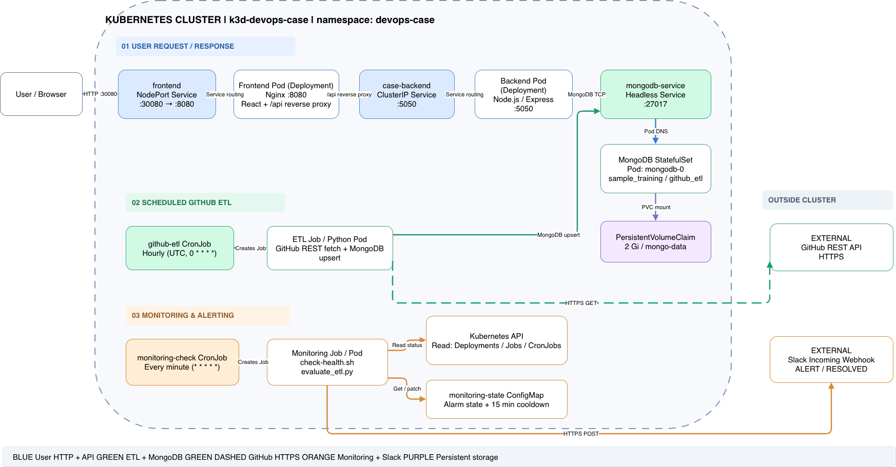

### WEB UYGULAMASI

Uygulamaya dışarıdan `frontend` NodePort Service üzerinden erişilir. Service, trafiği Nginx çalışan frontend Pod'una iletir. Nginx, React uygulamasının statik dosyalarını sunar.

Tarayıcıdan gönderilen `/api` istekleri Nginx reverse proxy tarafından cluster içindeki `case-backend` Service'ine iletilir. Backend Pod'u çalışan kayıtları için gerekli MongoDB işlemlerini `mongodb-service` üzerinden gerçekleştirir.

`frontend`, 30080 NodePort'u ile dış erişime açılan tek uygulama servisidir. `case-backend`, yalnızca cluster içinden erişilen ClusterIP Service'tir. `mongodb-service` ise MongoDB StatefulSet için sabit ağ kimliği sağlayan headless Service'tir.

Bu yerel mimaride Ingress Controller ve HTTPS/TLS terminasyonu bulunmaz. Trafik HTTP üzerinden sağlanır. Yerel bilgisayardan NodePort erişimi, k3d cluster oluşturulurken tanımlanan host port eşlemesine bağlıdır.

### ETL İŞ AKIŞI

`github-etl` CronJob'ı her saat başında UTC zaman diliminde çalışır (`0 * * * *`). Her çalışma için ayrı bir Kubernetes Job oluşturulur.

ETL, GitHub REST API'den repository verilerini alır ve MongoDB'deki `github_etl.repositories` koleksiyonuna kaydeder. Aynı repository yeniden işlendiğinde `github_id` alanı kullanılarak mevcut kayıt güncellenir.

### İZLEME VE BİLDİRİMLER

`monitoring-check` CronJob'ı her dakika çalışır. Backend Deployment'ın kullanılabilir replica durumunu, ETL CronJob'ını ve ETL Job sonuçlarını Kubernetes API üzerinden kontrol eder.

Alarm durumu `monitoring-state` ConfigMap'inde tutulur. Tanımlı bir sorun tespit edilirse Slack Incoming Webhook üzerinden bildirim gönderilir. Sorun çözüldüğünde alarm durumu güncellenir ve çözüm bildirimi gönderilir.

Mimari diyagramın açıklaması `docs/architecture.md`, düzenlenebilir Draw.io kaynağı `docs/architecture.drawio` dosyasındadır.

## 4. REPOSITORY YAPISI

Proje kaynak kodu, Kubernetes yapılandırmaları, operasyon scriptleri ve teslim belgeleri ayrı konumlarda tutulur.

```text
.github/workflows/     GitHub Actions CI ve image yayınlama iş akışı
docs/                  Mimari, bulgular, backup/restore runbook'u ve kanıt görselleri
kubernetes/            Uygulama, MongoDB, ETL ve monitoring manifestleri
mern-project/          React frontend, Express backend ve Cypress testleri
monitoring/            Kubernetes durum kontrolleri ve Slack bildirim mantığı
python-project/        GitHub repository verilerini MongoDB'ye aktaran ETL uygulaması
scripts/               Yerel deployment, rollback, backup, restore ve doğrulama scriptleri
tests/                 ETL monitoring ve toparlanma davranışı için birim testleri
backups/               Oluşturulan MongoDB yedek arşivleri ve SHA-256 checksum dosyaları
```

Önemli dosyalar:

- `docker-compose.yml`: Uygulamayı Docker Compose ile yerel olarak çalıştırır.
- `.env.example`: Compose ortamı için örnek değişkenleri içerir.
- `docs/findings.md`: Başlangıç projelerinde tespit edilen sorunları, öncelikleri ve uygulanan çözümleri açıklar.
- `docs/backup-restore.md`: Backup/restore yöntemi, doğrulama adımları, retention ve RPO/RTO bilgilerini içerir.
- `docs/architecture.png`: Kubernetes mimarisi diyagramıdır. Aynı diyagramın açıklaması ve düzenlenebilir kaynağı `docs/architecture.md` ile `docs/architecture.drawio` içindedir.
- `docs/screenshots/`: Web uygulaması, Docker, Kubernetes, ETL, CI/CD, rollback, backup/restore, güvenlik ve monitoring kanıtlarını içerir.
- `TESLIM_KANITLARI.md`: Ekran görüntülerinin neyi kanıtladığını açıklar.
- `CASE_SONU_CEVAPLARI.md`: Case sonu teknik sorularının Türkçe yanıtlarını içerir.
- `CASE_END_ANSWERS.md`: Case sonu teknik sorularının İngilizce yanıtlarını içerir.

## 5. ÖN KOŞULLAR

### GEREKLİ ARAÇLAR

- Git
- Docker Desktop ve Docker Compose
- Kubernetes kurulumu için `kubectl` ve `k3d`
- GitHub API erişimi için internet bağlantısı

Yerelde frontend geliştirmek veya Cypress testlerini çalıştırmak için Node.js 22 ve npm gerekir. ETL'yi Docker dışında çalıştırmak ya da Python birim testlerini yürütmek için Python 3.11 gerekir.

Proje macOS ve Docker Desktop üzerinde doğrulanmıştır. Komutlar macOS/Linux terminali için yazılmıştır.

### PROJEYİ İNDİRME

```bash
git clone https://github.com/iremsilay/devops-case.git
cd devops-case
```

## 6. HIZLI BAŞLANGIÇ: DOCKER COMPOSE

Docker Compose, frontend, backend ve MongoDB bileşenlerini yerel container ortamında çalıştırmak için kullanılır. Kubernetes dağıtımı README'nin ilgili bölümünde açıklanmıştır.

### 6.1 ORTAM DEĞİŞKENLERİ

Proje kökünde örnek ortam dosyasını kopyalayın:

```bash
cp .env.example .env
```

`.env` dosyasındaki değerler:

```dotenv
COMPOSE_MONGO_URI=mongodb://mongodb:27017
MONGO_DB=github_etl
MONGO_COLLECTION=repositories
GITHUB_USERNAME=your-github-username
GITHUB_TOKEN=
FRONTEND_PORT=8081
```

`GITHUB_USERNAME` değerini kullanılacak GitHub hesabıyla değiştirin. Public repository bilgileri token olmadan alınabilir; ancak GitHub API istek sınırları uygulanır. Token kullanılırsa yalnızca yerel `.env` dosyasında tutulmalı ve Git'e eklenmemelidir.

### 6.2 UYGULAMAYI BAŞLATMA

```bash
docker compose up -d --build
```

Bu komut MongoDB, backend ve frontend servislerini başlatır. ETL servisi profil altında tanımlıdır; uygulama başlarken otomatik çalışmaz.

### 6.3 SERVİSLERİ KONTROL ETME

```bash
docker compose ps
docker compose logs --tail=100 backend
docker compose logs --tail=100 frontend
```

Arayüze aşağıdaki adresten erişin:

```text
http://localhost:8081
```

`FRONTEND_PORT` farklı bir değere ayarlanmışsa bu adresi güncelleyin. Compose port eşlemesi yalnızca yerel bilgisayardan erişime açıktır.

Nginx reverse proxy üzerinden backend sağlık kontrollerini doğrulayın:

```bash
curl -i http://localhost:8081/api/healthcheck
curl -i http://localhost:8081/api/healthcheck/ready
```

Sağlıklı durumda iki endpoint de HTTP 200 döndürür. Readiness yanıtı MongoDB bağlantısının da kullanılabilir olduğunu gösterir.

### 6.4 ETL'Yİ TEK SEFER ÇALIŞTIRMA

```bash
docker compose --profile etl run --rm etl
```

ETL, GitHub repository verilerini MongoDB'ye kaydeder ve tamamlandığında durur. Aynı repository yeniden işlendiğinde `github_id` alanına göre mevcut kayıt güncellenir; yeni bir kayıt eklenmez.

Terminal çıktısında `fetched`, `inserted`, `updated` ve `unchanged` sayaçları yer alır. Bu komut yalnızca tek seferlik çalışır. Saatlik ETL zamanlaması Kubernetes'teki `github-etl` CronJob'ı tarafından sağlanır.

### 6.5 ORTAMI DURDURMA

```bash
docker compose down
```

Bu komut container'ları ve ağı kaldırır; MongoDB volume'unu korur.

```bash
docker compose down -v
```

Bu komut MongoDB volume'unu da siler. Veritabanı verisini kaldırmak istenmiyorsa kullanılmamalıdır.

## 7. KUBERNETES ORTAMI VE İLK KURULUM

Kubernetes dağıtımı, Docker Desktop üzerinde çalışan yerel `devops-case` k3d cluster'ı için hazırlanmıştır. Kullanılan Kubernetes context'i `k3d-devops-case`, namespace ise `devops-case` adını taşır.

Bu bölüm boş bir cluster için kurulum sırasını açıklar. Çalışan bir ortamda Secret'ları veya `monitoring-state` ConfigMap'ini yeniden uygulamadan önce mevcut durumu kontrol edin.

### 7.1 CLUSTER VE CONTEXT KONTROLÜ

```bash
k3d cluster list
kubectl config current-context
kubectl get nodes
```

`deploy-local.sh` yalnızca `k3d-devops-case` context'inde çalışır.

Yeni bir cluster oluşturulacaksa frontend NodePort'u için host port eşlemesi tanımlanmalıdır:

```bash
k3d cluster create devops-case --port '127.0.0.1:8081:30080@loadbalancer'
```

Bu komut yeni bir cluster oluşturur. Mevcut cluster'ı silip yeniden oluşturmak MongoDB verilerinin kaybolmasına neden olabilir.

### 7.2 IMAGE'LARI HAZIRLAMA

Kubernetes manifestleri varsayılan olarak yerel Docker image etiketlerini kullanır. Proje kökünde image'ları oluşturun:

```bash
docker build -t case-backend:1.0 ./mern-project/server
docker build -t case-frontend:1.0 ./mern-project/client
docker build -t case-etl:1.0 ./python-project
docker build -t case-monitoring:1.1 ./monitoring
```

Image'ları k3d cluster'ına aktarın:

```bash
k3d image import case-backend:1.0 case-frontend:1.0 case-etl:1.0 case-monitoring:1.1 -c devops-case
```

GitHub Actions tarafından GHCR'ye yayınlanan image'lar, kontrollü release sırasında `scripts/deploy-local.sh` ile uygulanır. Bu süreç README'nin CI/CD ve rollback bölümünde açıklanmıştır.

### 7.3 NAMESPACE VE GENEL YAPILANDIRMA

```bash
kubectl apply -f kubernetes/namespace.yaml
kubectl apply -f kubernetes/configmap.yaml
```

`app-config` ConfigMap'i, ETL için GitHub kullanıcı adı ve koleksiyon bilgilerini içerir. Farklı bir GitHub hesabı kullanılacaksa `GITHUB_USERNAME` değeri ETL başlatılmadan önce güncellenmelidir.

### 7.4 SECRET'LARI OLUŞTURMA

Kubernetes manifestleri aşağıdaki Secret'ları kullanır:

- `mongodb-auth`: MongoDB root hesabı ve uygulama kullanıcılarının başlangıç bilgileri.
- `backend-mongo-uri`: Backend için `ATLAS_URI` anahtarını içerir.
- `etl-mongo-uri`: ETL için `ATLAS_URI` anahtarını içerir.
- `monitoring-slack-webhook`: Slack bildirimleri için `SLACK_WEBHOOK_URL` anahtarını içerir.

MongoDB ilk kurulumunda kullanılacak yerel ortam dosyasını hazırlayın. Dosya aşağıdaki değişkenleri içermelidir:

```text
MONGO_INITDB_ROOT_USERNAME
MONGO_INITDB_ROOT_PASSWORD
MONGO_BACKEND_USERNAME
MONGO_BACKEND_PASSWORD
MONGO_ETL_USERNAME
MONGO_ETL_PASSWORD
```

Ardından `mongodb-auth` Secret'ını oluşturun:

```bash
kubectl create secret generic mongodb-auth \
  -n devops-case \
  --from-env-file=kubernetes/secrets/mongodb.env
```

Backend, ETL ve Slack için gereken diğer Secret'ları da aynı namespace'te, manifestlerde beklenen ad ve anahtarlarla oluşturun.

Gerçek parola, bağlantı URI'si ve webhook adreslerini Git'e eklemeyin. MongoDB URI'sindeki parola özel karakter içeriyorsa URL-encode edilmelidir. Secret değerleri değiştirildiğinde ilgili Pod'lar otomatik olarak yeni değeri kullanmaz; gerekli rollout işlemi ayrıca yapılmalıdır.

### 7.5 MONGODB'Yİ BAŞLATMA

MongoDB ilk kez boş bir volume üzerinde kuruluyorsa kullanıcı oluşturma script'ini ConfigMap olarak ekleyin:

```bash
kubectl create configmap mongodb-init-script \
  -n devops-case \
  --from-file=init-mongo.js=kubernetes/mongodb/init-mongo.js
```

MongoDB Service ve StatefulSet kaynaklarını uygulayın:

```bash
kubectl apply -f kubernetes/mongodb/service.yaml
kubectl apply -f kubernetes/mongodb/statefulset.yaml
kubectl rollout status statefulset/mongodb -n devops-case --timeout=180s
```

MongoDB, `mongodb-0` Pod'unda çalışır ve veriyi `mongo-data` PersistentVolumeClaim üzerinde tutar. `init-mongo.js` yalnızca boş bir MongoDB volume'u oluşturulurken çalışır. Mevcut volume üzerinde tekrar uygulanması kullanıcı bilgilerini değiştirmez.

### 7.6 UYGULAMA VE ETL KAYNAKLARINI BAŞLATMA

MongoDB hazır olduktan sonra backend, frontend ve ETL kaynaklarını uygulayın:

```bash
kubectl apply -f kubernetes/backend/service.yaml
kubectl apply -f kubernetes/backend/deployment.yaml
kubectl apply -f kubernetes/frontend/service.yaml
kubectl apply -f kubernetes/frontend/deployment.yaml
kubectl apply -f kubernetes/etl/cronjob.yaml
```

Deployment durumlarını kontrol edin:

```bash
kubectl rollout status deployment/backend -n devops-case --timeout=180s
kubectl rollout status deployment/frontend -n devops-case --timeout=180s
kubectl get deployments,services,cronjobs -n devops-case
```

Backend ve frontend için birer replica, MongoDB için tek StatefulSet replica'sı tanımlanmıştır. Bu yerel kurulum yüksek erişilebilirlik sağlamaz.

### 7.7 MONITORING KAYNAKLARINI BAŞLATMA

```bash
kubectl apply -f kubernetes/monitoring/serviceaccount.yaml
kubectl apply -f kubernetes/monitoring/role.yaml
kubectl apply -f kubernetes/monitoring/rolebinding.yaml
kubectl apply -f kubernetes/monitoring/configmap.yaml
kubectl apply -f kubernetes/monitoring/state-configmap.yaml
kubectl apply -f kubernetes/monitoring/cronjob.yaml
```

Monitoring, sınırlı yetkili bir ServiceAccount ile çalışır. `monitoring-state` ConfigMap'i alarm durumunu tutar.

`state-configmap.yaml` yalnızca başlangıç durumu içindir. Monitoring çalışmaya başladıktan sonra bu dosyanın yeniden uygulanması aktif alarm durumunu sıfırlayabilir. Slack bildirimi için `monitoring-slack-webhook` Secret'ının önceden oluşturulmuş olması gerekir.

### 7.8 KURULUM SONRASI KONTROL VE ERİŞİM

```bash
kubectl get pods,deployments,services,cronjobs,pvc -n devops-case
```

Host port eşlemesi tanımlandıysa uygulamaya `http://localhost:8081` adresinden erişin. Geçici erişim için frontend Service'ine port-forward uygulanabilir:

```bash
kubectl port-forward -n devops-case service/frontend 8082:8080
```

Bu komut çalıştığı sürece uygulama `http://localhost:8082` adresinden erişilebilir olur.

## 8. UYGULAMA İŞLEVLERİNİN DOĞRULANMASI

### 8.1 WEB UYGULAMASI VE SAĞLIK KONTROLLERİ

Web arayüzünde çalışan kaydı oluşturma, listeleme, düzenleme ve silme işlemleri doğrulanmıştır. Backend, kayıtları MongoDB'deki `sample_training.records` koleksiyonunda tutar.

Sağlık kontrolleri iki endpoint üzerinden sağlanır:

- `/healthcheck`: Backend sürecinin yanıt verdiğini kontrol eden liveness endpoint'i.
- `/healthcheck/ready`: Backend ile MongoDB bağlantısının kullanılabilir olduğunu kontrol eden readiness endpoint'i.

Frontend'e port-forward ile erişiliyorsa kontroller aşağıdaki komutlarla yapılabilir:

```bash
curl -i http://localhost:8082/api/healthcheck
curl -i http://localhost:8082/api/healthcheck/ready
```

Sağlıklı durumda iki endpoint de HTTP 200 döndürür. MongoDB erişilemez olduğunda `/healthcheck/ready` HTTP 503 ve `NOT_READY` döndürür. MongoDB yeniden erişilebilir olduğunda backend yeniden başlatılmadan tekrar `READY` durumuna geçer.

**Kanıtlar:**

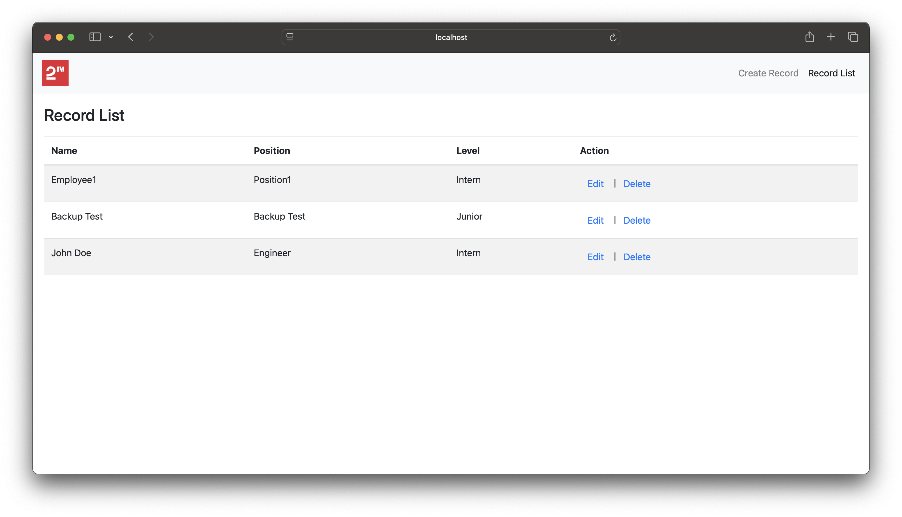

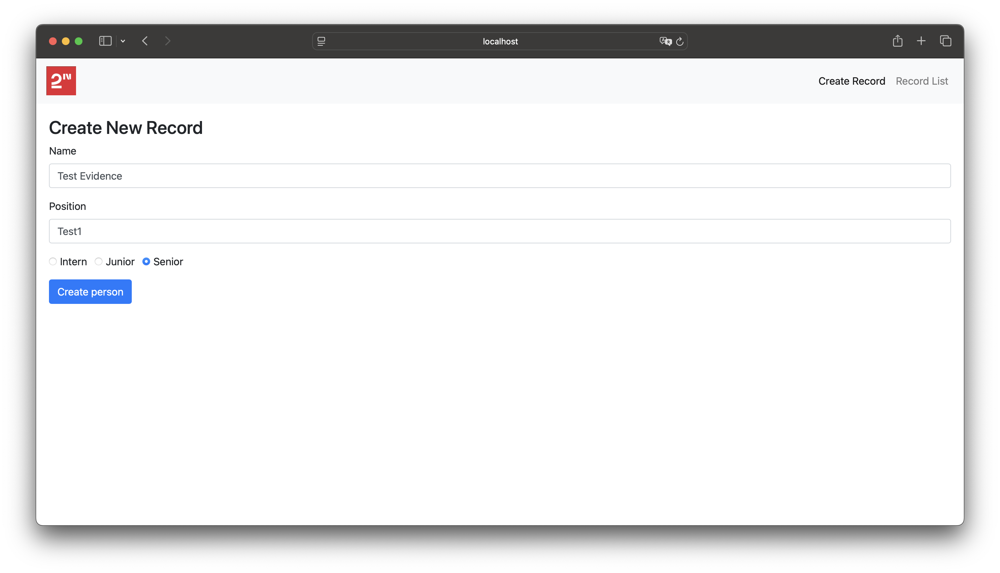

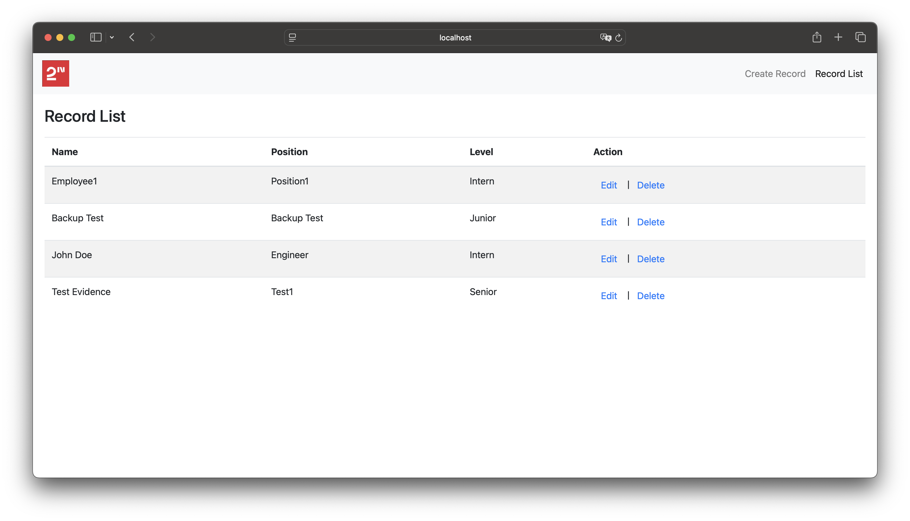

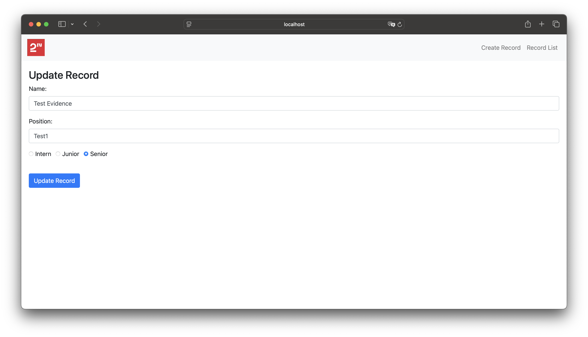

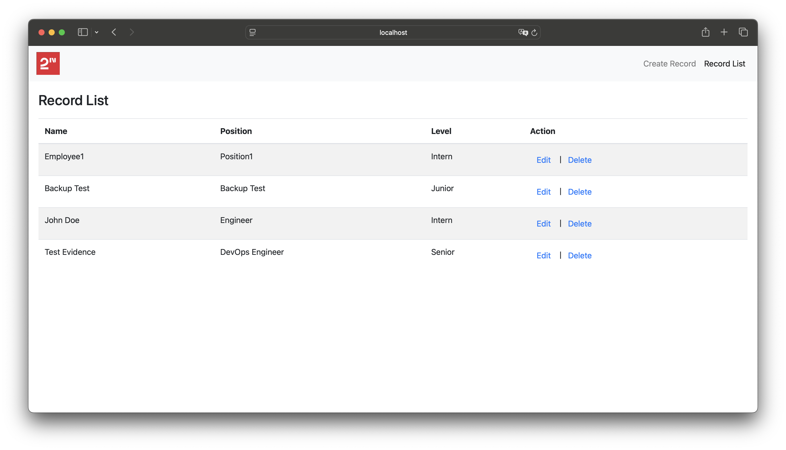

### 8.2 ETL GÜNCELLEME DOĞRULAMASI

ETL CronJob ve oluşturduğu Job'lar aşağıdaki komutlarla kontrol edilir:

```bash
kubectl get cronjob github-etl -n devops-case
kubectl get jobs -n devops-case
```

Belirli bir Job'ın çıktısını görmek için:

```bash
kubectl logs -n devops-case job/<etl-job-adi>
```

`github-etl` CronJob'ı her saat başında UTC zaman diliminde çalışır (`0 * * * *`). İlk çalıştırmada GitHub repository verileri MongoDB'ye kaydedilir. Sonraki çalıştırmalarda `github_id` benzersiz alanı üzerinden eşleşen kayıt güncellenir.

Doğrulama sırasında aynı üç repository ikinci kez işlendi. İkinci çalıştırmada `fetched=3`, `inserted=0`, `updated=3` ve `unchanged=0` sonucu alındı. Koleksiyondaki toplam kayıt sayısı üç olarak kaldı. `github_id` alanındaki benzersiz indeks, aynı repository için duplicate kayıt oluşturulmasını engeller.

Repository sayısı, seçilen GitHub hesabındaki repository sayısına bağlı olarak değişebilir.

**Kanıtlar:**

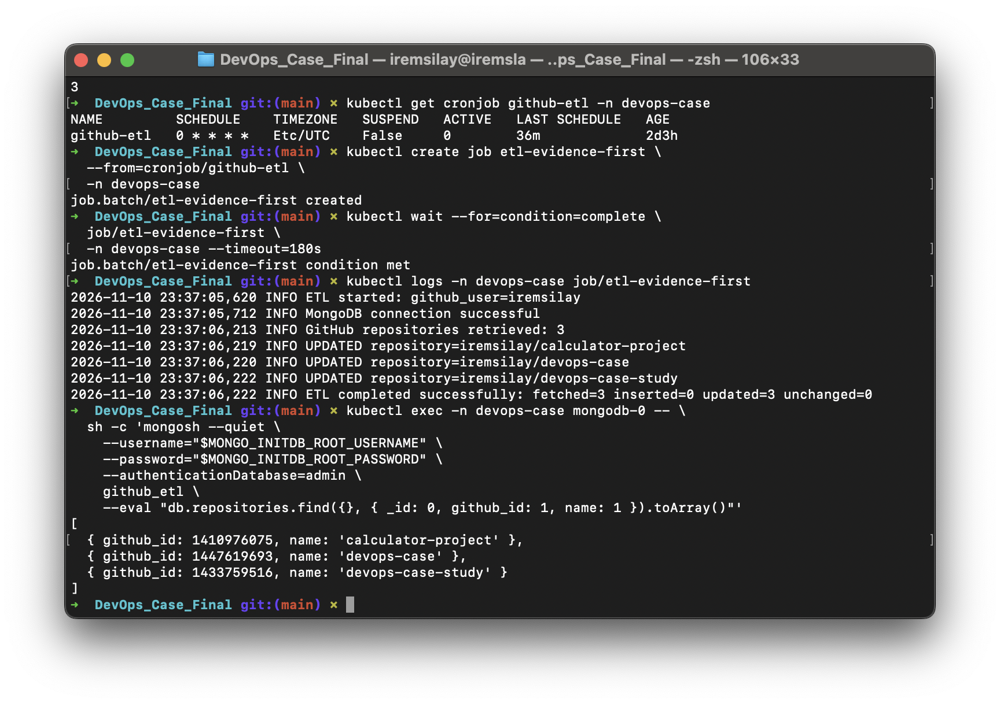

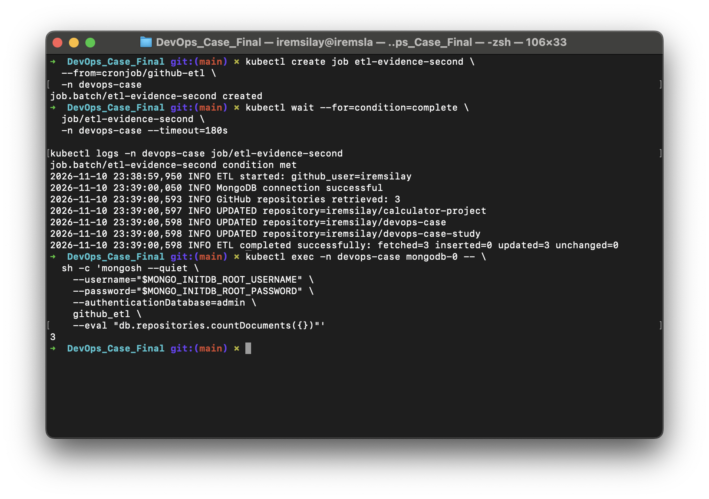

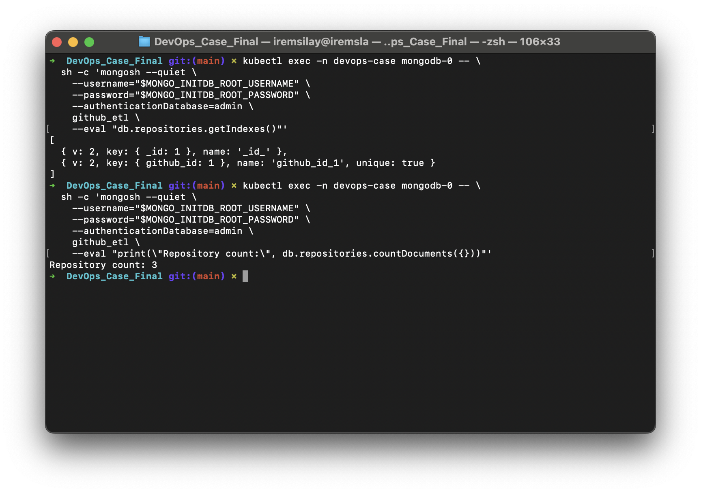

## 9. TESTLER VE KALİTE KONTROLLERİ

### 9.1 FRONTEND ÜRETİM DERLEMESİ

```bash
cd mern-project/client
npm ci
npm run build
```
Bu komut, React uygulamasının production build çıktısını oluşturur.

### 9.2 BACKEND KONTROLLERİ

```bash
cd mern-project/server
npm ci
npm audit --omit=dev --audit-level=high
node --check server.mjs
```

`npm audit`, production bağımlılıklarındaki bilinen güvenlik açıklarını kontrol eder. `node --check`, backend dosyasının JavaScript sözdizimini doğrular.

### 9.3 CYPRESS UÇTAN UCA TESTLERİ

Cypress testleri, frontend ve backend çalışırken yürütülür:

```bash
cd mern-project/client
npx cypress run --e2e
```

Yerel Cypress yapılandırmasında varsayılan adres `http://localhost:3000` olarak tanımlıdır. Uygulama farklı bir portta çalışıyorsa `baseUrl` değeri buna göre güncellenmelidir.

GitHub Actions, Cypress testlerini hedef Kubernetes cluster'ından bağımsız bir Docker ağı içinde MongoDB, backend ve frontend container'larıyla çalıştırır. Başlangıçtaki kayıt ekleme testi, kaydı yanlış sayfada aradığı için başarısız oluyordu. Testin kayıt listesinin bulunduğu `/records` sayfasını kontrol edecek şekilde güncellenmesinden sonra iki Cypress testi başarıyla çalıştı.

### 9.4 MONITORING VE ETL TOPARLANMA BİRİM TESTLERİ

Proje kökünden çalıştırın:

```bash
python3 -m unittest discover -s tests -p 'test_*.py' -v
```

Altı birim testi, ETL Job sonuçlarını değerlendiren monitoring mantığını kapsar. Testler; eski ve yeni ETL başarısızlıklarını ayırma, başarılı çalışma sonrası toparlanma, hiç başarılı Job bulunmaması, eksik hata zamanı ve farklı CronJob'a ait başarısızlıkların filtrelenmesi durumlarını doğrular.

Altı testin başarılı olması, bu senaryoların geçtiğini gösterir. Tam kod kapsamı ölçümü yapılmamıştır.

### 9.5 BAĞIMLILIK GÜVENLİK KONTROLÜ

Başlangıçta `npm audit`, backend için 11, frontend için 89 güvenlik açığı bildirdi. Yapılan bağımlılık güncellemeleri sonrası backend için açık kalmadı; frontend tarafında son yerel kontrolde 33 açık kaldı.

Bu sayılar tarihsel ölçümlerdir. Güncel sonuç için audit komutlarını yeniden çalıştırın.

Frontend'in son container image'ı Node.js bağımlılıklarını içermez; derlenen statik dosyalar Nginx ile sunulur. Buna rağmen frontend build bağımlılıkları ve tedarik zinciri açısından kalan riskler tamamen ortadan kalkmaz. Kalan bağımlılık riskleri `docs/findings.md` dosyasında açıklanmıştır.

### 9.6 CONTAINER IMAGE GÜVENLİK TARAMASI VE SBOM

CI pipeline'ında backend, frontend ve ETL image'ları için Trivy güvenlik taraması ve CycloneDX formatında SBOM üretimi yapılır.

Tarama, bilinen `HIGH` ve `CRITICAL` güvenlik açıklarını raporlar. Her bileşen için oluşturulan Trivy raporu ve SBOM dosyası GitHub Actions artifact'ı olarak 14 gün saklanır.

| Artifact | İçerik |
| --- | --- |
| `security-backend` | `trivy-backend.json`, `sbom-backend.json` |
| `security-frontend` | `trivy-frontend.json`, `sbom-frontend.json` |
| `security-etl` | `trivy-etl.json`, `sbom-etl.json` |

10 Kasım 2026 tarihli workflow çalışmasında `Security - backend`, `Security - frontend` ve `Security - etl` job'ları başarıyla tamamlandı.

[GitHub Actions Run #13](https://github.com/iremsilay/devops-case/actions/runs/42861106121)

Tarama raporlama amaçlıdır; bulunan açıklar CI çalışmasını otomatik olarak başarısız yapmaz. Tarama, CI ortamında oluşturulan image üzerinde yapılır; GHCR'ye gönderilen image digest'ini doğrudan taramaz. Image signing, policy as code ve açık nedeniyle yayın engelleme bu sürümde uygulanmamıştır.

**Kanıtlar:**

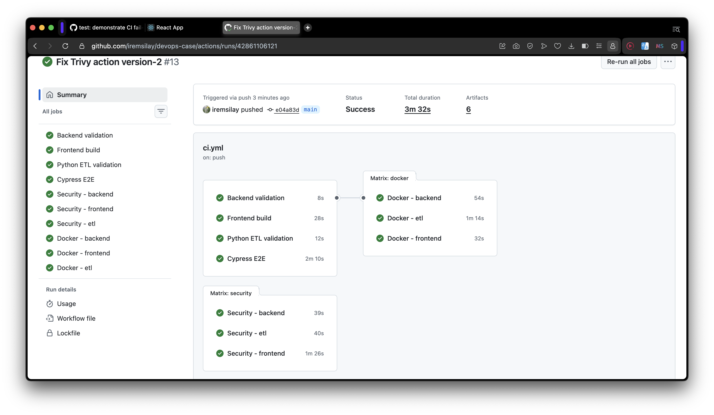

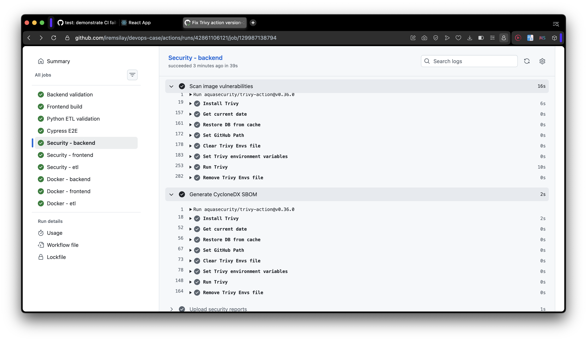

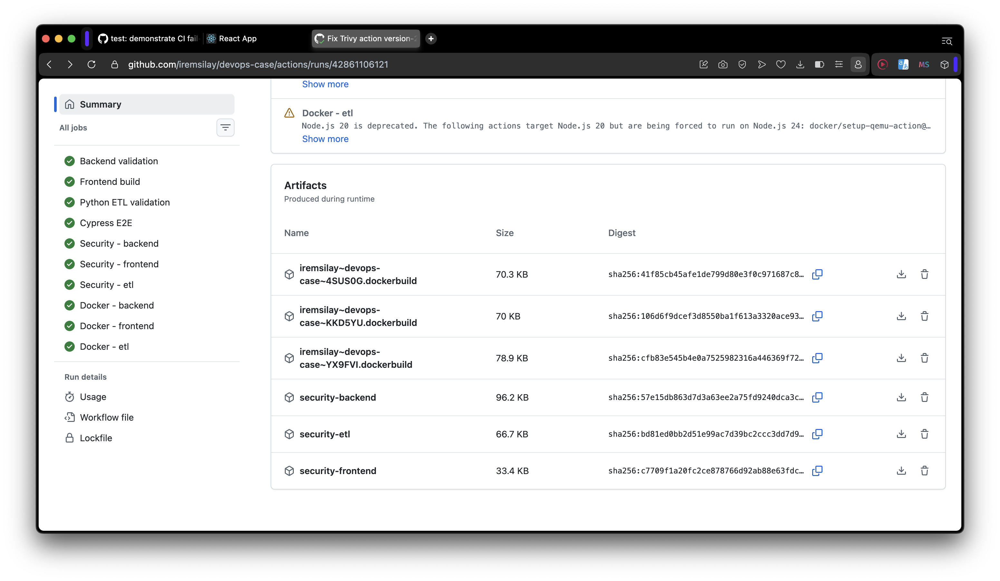

## 10. CI/CD VE RELEASE YÖNETİMİ

CI süreci GitHub Actions ile doğrulama, test ve container image yayınlama işlemlerini yürütür. Yerel Kubernetes cluster'ına deployment ise kontrollü olarak `scripts/deploy-local.sh` ile yapılır.

### 10.1 CI PIPELINE

`.github/workflows/ci.yml` dosyasındaki workflow şu durumlarda çalışır:

- `main` dalına yapılan push
- `main` dalını hedefleyen pull request
- `workflow_dispatch` ile manuel tetikleme

Pipeline aşağıdaki kontrolleri yürütür:

1. Backend bağımlılıklarını kurar, production bağımlılıklarını denetler ve JavaScript sözdizimini kontrol eder.
2. Frontend bağımlılıklarını kurar ve production build oluşturur.
3. Python ETL bağımlılıklarını kurar, dosyayı derler ve gerekli modülleri doğrular.
4. MongoDB, backend ve frontend container'larıyla Cypress E2E testlerini çalıştırır.
5. Başarılı kontrollerden sonra backend, frontend ve ETL image'larını `linux/amd64` ve `linux/arm64` mimarileri için oluşturur.
6. `main` dalına yapılan push'larda image'ları GHCR'ye yayınlar.

Container image güvenlik taraması ve SBOM üretimi, ayrı Security job'ları ile yürütülür. Bu kontrollerin kapsamı ve kanıtları [9.6 CONTAINER IMAGE GÜVENLİK TARAMASI VE SBOM](#96-container-image-güvenlik-taraması-ve-sbom) bölümünde yer alır.

#### CYPRESS TEST ORTAMI

Cypress testleri, hedef Kubernetes cluster'ında değil; GitHub Actions runner üzerinde oluşturulan geçici Docker ortamında çalışır. Pipeline, MongoDB, backend ve frontend container'ları için ayrı bir `case-ci` ağı oluşturur.

Cypress çalışmadan önce backend readiness kontrolü ve frontend üzerinden API erişimi doğrulanır. Test başarısız olursa container logları ve varsa Cypress ekran görüntüleri artifact olarak saklanır.

Bu ortam, testlerin yerel Kubernetes cluster'ındaki çalışan servisleri veya verileri etkilemesini engeller. Kubernetes orkestrasyon davranışının tamamını test etmez.

#### FAIL-FAST DAVRANIŞI

Docker image build ve yayınlama aşaması `backend`, `frontend`, `etl` ve `cypress` job'larının başarılı olmasına bağlıdır. Bu job'lardan biri başarısız olduğunda Docker job'ı çalışmaz.

Bu davranış, `test/ci-fail-fast` branch'inden `main` dalına açılan geçici Pull Request #1 ile doğrulandı. Cypress testine kasıtlı olarak başarısız olan `FAIL_FAST_TEST_ELEMENT` assertion'ı eklendi.

| Kontrol | Sonuç |
| --- | --- |
| Backend validation | Başarılı |
| Frontend build | Başarılı |
| Python ETL validation | Başarılı |
| Cypress E2E | Başarısız |
| Docker build/publish | Atlandı |

- [Pull Request #1 — CI fail-fast testi](https://github.com/iremsilay/devops-case/pull/1)
- Test commit'i: `4cd5e7d`

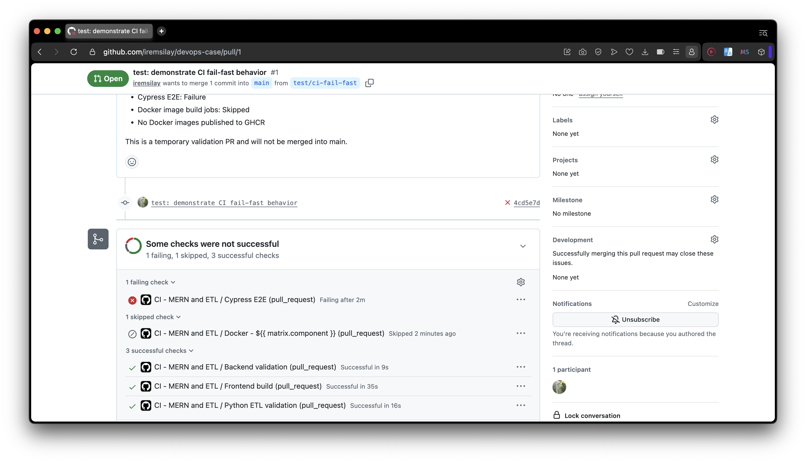

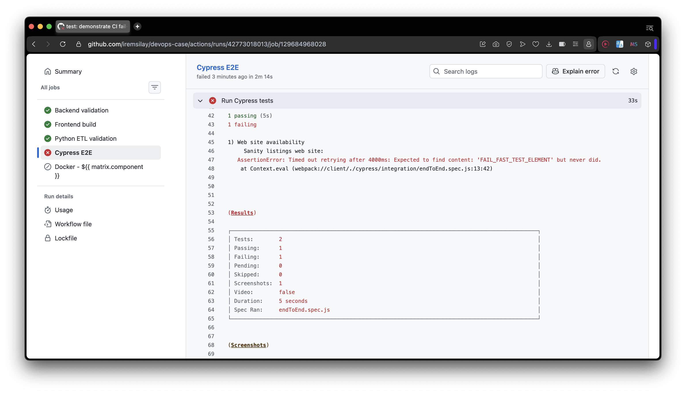

Test yalnızca geçici branch üzerinde yapıldı; başarısız assertion `main` dalına dahil edilmedi.

### 10.2 BAŞARILI CI ÇALIŞMASI

`main` dalına yapılan push sonrasında `CI - MERN and ETL` workflow'u başarıyla tamamlandı.

| Bilgi | Değer |
| --- | --- |
| Workflow | CI - MERN and ETL (#9) |
| Commit | `b5873c8` |
| Sonuç | Success |
| Süre | 3 dakika 11 saniye |

Backend validation, frontend build, Python ETL validation, Cypress E2E ve Docker build job'ları başarıyla tamamlandı.

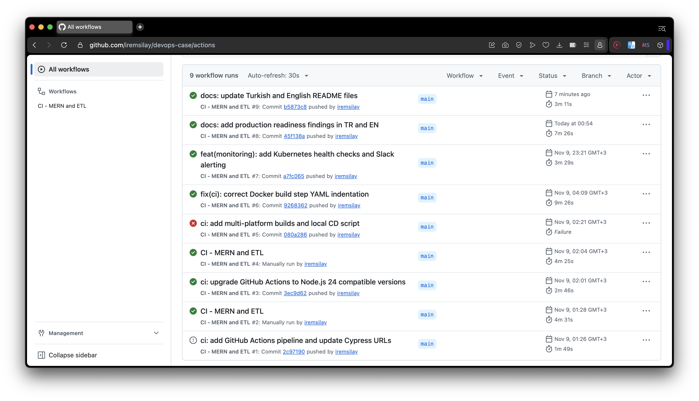

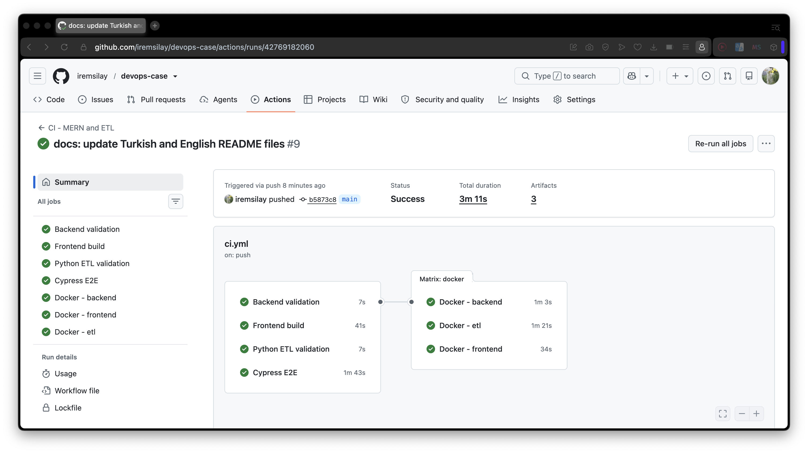

### 10.3 GHCR IMAGE YAYINLAMA

Başarılı `main` push'larında aşağıdaki image'lar GHCR'ye yayınlanır:

- `ghcr.io/iremsilay/devops-case-backend`
- `ghcr.io/iremsilay/devops-case-frontend`
- `ghcr.io/iremsilay/devops-case-etl`

Her image için iki tag kullanılır:

- `latest`: En son yayınlanan sürüm
- `sha-<40-karakterlik-commit-hash>`: Belirli bir commit'e ait sürüm

SHA tag'i, deployment sırasında belirli bir CI çıktısının seçilmesini sağlar.

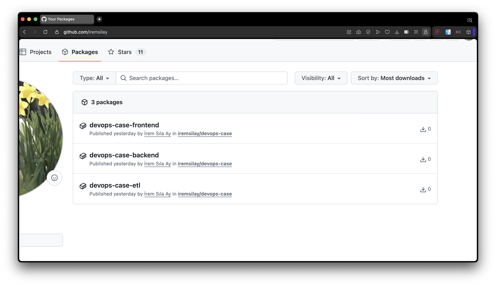

Backend image'ının `latest` ve `sha-b5873c8b85f31885109fb038f517e18f06601448` tag'leriyle yayınlandığı doğrulandı. SHA tag'i, başarılı CI workflow'unun commit'iyle eşleşir.

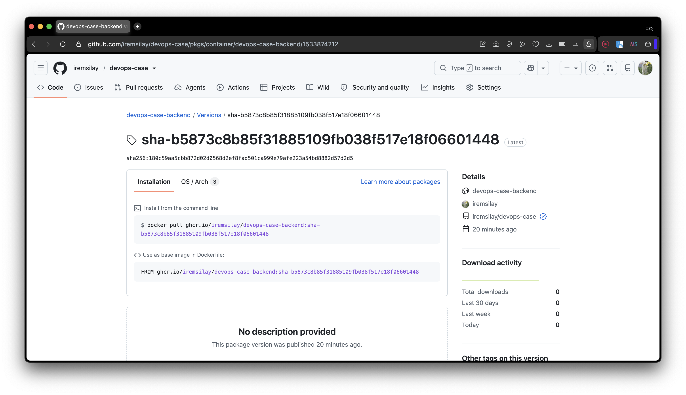

### 10.4 YEREL KUBERNETES DEPLOYMENT

GitHub Actions, yerel Kubernetes cluster'ına doğrudan deployment yapmaz. Yerel cluster'ı GitHub-hosted runner'a açmak yerine image yayınlama ve deployment işlemleri ayrılmıştır.

Bu nedenle çözüm tam otomatik CD veya GitOps olarak tanımlanmaz. Yerel cluster'a sürüm geçişi aşağıdaki komutla manuel olarak başlatılır:

```bash
./scripts/deploy-local.sh sha-<40-karakterlik-commit-hash>
```

Script yalnızca `k3d-devops-case` context'inde çalışır. Sırasıyla backend Deployment, frontend Deployment ve ETL CronJob image referanslarını günceller. Backend veya frontend rollout işlemi başarısız olursa sonraki kaynak güncellenmez.

Yerel cluster'da aşağıdaki sürüm geçişi başarıyla doğrulandı:

| Bilgi | Değer |
| --- | --- |
| Namespace | `devops-case` |
| Önceki sürüm | `sha-92683629ca434accfb946cb255ad97eb0e4f4bc5` |
| Yeni sürüm | `sha-b5873c8b85f31885109fb038f517e18f06601448` |
| Yöntem | `scripts/deploy-local.sh` |
| Sonuç | Başarılı |

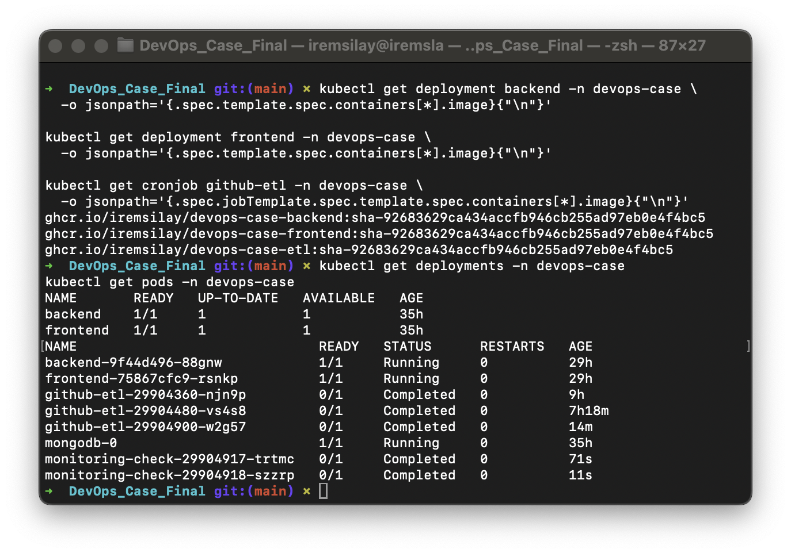

```bash
./scripts/deploy-local.sh sha-b5873c8b85f31885109fb038f517e18f06601448
```

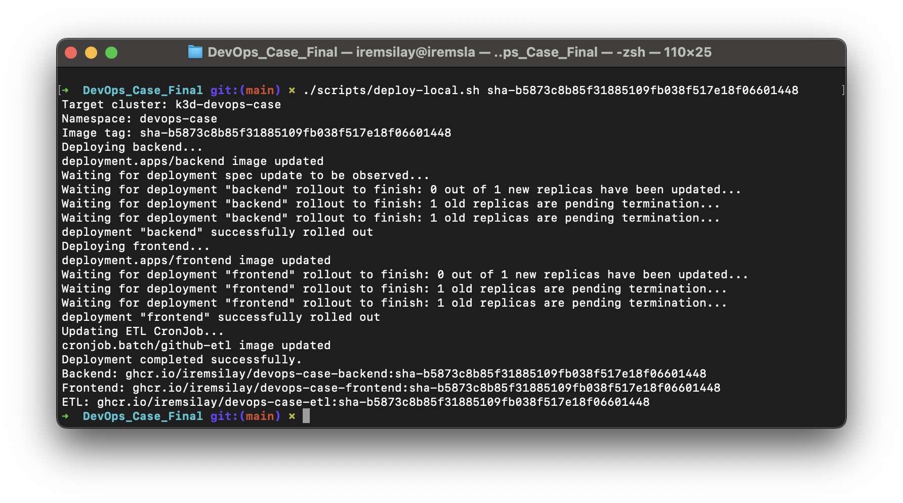

Deployment sonrasında backend ve frontend `1/1 Ready`, ilgili Pod'lar `Running` durumundadır. Backend, frontend ve ETL image referanslarının yeni SHA sürümüne geçtiği doğrulandı.

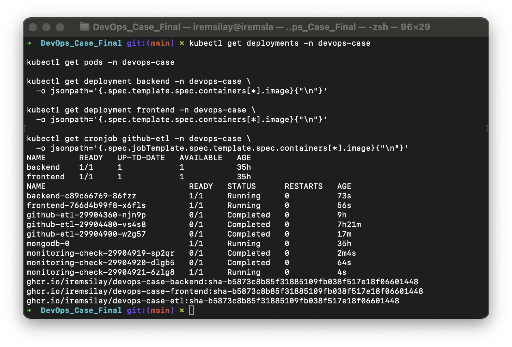

### 10.5 ROLLBACK

`deploy-local.sh`, deployment öncesinde backend, frontend ve ETL kaynaklarının image referanslarını kaydeder. Bir komut hata verirse Bash `ERR` trap mekanizması rollback fonksiyonunu çalıştırır.

Rollback, önceki image referanslarını `kubectl set image` ile geri uygular ve backend ile frontend rollout durumlarını yeniden kontrol eder. Cluster veya image erişimiyle ilgili bir sorun varsa manuel inceleme gerekebilir.

Rollback mekanizması, GHCR'de bulunmayan bir image tag'iyle test edildi:

| Bilgi | Değer |
| --- | --- |
| Sağlıklı sürüm | `sha-b5873c8b85f31885109fb038f517e18f06601448` |
| Hatalı test sürümü | `sha-0000000000000000000000000000000000000000` |
| Beklenen hata | Backend rollout zaman aşımı |
| Sonuç | Otomatik rollback tamamlandı |

```bash
./scripts/deploy-local.sh sha-0000000000000000000000000000000000000000
```

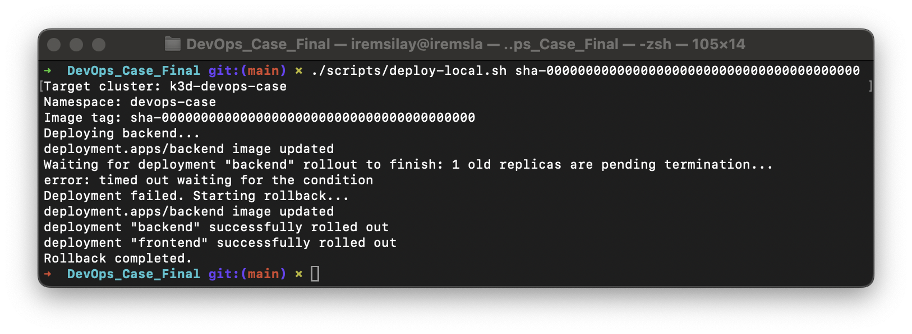

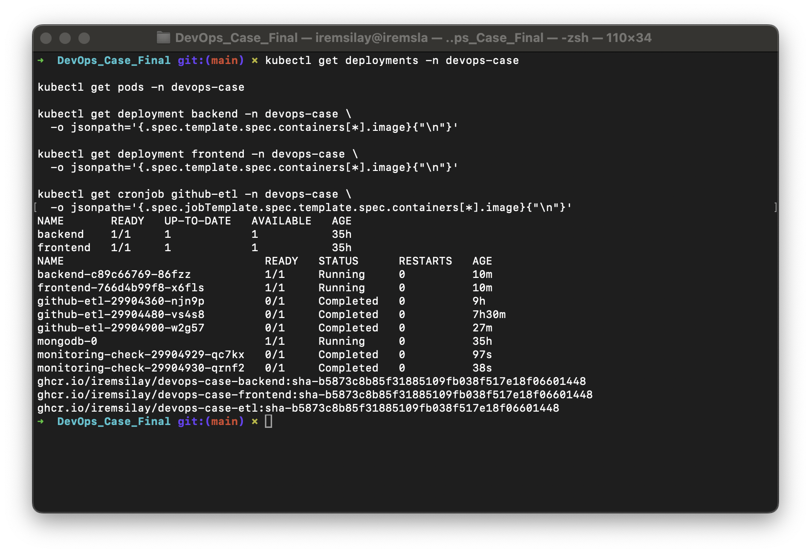

Rollback yalnızca image referanslarını geri alır. Veritabanı verisini veya şema değişikliklerini geri yüklemez. ETL image'ı güncellendikten ya da geri alındıktan sonra sonraki ETL Job sonucunun ayrıca kontrol edilmesi gerekir.

### 10.6 SINIRLAMALAR

- Kubernetes deployment işlemi GitHub Actions tarafından otomatik tetiklenmez.
- GHCR'deki SHA tag'inin mevcut olması ve cluster tarafından çekilebilmesi gerekir.
- Private image erişimi gerekiyorsa uygun `imagePullSecret` yapılandırılmalıdır.
- Cypress testleri izole Docker ortamında çalışır; Kubernetes deployment davranışının tamamını kapsamaz.

## 11. MONITORING, LOGLAMA VE SLACK UYARILARI

`monitoring-check` CronJob'ı her dakika çalışır. Backend Deployment'ın kullanılabilir replica durumunu, `github-etl` CronJob'ını ve ETL Job sonuçlarını Kubernetes API üzerinden kontrol eder.

### 11.1 ALARM TÜRLERİ

| Alarm | Koşul |
| --- | --- |
| `BACKEND_UNAVAILABLE` | Backend için istenen replica sayısının sıfır olması veya kullanılabilir replica sayısının istenen değerin altında kalması |
| `ETL_OVERDUE` | Son başarılı ETL çalışmasının 4500 saniyeyi, yani 75 dakikayı aşması |
| `ETL_JOB_FAILED` | Son başarılı ETL çalışmasından sonra başarısız bir ETL Job'ının bulunması |
| `ETL_NO_SUCCESS` | ETL için hiç başarılı çalışma kaydı bulunmaması |
| `ETL_SUSPENDED` | `github-etl` CronJob'ının askıya alınması |

Her alarmın aktiflik durumu ve son bildirim zamanı `monitoring-state` ConfigMap'inde tutulur. İlk alarm Slack'e gönderilir. Devam eden sorunlarda her alarm için 900 saniyelik, yani 15 dakikalık bildirim sınırı uygulanır.

Sorun çözüldüğünde alarm durumu temizlenir ve Slack'e `RESOLVED` bildirimi gönderilir. Webhook isteği başarısız olursa bildirim başarılı kabul edilmez.

ConfigMap güncellemelerinde `resourceVersion` kullanılarak eski durum üzerinden yapılan güncellemeler reddedilir. Bu kontrol, tüm eşzamanlı bildirim yarışlarını tamamen engellemez.

`monitoring/evaluate_etl.py`, Job `ownerReferences` ve hata zamanlarını değerlendirir. Böylece son başarılı ETL çalışmasından önceki eski başarısızlıklar yeni alarm olarak değerlendirilmez. Bu mantık altı birim testiyle doğrulanmıştır.

### 11.2 KONTROL KOMUTLARI

```bash
kubectl get cronjob monitoring-check -n devops-case
kubectl get jobs -n devops-case
kubectl logs -n devops-case job/<monitoring-job-adi>
```

Aktif alarm durumunu incelemek için:

```bash
kubectl get configmap monitoring-state -n devops-case -o yaml
```

`monitoring-state` yalnızca alarm metadatasını içerir. Slack webhook değeri Secret içinde tutulur; okunmamalı, loglanmamalı veya paylaşılmamalıdır.

### 11.3 DOĞRULANMIŞ BACKEND ALARM SENARYOSU

Backend kullanılabilirliği, Slack bildirimi, bildirim sınırı ve toparlanma davranışı yerel Kubernetes ortamında kontrollü olarak test edildi.

Testte backend geçici olarak sıfır replikaya indirildi. Monitoring bu durumu `BACKEND_UNAVAILABLE` alarmı olarak tespit etti. Alarmın `monitoring-state` ConfigMap'inde aktif olduğu ve Slack bildiriminin gönderildiği doğrulandı.

Tekrarlanan kontrol, yeni Slack bildirimi göndermedi ve `ALERT_THROTTLED` sonucunu üretti. Backend tekrar bir replikaya çıkarıldıktan sonra Deployment `1/1 Available` durumuna döndü. Monitoring alarmı temizledi ve Slack'e `RESOLVED` bildirimi gönderdi.

| Kontrol | Sonuç |
| --- | --- |
| Normal backend durumu | `1/1`, `BACKEND_HEALTHY` |
| Arıza durumu | `0/0`, `BACKEND_UNAVAILABLE` |
| Alarm kaydı | `active:true` |
| Slack alarmı | `BACKEND_UNAVAILABLE` bildirimi gönderildi |
| Tekrarlanan kontrol | `ALERT_THROTTLED` |
| Toparlanma | Backend `1/1`, monitoring sağlıklı |
| Temizlenen alarm | `active:false`, `last_sent:0` |
| Slack toparlanma bildirimi | `RESOLVED` gönderildi |

Test sırasında, eski backend kontrolünün `0/0` durumunu sağlıklı kabul ettiği tespit edildi. Koşul aşağıdaki şekilde güncellendi:

```bash
if (( desired == 0 || available < desired )); then
```

Güncellenen script, `monitoring-script` ConfigMap'ine aktarıldı ve kontrollü testte doğrulandı.

### 11.4 TEST KOMUTLARI

Backend arızasını oluşturmak ve monitoring Job'ını manuel çalıştırmak için:

```bash
kubectl scale deployment backend -n devops-case --replicas=0
kubectl get deployment backend -n devops-case

kubectl create job monitoring-backend-test \
  --from=cronjob/monitoring-check \
  -n devops-case

kubectl logs -n devops-case job/monitoring-backend-test

kubectl get configmap monitoring-state \
  -n devops-case \
  -o jsonpath='{.data.BACKEND_UNAVAILABLE}'
```

Test tamamlandıktan sonra backend'i geri yükleyin:

```bash
kubectl scale deployment backend -n devops-case --replicas=1
kubectl rollout status deployment/backend \
  -n devops-case --timeout=180s
```

Testten sonra geçici Job kaynakları kaldırıldı, otomatik monitoring yeniden etkinleştirildi ve sağlıklı monitoring sonucu doğrulandı.

### 11.5 KANITLAR

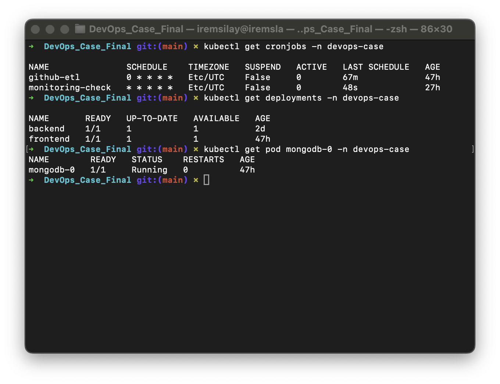

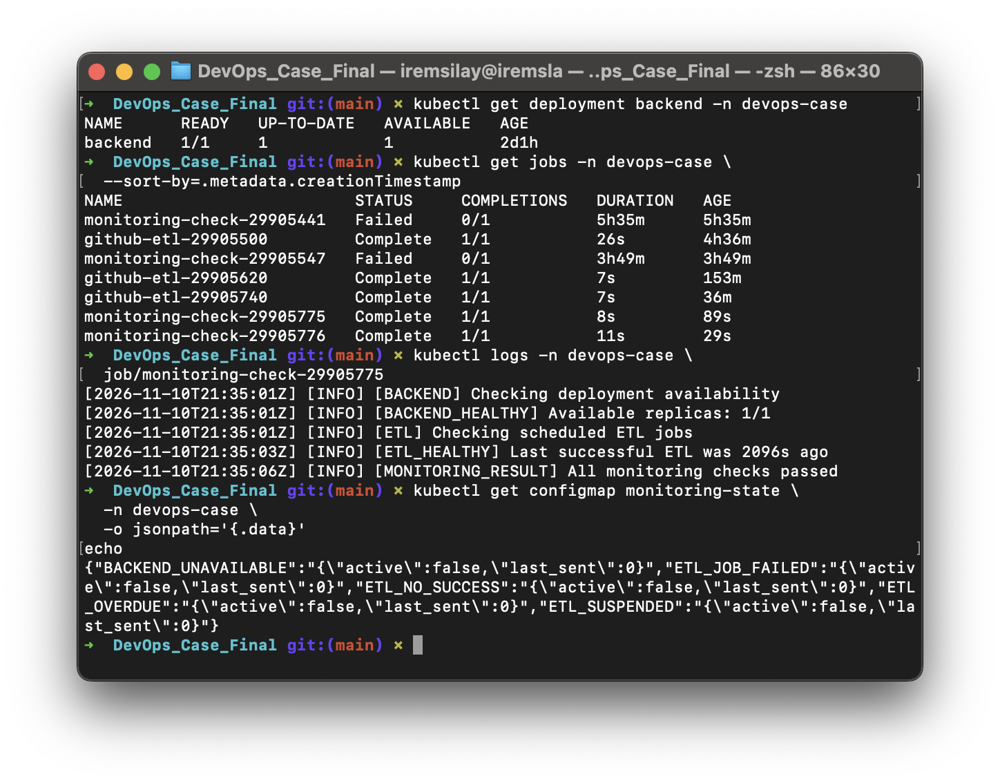

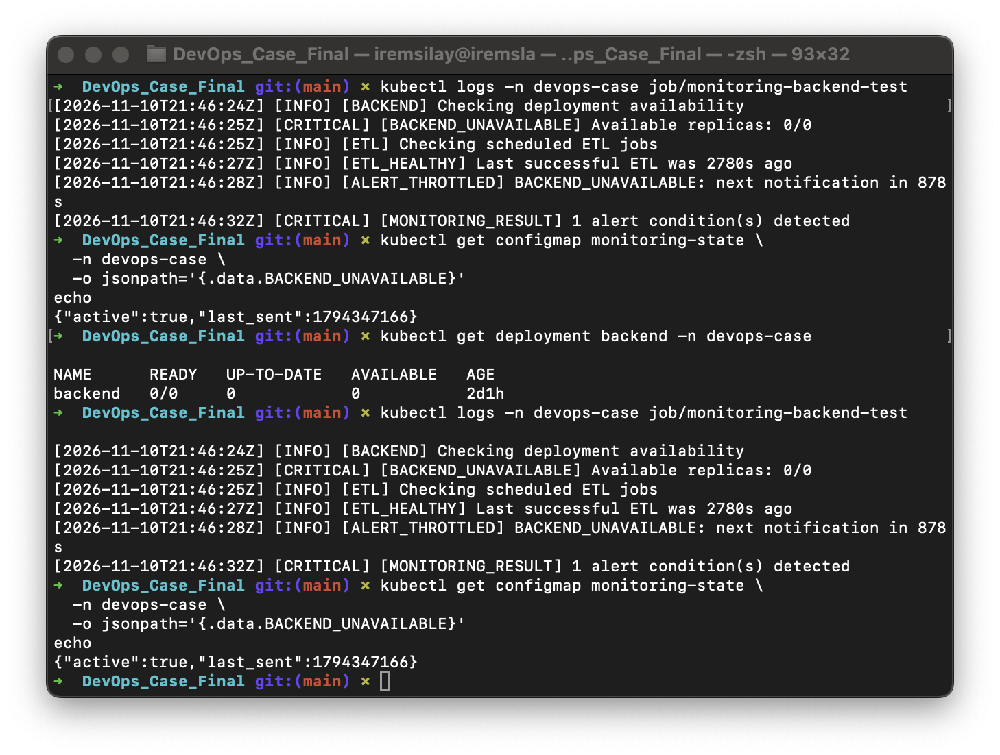

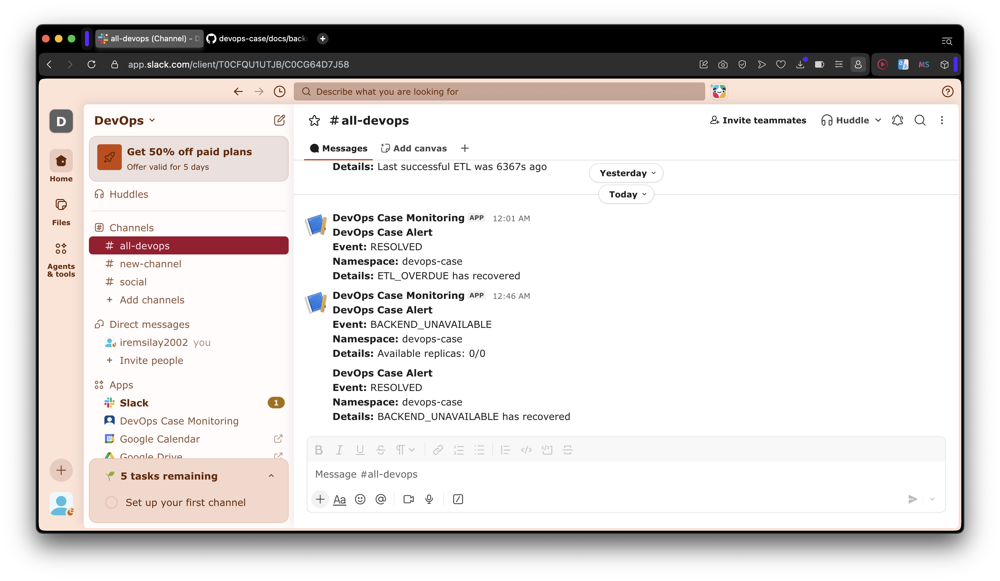

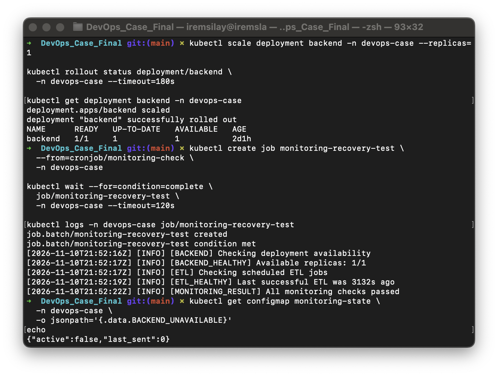


### 11.6 SINIRLAMALAR

Bu doğrulama, backend kullanılabilirliği için alarm, bildirim sınırı ve toparlanma akışını kapsar. Tüm ETL alarm koşulları ve cluster seviyesindeki arızalar uçtan uca test edilmemiştir.

Cluster veya Kubernetes API tamamen erişilemezse cluster içinde çalışan monitoring CronJob'ı bildirim üretemeyebilir. Prometheus/Grafana, merkezi log toplama ve harici cluster erişilebilirlik izleme bu sürümde uygulanmamıştır.

## 12. MONGODB BACKUP VE RESTORE

MongoDB'nin `sample_training` ve `github_etl` veritabanları için `scripts/backup.sh` ve `scripts/restore.sh` kullanılır. Scriptler, Kubernetes'teki `devops-case` namespace'inde çalışan `mongodb-0` Pod'u ile çalışır; Docker Compose MongoDB container'ını hedeflemez.

Ayrıntılı runbook, RPO/RTO hedefleri ve retention yaklaşımı `docs/backup-restore.md` dosyasında yer alır.

### 12.1 BACKUP ALMA

Proje kökünden çalıştırın:

```bash
./scripts/backup.sh
```

Script, `mongodump` ile iki veritabanını arşivler ve her çalıştırmada `backups/YYYYMMDDTHHMMSSZ/` dizinini oluşturur.

```text
backups/<timestamp>/
├── sample_training.archive
├── github_etl.archive
└── SHA256SUMS
```

Arşivler Kubernetes Pod'undan yerel bilgisayara aktarılır. Boş arşiv veya başarısız dump işlemi hata olarak değerlendirilir. Backup dizini `700`, dosyalar `600` izinleriyle oluşturulur.

Arşiv bütünlüğünü doğrulamak için:

```bash
(cd backups/<timestamp> && shasum -a 256 -c SHA256SUMS)
```

### 12.2 RESTORE İŞLEMİ

```bash
./scripts/restore.sh backups/<timestamp>
```

Script, restore öncesinde SHA-256 checksum değerlerini doğrular ve kullanıcıdan `RESTORE` onayı ister.

Restore işlemi `mongorestore --drop` ile yapılır. Bu nedenle hedef collection'lardaki mevcut veri silinir ve yedekteki veri geri yüklenir. Backup alındıktan sonra oluşan değişiklikler restore sırasında kaybolabilir.

### 12.3 UÇTAN UCA BACKUP VE RESTORE DOĞRULAMASI

Backup ve restore işlemi, 10 Kasım 2026 tarihinde yerel Kubernetes ortamında test edildi.

| Bilgi | Değer |
| --- | --- |
| Kubernetes context | `k3d-devops-case` |
| Namespace | `devops-case` |
| MongoDB Pod | `mongodb-0` |
| Frontend | `http://localhost:8082/records` |
| Backup dizini | `backups/20261110T161624Z` |
| Test kaydı | `Backup Test` |

Test sırasında ETL CronJob'ı yeni veri yazılmasını önlemek için geçici olarak askıya alındı.

#### 1. KAYIT OLUŞTURMA

React arayüzünden aşağıdaki kayıt oluşturuldu:

| Alan | Değer |
| --- | --- |
| Name | `Backup Test` |
| Position | `Backup Test` |
| Level | `Junior` |

Kayıt, React arayüzünde ve MongoDB'deki `sample_training.records` koleksiyonunda doğrulandı. Backup öncesinde collection'da `Backup Test` ve `Employee1` olmak üzere iki kayıt bulunuyordu.


#### 2. BACKUP VE BÜTÜNLÜK DOĞRULAMASI

```bash
./scripts/backup.sh
```

Backup, `backups/20261110T161624Z` dizinine kaydedildi. `sample_training` veritabanından üç belge, `github_etl.repositories` koleksiyonundan üç belge yedeklendi.

Her iki arşivin checksum doğrulaması başarılıydı:

```text
sample_training.archive: OK
github_etl.archive: OK
```

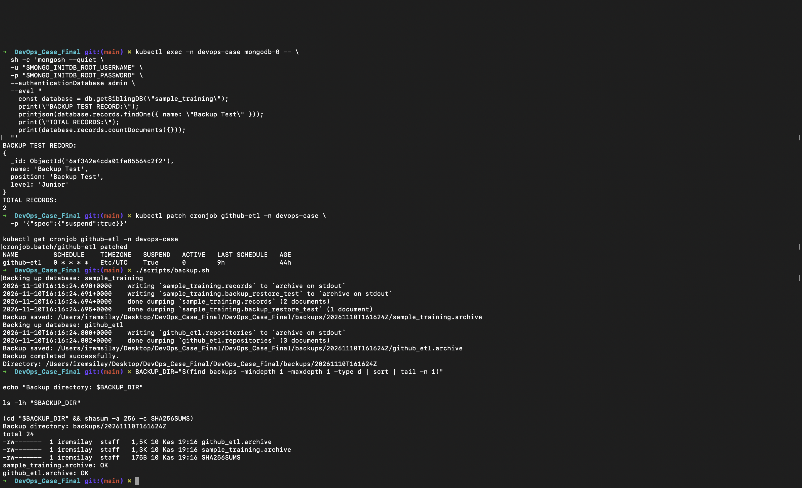

#### 3. COLLECTION'I SİLME

Veri kaybını simüle etmek için `sample_training.records` collection'ı silindi.

```text
RECORDS BEFORE DROP:
2

COLLECTION DROPPED:
true

RECORDS AFTER DROP:
0
```

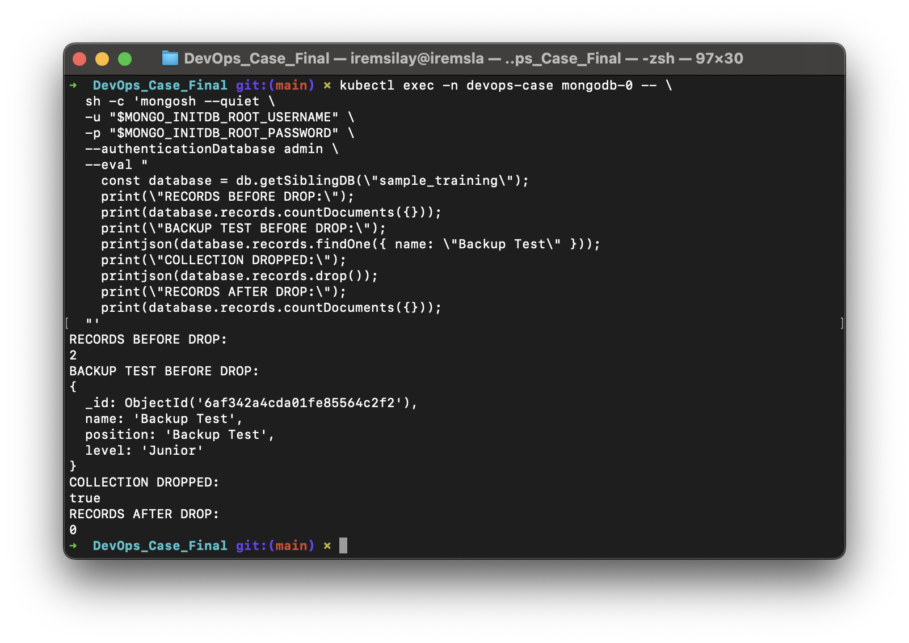

#### 4. VERİ KAYBININ DOĞRULANMASI

Collection silindikten sonra `Backup Test` ve `Employee1` kayıtlarının React arayüzünde görünmediği doğrulandı.

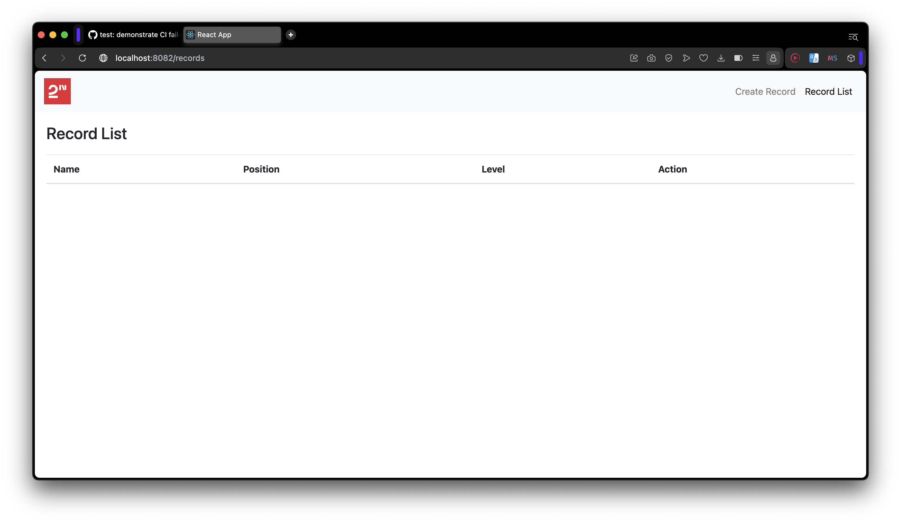

MongoDB sorgusunda da test kaydı bulunamadı ve toplam kayıt sayısı sıfırdı:

```text
BACKUP TEST AFTER DELETION:
null

TOTAL RECORDS:
0
```

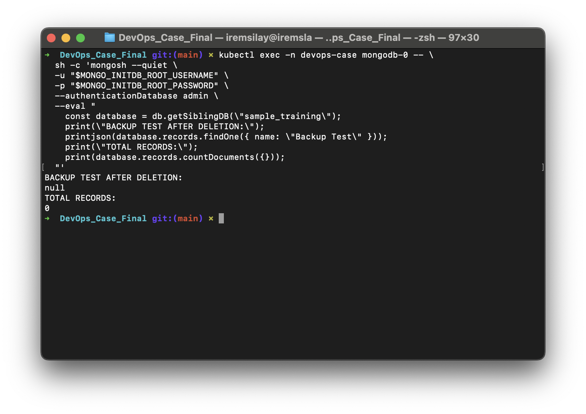

#### 5. RESTORE VE SÜRE ÖLÇÜMÜ

```bash
/usr/bin/time -p ./scripts/restore.sh backups/20261110T161624Z
```

Restore sırasında iki veritabanında toplam altı belge, hata olmadan geri yüklendi.

| Veritabanı | Geri yüklenen belge | Başarısız belge |
| --- | ---: | ---: |
| `sample_training` | 3 | 0 |
| `github_etl` | 3 | 0 |
| **Toplam** | **6** | **0** |

```text
Restore completed successfully.

real 4,80
user 0,12
sys 0,06
```

Script'in çalışma süresi 4,80 saniye olarak ölçüldü. Bu ölçüm kullanıcı onayını içerir; uçtan uca uygulama kurtarma süresi olarak değerlendirilmemelidir.

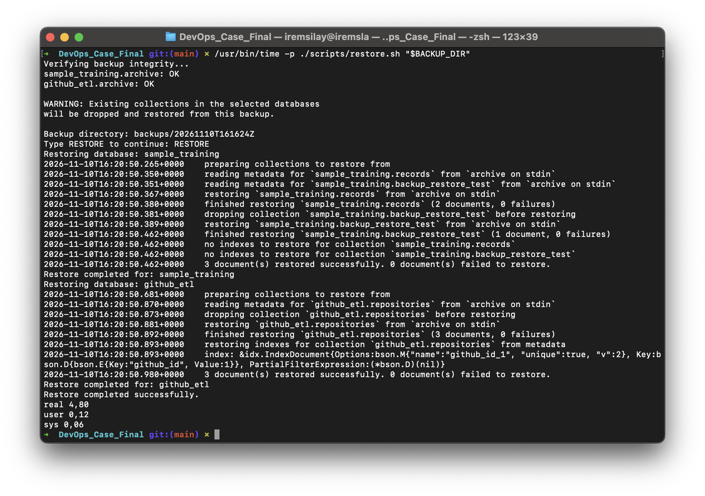

#### 6. GERİ YÜKLENEN VERİNİN DOĞRULANMASI

Restore sonrasında `Backup Test` ve `Employee1` kayıtları React arayüzünde yeniden görüntülendi.

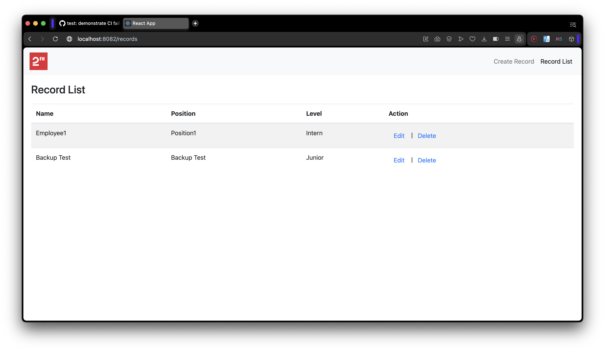

MongoDB sorgusu da kayıtların aynı alan değerleriyle geri geldiğini doğruladı:

```text
RESTORED BACKUP TEST RECORD:
name: 'Backup Test'
position: 'Backup Test'
level: 'Junior'

RESTORED EMPLOYEE1 RECORD:
name: 'Employee1'
position: 'Position1'
level: 'Intern'

TOTAL RECORDS:
2
```

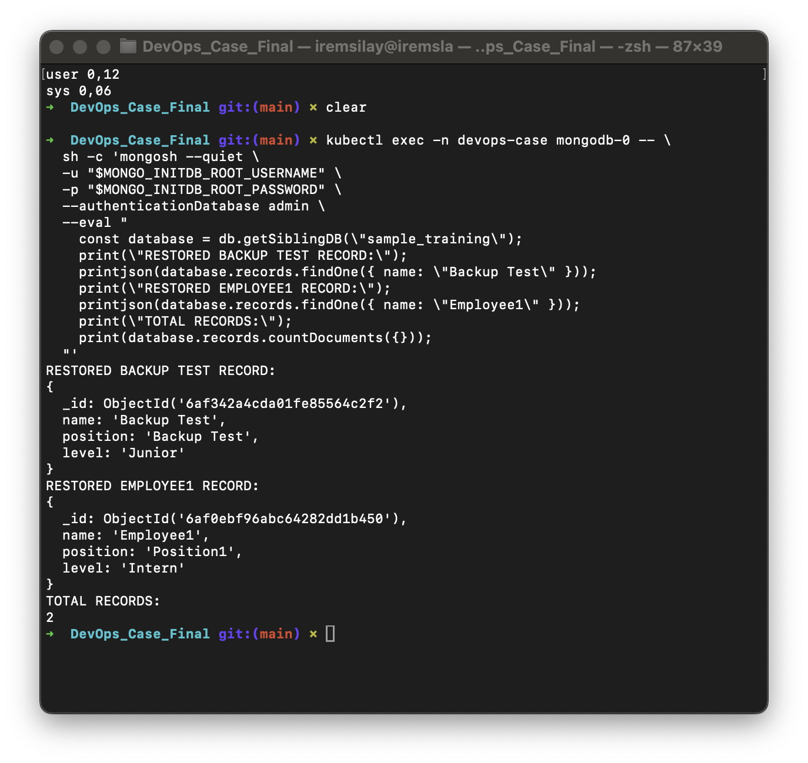

#### 7. TEST SONRASI SERVİS KONTROLÜ

Test sonrasında `github-etl` CronJob'ı yeniden etkinleştirildi. Son kontrolde backend ve frontend `1/1 Ready`, MongoDB Pod'u `1/1 Running` durumundaydı. MongoDB Pod'unun restart sayısı sıfırdı.

### 12.4 OTOMATİK BACKUP DOĞRULAMASI

`scripts/verify-backup.sh`, backup arşivlerinin yalnızca checksum bütünlüğünü değil, izole bir MongoDB ortamında geri yüklenebilirliğini de doğrular.

Script aşağıdaki işlemleri yapar:

1. Archive dosyalarını ve SHA-256 checksum değerlerini kontrol eder.
2. Docker üzerinde `--network none` ile geçici MongoDB 7 container'ı oluşturur.
3. İki archive dosyasını bu izole ortama geri yükler.
4. Collection'ların varlığını ve boş olmadığını kontrol eder.
5. Sonucu `PASS` veya `FAIL` olarak bildirir.
6. Geçici container'ı işlem sonunda kaldırır.

```bash
./scripts/verify-backup.sh backups/20261110T161624Z
```

Doğrulama testinde toplam altı belge geri yüklendi:

| Collection | Kurtarılan belge |
| --- | ---: |
| `sample_training.records` | 2 |
| `sample_training.backup_restore_test` | 1 |
| `github_etl.repositories` | 3 |
| **Toplam** | **6** |

```text
PASS: Backup restored and verified successfully.
Backup verification completed successfully.
Cleaning up temporary MongoDB...
```

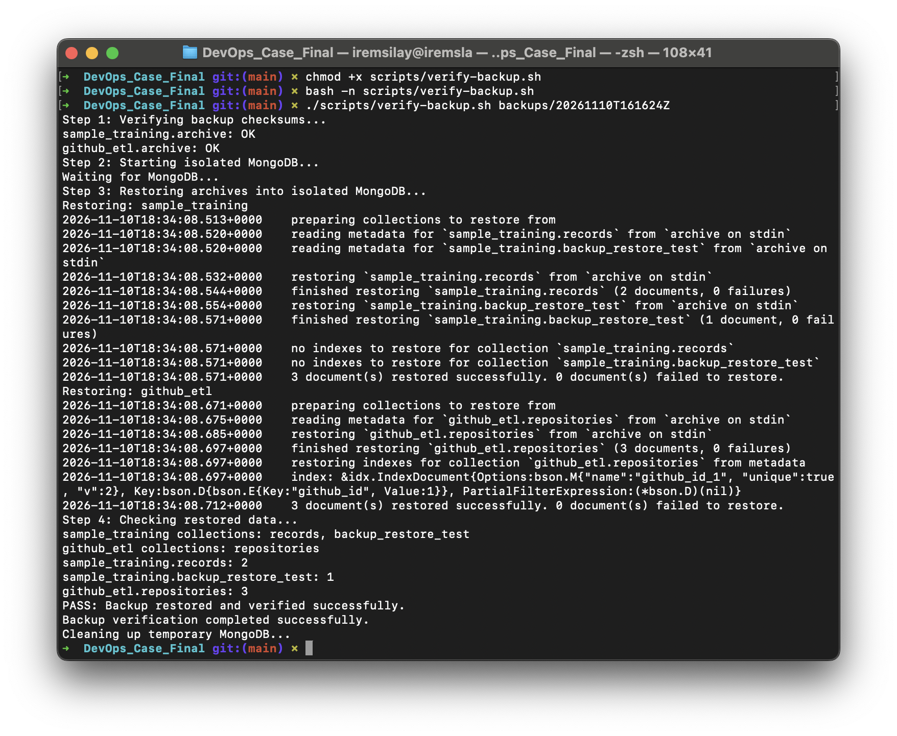

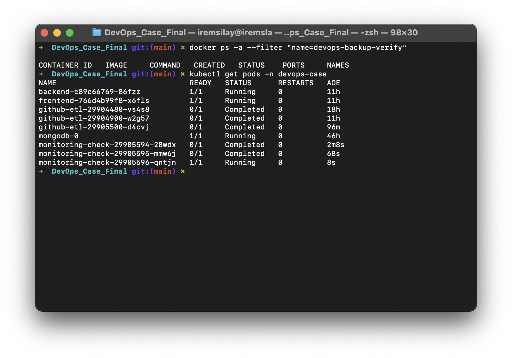

### 12.5 SINIRLAMALAR

- Backup işlemi manuel başlatılır; zamanlanmış backup bulunmaz.
- Hedef RPO 24 saat, hedef RTO 15 dakikadır. Mevcut manuel süreç bu hedefleri otomatik olarak garanti etmez.
- 4,80 saniyelik restore süresi yalnızca script çalışma süresidir; uçtan uca RTO ölçümü değildir.
- Retention hedefi yedi gündür; otomatik eski backup temizliği uygulanmamıştır.
- Backup dosyaları cluster dışında ancak aynı yerel bilgisayarda tutulur. Disk kaybına karşı bağımsız off-site koruma sağlamaz.
- Şifreli uzak object storage, point-in-time recovery ve otomatik disaster recovery tatbikatı uygulanmamıştır.
- `verify-backup.sh`, collection'ların boş olmadığını kontrol eder; belge içeriklerini veya uygulama davranışını karşılaştırmaz.

## 13. ROLLBACK, TEMİZLİK VE GÜVENLİK

### 13.1 ROLLBACK SINIRLARI

`deploy-local.sh`, deployment sırasında oluşan hata sonrasında backend, frontend ve ETL için deployment öncesinde kaydedilen image referanslarını yeniden uygular. Rollback akışı ve doğrulanmış test kanıtları **10.5 ROLLBACK** bölümünde yer alır.

Rollback, yalnızca Kubernetes kaynaklarının image referanslarını geri alır. MongoDB verisini, collection içeriğini veya veri şeması değişikliklerini geri yüklemez.

Deployment başarıyla tamamlandıktan sonra ortaya çıkan bir sorun için otomatik rollback tetiklenmez. Bu durumda önceki çalışan commit SHA'sı belirlenerek script eski sürüm etiketiyle yeniden çalıştırılabilir:

```bash
./scripts/deploy-local.sh sha-<önceki-40-karakterlik-commit-hash>
```

ETL CronJob image'ının geri alınması, ETL'nin başarılı çalıştığını tek başına göstermez. Sonraki ETL Job sonucu ayrıca kontrol edilmelidir.

### 13.2 GÜVENLİ TEMİZLİK

Docker Compose ortamını kaldırmak için:

```bash
docker compose down
```

Bu komut container'ları ve ağları kaldırır, MongoDB volume'unu korur.

```bash
docker compose down -v
```

Bu komut MongoDB volume'unu da siler. Veritabanı verisini kaldırmak istenmiyorsa kullanılmamalıdır.

Kubernetes ortamında `devops-case` namespace'inin silinmesi MongoDB PVC'si ve ilgili kaynaklar için veri kaybına neden olabilir. Namespace veya cluster silmeden önce backup alınmalıdır.

Monitoring testi sonrasında geçici Job ve CronJob kaynakları kaldırılmalı, `monitoring-check` CronJob'ının askıya alınmadığı doğrulanmalı ve aktif alarm durumları kontrol edilmelidir. Normal çalışma sırasında `monitoring-state` ConfigMap'i sıfırlanmamalıdır.

### 13.3 GÜVENLİK YAKLAŞIMI

- Parolalar, token'lar, MongoDB URI'leri ve Slack webhook adresi repository veya container image içine eklenmez.
- Kubernetes Secret, gizli değerleri; ConfigMap ise gizli olmayan yapılandırmaları tutar.
- Backend ve ETL, yalnızca kendi veritabanlarına erişmesi amaçlanan ayrı MongoDB kullanıcılarıyla çalışır.
- Backend, frontend ve ETL container'ları gereksiz root ayrıcalıklarından kaçınır.
- Monitoring bileşeni read-only root filesystem ve sınırlı Kubernetes ServiceAccount yetkileriyle çalışır.
- Backend `ClusterIP`, MongoDB ise headless Service olarak yalnızca cluster içinden erişilebilir. Dış erişim yalnızca frontend NodePort Service üzerinden sağlanır.
- Production bağımlılık denetimi CI içinde çalışır. Trivy taraması ve SBOM üretimi **9.6 CONTAINER IMAGE GÜVENLİK TARAMASI VE SBOM** bölümünde açıklanmıştır.

### 13.4 BİLİNEN GÜVENLİK SINIRLAMALARI

- CORS yapılandırması dar bir izin listesiyle sınırlandırılmamıştır.
- API için tam şema tabanlı input validation uygulanmamıştır.
- Cluster tek node, MongoDB ise tek replica ile çalışır.
- Otomatik Secret rotasyonu uygulanmamıştır.
- NetworkPolicy tanımlanmamıştır.
- Image signing, policy as code ve güvenlik açığı tespit edildiğinde image yayınını engelleyen bir politika bulunmamaktadır.

Bu noktalar, yerel teknik değerlendirme ortamının sınırlarıdır. Production ortamında erişim politikaları, Secret yönetimi, ağ ayrımı, yüksek erişilebilirlik ve güvenlik politikaları ayrıca uygulanmalıdır.

## 14. SIK KARŞILAŞILAN SORUNLAR

### FRONTEND AÇILIYOR FAKAT API İSTEĞİ BAŞARISIZ

- Frontend'in `/api` adresini kullandığını kontrol edin.
- Backend Pod'unun hazır olduğunu ve `/healthcheck/ready` endpoint'inin HTTP 200 döndürdüğünü doğrulayın.
- Nginx yapılandırmasındaki `case-backend` servis adını ve aynı namespace'teki Service kaynağını inceleyin.
- k3d host port eşlemesini veya `kubectl port-forward` komutunu kontrol edin.

### BACKEND READY DEĞİL

- MongoDB Pod ve PVC durumunu kontrol edin.
- MongoDB loglarını inceleyin.
- `backend-mongo-uri` Secret'ının varlığını ve backend kullanıcısının yetkilerini doğrulayın.
- `/healthcheck` ile `/healthcheck/ready` sonuçlarını ayrı değerlendirin. Liveness başarılı olsa bile MongoDB erişilemezse readiness başarısız olabilir.

### POD `IMAGEPULLBACKOFF` DURUMUNDA

- Yerel `case-*` image'larının k3d cluster'ına aktarıldığını doğrulayın.
- GHCR image kullanılıyorsa ilgili SHA tag'inin mevcut olduğunu ve cluster'ın registry'ye erişebildiğini kontrol edin.
- Ayrıntılı hata için Pod olaylarını inceleyin:

```bash
kubectl describe pod <pod-adi> -n devops-case
```

### ETL ÇALIŞMIYOR

- `github-etl` CronJob'ının `suspend=false` durumda olduğunu kontrol edin.
- Son Job'ların durumunu ve loglarını inceleyin.
- GitHub kullanıcı adını, API istek sınırını ve MongoDB bağlantısını doğrulayın.

```bash
kubectl get cronjob,jobs -n devops-case
kubectl logs -n devops-case job/<etl-job-adi>
```

### SLACK BİLDİRİMİ GELMİYOR

- `monitoring-check` CronJob'ını ve son monitoring Job loglarını inceleyin.
- `monitoring-slack-webhook` Secret'ının mevcut olduğunu doğrulayın.
- Alarmın aktif olup olmadığını ve bildirim sınırlandırma zamanını `monitoring-state` ConfigMap'inde kontrol edin.
- `WEBHOOK_FAILED` ve `WEBHOOK_SENT` loglarını karşılaştırın. Webhook değerini loglamayın veya paylaşmayın.

### BACKUP VEYA RESTORE HATA VERİYOR

- `mongodb-0` Pod'unun hazır olduğunu kontrol edin.
- MongoDB kullanıcılarının ve bağlantı Secret'larının doğru yapılandırıldığını doğrulayın.
- Archive dosyalarının ve `SHA256SUMS` dosyasının bulunduğunu kontrol edin.
- Restore işleminin `--drop` kullandığını unutmayın; hedef collection'lardaki mevcut veri silinir.

## 15. DOĞRULANAN SONUÇLAR VE BİLİNEN SINIRLAMALAR

### DOĞRULANAN SONUÇLAR

| Alan | Doğrulanan sonuç |
| --- | --- |
| Docker Compose | Frontend, backend ve MongoDB servisleri başarıyla çalıştırıldı. |
| Web uygulaması | Create, read/list, update ve delete işlemleri arayüz üzerinden doğrulandı. |
| Cypress | İki E2E testi başarıyla tamamlandı. |
| Readiness | MongoDB kesintisinde readiness HTTP 503 döndü; veritabanı geri geldiğinde backend yeniden başlatılmadan HTTP 200 durumuna geçti. |
| Kubernetes | Frontend ve backend Deployment kaynakları `1/1 Ready` durumunda doğrulandı. |
| ETL | Saatlik CronJob çalışması, ilk veri aktarımı ve `github_id` ile duplicate oluşturmadan güncelleme doğrulandı. |
| Monitoring | Backend alarmı, Slack bildirimi, 15 dakikalık throttling ve `RESOLVED` bildirimi uçtan uca test edildi. |
| Backup ve restore | Kayıt oluşturma, backup, collection silme, veri kaybı, restore ve geri gelen verinin doğrulanması tamamlandı. |
| Backup doğrulama | İzole MongoDB container'ında checksum doğrulaması ve archive restore testi başarıyla tamamlandı. |
| İleri güvenlik | Trivy image taraması ve CycloneDX SBOM üretimi CI içinde doğrulandı. |

Bu sonuçlar belirtilen test ortamı ve test zamanı için geçerlidir. Yeni bir kurulumda ilgili komutlar yeniden çalıştırılarak mevcut durum doğrulanmalıdır.

### BİLİNEN SINIRLAMALAR

- Ortam, public cloud production servisi değildir; Docker Desktop üzerindeki yerel k3d cluster'ında doğrulanmıştır.
- MongoDB tek replica ile çalışır. Replica set, otomatik failover ve çoklu node yapısı bulunmaz.
- CI image üretimini otomatikleştirir; Kubernetes deployment işlemi manuel olarak başlatılır.
- Helm/Kustomize, Terraform, Argo CD/Flux ve HPA/PDB uygulanmamıştır.
- Prometheus/Grafana, merkezi log toplama ve cluster dışı erişilebilirlik izleme bulunmaz.
- CORS için dar bir izin listesi, tam API şema doğrulaması, NetworkPolicy ve otomatik Secret rotasyonu uygulanmamıştır.
- Backup işlemi manuel başlatılır. Otomatik retention temizliği, şifreli uzak depolama ve point-in-time recovery bulunmaz.
- Güvenlik taraması raporlama amaçlıdır; bulunan açıklar image yayınını otomatik olarak engellemez.

## 16. EK DOKÜMANLAR VE TESLİM KANITLARI

- [Başlangıç bulguları ve uygulanan iyileştirmeler](docs/findings.md)
- [İngilizce bulgu dokümanı](docs/findings_en.md)
- [Mimari açıklama](docs/architecture.md)
- [Düzenlenebilir mimari diyagramı](docs/architecture.drawio)
- [Backup ve restore runbook'u](docs/backup-restore.md)
- [Ekran görüntüleri](docs/screenshots/)
- [Türkçe teslim kanıtları](TESLIM_KANITLARI.md)
- [İngilizce teslim kanıtları](SUBMISSION_EVIDENCE.md)
- [Türkçe case cevapları](CASE_SONU_CEVAPLARI.md)
- [İngilizce case cevapları](CASE_END_ANSWERS.md)
- [Türkçe değerlendirme dokümanı](DevOps_Teknik_Case_TR.docx)
- [İngilizce değerlendirme dokümanı](DevOps_Technical_Case_EN.docx)