# DEVOPS TECHNICAL CASE — MERN APPLICATION AND PYTHON ETL

## 1. PROJECT OVERVIEW

This project was prepared to review the provided MERN application and Python ETL workload, address critical operational issues and run the applications in a reproducible environment.

The project uses Docker Compose for local validation and Docker Desktop with k3d for Kubernetes deployment. Kubernetes runs on a local cluster. No public cloud or internet-accessible production environment has been deployed.

The MERN application supports creating, listing, updating, and deleting employee records. The Python ETL retrieves repository information for the specified GitHub user through the GitHub API and stores it in MongoDB. On subsequent runs, it matches repositories by their GitHub identities and updates existing records.

The project also includes GitHub Actions CI and container image builds, controlled deployment and rollback to the local Kubernetes cluster, MongoDB backup and restore, Kubernetes-based monitoring and Slack notifications. The scope and limitations of the environment are explained in the relevant sections.

**Repository:** [iremsilay/devops-case](https://github.com/iremsilay/devops-case)

## 2. TECHNOLOGIES AND COMPONENTS

| Component | Technologies | Description |
| --- | --- | --- |
| Frontend | React, JavaScript, Nginx | The React application is built during the Docker build stage. The generated static files are served by Nginx on port 8080. Nginx forwards `/api` requests to the backend service. |
| Backend | Node.js 22, Express, MongoDB Node.js driver | The API runs on port 5050. It provides CRUD operations for employee records under `/record`, a liveness check under `/healthcheck`, and a readiness check under `/healthcheck/ready` that also evaluates the MongoDB connection. |
| Database | MongoDB 7 | Application records are stored in the `sample_training.records` collection, while ETL data is stored in `github_etl.repositories`. A PersistentVolumeClaim is used for persistent data in Kubernetes. |
| ETL | Python 3.11, Requests, PyMongo | Retrieves repository data from the GitHub API and stores it in MongoDB. It performs upserts using the unique `github_id` field, preventing duplicate records for the same repository. |
| Container environment | Docker, Docker Compose | Frontend, backend, ETL, and monitoring components are packaged as containers. Docker Compose runs the application in a local container environment. |
| Orchestration | Docker Desktop, k3d, Kubernetes | The local Kubernetes cluster runs with k3d. Deployment, StatefulSet, Service, ConfigMap, Secret, Job, and CronJob resources are used. |
| CI and image publishing | GitHub Actions, Docker Buildx, GitHub Container Registry | The pipeline runs builds, basic checks, and Cypress tests. Backend, frontend, and ETL images are published to GHCR after successful pushes to the `main` branch. |
| Monitoring and notifications | Bash, Python, `kubectl`, Kubernetes CronJob, ConfigMap, Slack Incoming Webhook | The monitoring CronJob checks backend and ETL status. Alert state is stored in a ConfigMap, and Slack notifications are sent when required. |
| Backup and restore | `mongodump`, `mongorestore`, shell scripts, SHA-256 | MongoDB data is archived with scripts. Archive SHA-256 checksums are verified before restore. |

## 3. ARCHITECTURE AND TRAFFIC FLOW

Kubernetes resources run in the `devops-case` namespace.

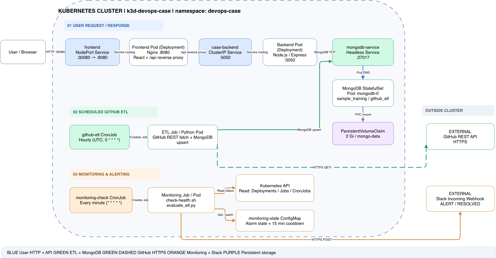

### WEB APPLICATION

The application is externally accessible through the `frontend` NodePort Service. The Service routes traffic to the frontend Pod running Nginx. Nginx serves the static files of the React application.

Browser requests sent to `/api` are forwarded by the Nginx reverse proxy to the `case-backend` Service inside the cluster. The backend Pod performs MongoDB operations for employee records through `mongodb-service`.

`frontend` is the only application service exposed externally through NodePort 30080. `case-backend` is a ClusterIP Service accessible only within the cluster. `mongodb-service` is a headless Service that provides stable network identity for the MongoDB StatefulSet.

This local architecture does not include an Ingress Controller or HTTPS/TLS termination. Traffic is served over HTTP. NodePort access from the local computer depends on the host port mapping defined when the k3d cluster is created.

### ETL WORKFLOW

The `github-etl` CronJob runs at the start of every hour in the UTC time zone (`0 * * * *`). A separate Kubernetes Job is created for each execution.

The ETL retrieves repository data from the GitHub REST API and stores it in the `github_etl.repositories` collection in MongoDB. When the same repository is processed again, the existing record is updated using the `github_id` field.

### MONITORING AND NOTIFICATIONS

The `monitoring-check` CronJob runs every minute. It checks the available replica status of the backend Deployment, the ETL CronJob, and ETL Job results through the Kubernetes API.

Alert state is stored in the `monitoring-state` ConfigMap. When a defined issue is detected, a notification is sent through a Slack Incoming Webhook. When the issue is resolved, the alert state is updated and a recovery notification is sent.

The architecture description is available in `docs/architecture.md`, and the editable Draw.io source is available in `docs/architecture.drawio`.

## 4. REPOSITORY STRUCTURE

Project source code, Kubernetes configuration, operational scripts, and submission documents are stored separately.

```text
.github/workflows/     GitHub Actions CI and image publishing workflow
docs/                  Architecture, findings, backup/restore runbook, and evidence screenshots
kubernetes/            Application, MongoDB, ETL, and monitoring manifests
mern-project/          React frontend, Express backend, and Cypress tests
monitoring/            Kubernetes status checks and Slack notification logic
python-project/        ETL application that imports GitHub repository data into MongoDB
scripts/               Local deployment, rollback, backup, restore, and verification scripts
tests/                 Unit tests for ETL monitoring and recovery behavior
backups/               Generated MongoDB backup archives and SHA-256 checksum files
```

Important files:

- `docker-compose.yml`: Runs the application locally with Docker Compose.
- `.env.example`: Contains example variables for the Compose environment.
- `docs/findings.md`: Explains identified issues in the starter projects, priorities, and applied improvements.
- `docs/backup-restore.md`: Contains the backup/restore method, verification steps, retention, and RPO/RTO information.
- `docs/architecture.png`: Kubernetes architecture diagram. Its explanation and editable source are available in `docs/architecture.md` and `docs/architecture.drawio`.
- `docs/screenshots/`: Contains evidence for the web application, Docker, Kubernetes, ETL, CI/CD, rollback, backup/restore, security, and monitoring.
- `TESLIM_KANITLARI.md`: Explains what each screenshot demonstrates.
- `CASE_SONU_CEVAPLARI.md`: Contains Turkish answers to the technical case questions.
- `CASE_END_ANSWERS.md`: Contains English answers to the technical case questions.

## 5. PREREQUISITES

### REQUIRED TOOLS

- Git
- Docker Desktop and Docker Compose
- `kubectl` and `k3d` for the Kubernetes setup
- Internet access for the GitHub API

Node.js 22 and npm are required for local frontend development and Cypress tests. Python 3.11 is required to run the ETL outside Docker or to run Python unit tests.

The project was validated on macOS with Docker Desktop. Commands are written for a macOS/Linux terminal.

### CLONE THE PROJECT

```bash
git clone https://github.com/iremsilay/devops-case.git
cd devops-case
```

## 6. QUICK START: DOCKER COMPOSE

Docker Compose runs the frontend, backend, and MongoDB components in a local container environment. Kubernetes deployment is described in the relevant section of this README.

### 6.1 ENVIRONMENT VARIABLES

Copy the example environment file in the project root:

```bash
cp .env.example .env
```

Values in the `.env` file:

```dotenv
COMPOSE_MONGO_URI=mongodb://mongodb:27017
MONGO_DB=github_etl
MONGO_COLLECTION=repositories
GITHUB_USERNAME=your-github-username
GITHUB_TOKEN=
FRONTEND_PORT=8081
```

Replace `GITHUB_USERNAME` with the GitHub account to use. Public repository information can be retrieved without a token, but GitHub API request limits apply. If a token is used, it must remain only in the local `.env` file and must not be committed to Git.

### 6.2 START THE APPLICATION

```bash
docker compose up -d --build
```

This command starts the MongoDB, backend, and frontend services. The ETL service is defined under a profile and does not start automatically.

### 6.3 CHECK THE SERVICES

```bash
docker compose ps
docker compose logs --tail=100 backend
docker compose logs --tail=100 frontend
```

Access the application at:

```text
http://localhost:8081
```

If `FRONTEND_PORT` is set to a different value, update the address accordingly. The Compose port mapping is accessible only from the local computer.

Verify backend health checks through the Nginx reverse proxy:

```bash
curl -i http://localhost:8081/api/healthcheck
curl -i http://localhost:8081/api/healthcheck/ready
```

Both endpoints return HTTP 200 when healthy. The readiness response also confirms that the MongoDB connection is available.

### 6.4 RUN THE ETL ONCE

```bash
docker compose --profile etl run --rm etl
```

The ETL stores GitHub repository data in MongoDB and exits when complete. When the same repository is processed again, the existing record is updated using the `github_id` field instead of creating a new record.

The terminal output includes `fetched`, `inserted`, `updated`, and `unchanged` counters. This command runs the ETL once. Hourly ETL scheduling is provided by the `github-etl` CronJob in Kubernetes.

### 6.5 STOP THE ENVIRONMENT

```bash
docker compose down
```

This command removes containers and the network while preserving the MongoDB volume.

```bash
docker compose down -v
```

This command also deletes the MongoDB volume. Do not use it when the database data should be preserved.

## 7. KUBERNETES ENVIRONMENT AND INITIAL SETUP

The Kubernetes deployment is prepared for the local `devops-case` k3d cluster running on Docker Desktop. The Kubernetes context is `k3d-devops-case`, and the namespace is `devops-case`.

This section describes the installation order for an empty cluster. Before reapplying Secrets or the `monitoring-state` ConfigMap in a running environment, check the current state.

### 7.1 CHECK THE CLUSTER AND CONTEXT

```bash
k3d cluster list
kubectl config current-context
kubectl get nodes
```

`deploy-local.sh` runs only in the `k3d-devops-case` context.

When creating a new cluster, a host port mapping must be defined for the frontend NodePort:

```bash
k3d cluster create devops-case --port '127.0.0.1:8081:30080@loadbalancer'
```

This command creates a new cluster. Deleting and recreating an existing cluster can cause MongoDB data loss.

### 7.2 BUILD THE IMAGES

Kubernetes manifests use local Docker image tags by default. Build the images from the project root:

```bash
docker build -t case-backend:1.0 ./mern-project/server
docker build -t case-frontend:1.0 ./mern-project/client
docker build -t case-etl:1.0 ./python-project
docker build -t case-monitoring:1.1 ./monitoring
```

Import the images into the k3d cluster:

```bash
k3d image import case-backend:1.0 case-frontend:1.0 case-etl:1.0 case-monitoring:1.1 -c devops-case
```

Images published to GHCR by GitHub Actions are applied with `scripts/deploy-local.sh` during a controlled release. This process is described in the CI/CD and rollback section of this README.

### 7.3 APPLY THE NAMESPACE AND GENERAL CONFIGURATION

```bash
kubectl apply -f kubernetes/namespace.yaml
kubectl apply -f kubernetes/configmap.yaml
```

The `app-config` ConfigMap contains the GitHub username and collection information for the ETL. If a different GitHub account is used, update `GITHUB_USERNAME` before starting the ETL.

### 7.4 CREATE THE SECRETS

Kubernetes manifests use the following Secrets:

- `mongodb-auth`: Initial credentials for the MongoDB root account and application users.
- `backend-mongo-uri`: Contains the `ATLAS_URI` key for the backend.
- `etl-mongo-uri`: Contains the `ATLAS_URI` key for the ETL.
- `monitoring-slack-webhook`: Contains the `SLACK_WEBHOOK_URL` key for Slack notifications.

Prepare the local environment file used during the initial MongoDB setup. It must contain the following variables:

```text
MONGO_INITDB_ROOT_USERNAME
MONGO_INITDB_ROOT_PASSWORD
MONGO_BACKEND_USERNAME
MONGO_BACKEND_PASSWORD
MONGO_ETL_USERNAME
MONGO_ETL_PASSWORD
```

Create the `mongodb-auth` Secret:

```bash
kubectl create secret generic mongodb-auth \
  -n devops-case \
  --from-env-file=kubernetes/secrets/mongodb.env
```

Create the backend, ETL, and Slack Secrets in the same namespace with the names and keys expected by the manifests.

Do not commit actual passwords, connection URIs, or webhook addresses to Git. If a password in a MongoDB URI contains special characters, it must be URL-encoded. Pods do not automatically use updated Secret values; the required rollout must be performed separately.

### 7.5 START MONGODB

If MongoDB is being installed on an empty volume for the first time, add the user creation script as a ConfigMap:

```bash
kubectl create configmap mongodb-init-script \
  -n devops-case \
  --from-file=init-mongo.js=kubernetes/mongodb/init-mongo.js
```

Apply the MongoDB Service and StatefulSet:

```bash
kubectl apply -f kubernetes/mongodb/service.yaml
kubectl apply -f kubernetes/mongodb/statefulset.yaml
kubectl rollout status statefulset/mongodb -n devops-case --timeout=180s
```

MongoDB runs in the `mongodb-0` Pod and stores data in the `mongo-data` PersistentVolumeClaim. `init-mongo.js` runs only when a new MongoDB volume is initialized. Reapplying it to an existing volume does not change user credentials.

### 7.6 START APPLICATION AND ETL RESOURCES

After MongoDB is ready, apply the backend, frontend, and ETL resources:

```bash
kubectl apply -f kubernetes/backend/service.yaml
kubectl apply -f kubernetes/backend/deployment.yaml
kubectl apply -f kubernetes/frontend/service.yaml
kubectl apply -f kubernetes/frontend/deployment.yaml
kubectl apply -f kubernetes/etl/cronjob.yaml
```

Check the Deployment status:

```bash
kubectl rollout status deployment/backend -n devops-case --timeout=180s
kubectl rollout status deployment/frontend -n devops-case --timeout=180s
kubectl get deployments,services,cronjobs -n devops-case
```

One replica is defined for the backend and frontend, and one StatefulSet replica is defined for MongoDB. This local setup does not provide high availability.

### 7.7 START MONITORING RESOURCES

```bash
kubectl apply -f kubernetes/monitoring/serviceaccount.yaml
kubectl apply -f kubernetes/monitoring/role.yaml
kubectl apply -f kubernetes/monitoring/rolebinding.yaml
kubectl apply -f kubernetes/monitoring/configmap.yaml
kubectl apply -f kubernetes/monitoring/state-configmap.yaml
kubectl apply -f kubernetes/monitoring/cronjob.yaml
```

Monitoring runs with a limited-permission ServiceAccount. The `monitoring-state` ConfigMap stores the alert state.

`state-configmap.yaml` is intended only for the initial state. Reapplying it after monitoring has started can reset active alerts. The `monitoring-slack-webhook` Secret must be created before Slack notifications can be sent.

### 7.8 POST-INSTALLATION CHECKS AND ACCESS

```bash
kubectl get pods,deployments,services,cronjobs,pvc -n devops-case
```

If the host port mapping is configured, access the application at `http://localhost:8081`. For temporary access, forward the frontend Service port:

```bash
kubectl port-forward -n devops-case service/frontend 8082:8080
```

The application remains accessible at `http://localhost:8082` while this command is running.

## 8. APPLICATION FUNCTIONALITY VALIDATION

### 8.1 WEB APPLICATION AND HEALTH CHECKS

Creating, listing, updating, and deleting employee records were validated through the web interface. The backend stores records in the MongoDB `sample_training.records` collection.

Health checks are provided through two endpoints:

- `/healthcheck`: Liveness endpoint that checks whether the backend process is responding.
- `/healthcheck/ready`: Readiness endpoint that checks whether the backend and MongoDB connection are available.

When the frontend is accessed through port-forward, the checks can be run with:

```bash
curl -i http://localhost:8082/api/healthcheck
curl -i http://localhost:8082/api/healthcheck/ready
```

Both endpoints return HTTP 200 when healthy. When MongoDB is unavailable, `/healthcheck/ready` returns HTTP 503 and `NOT_READY`. Once MongoDB becomes available again, the backend returns to the `READY` state without requiring a restart.

**Evidence:**

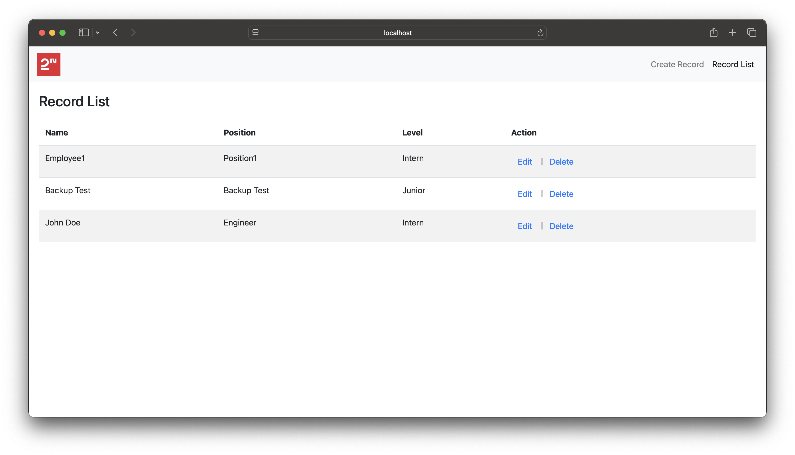

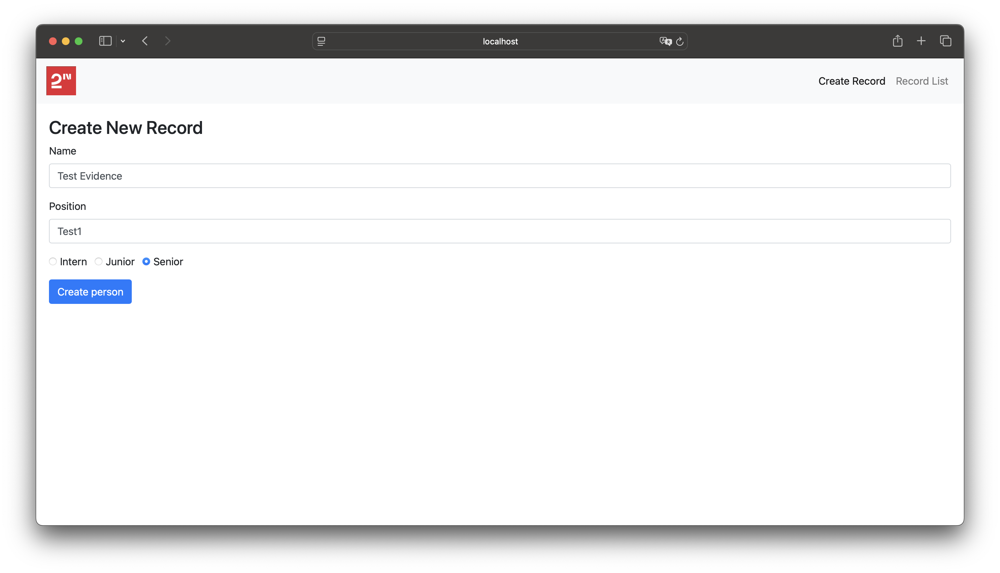

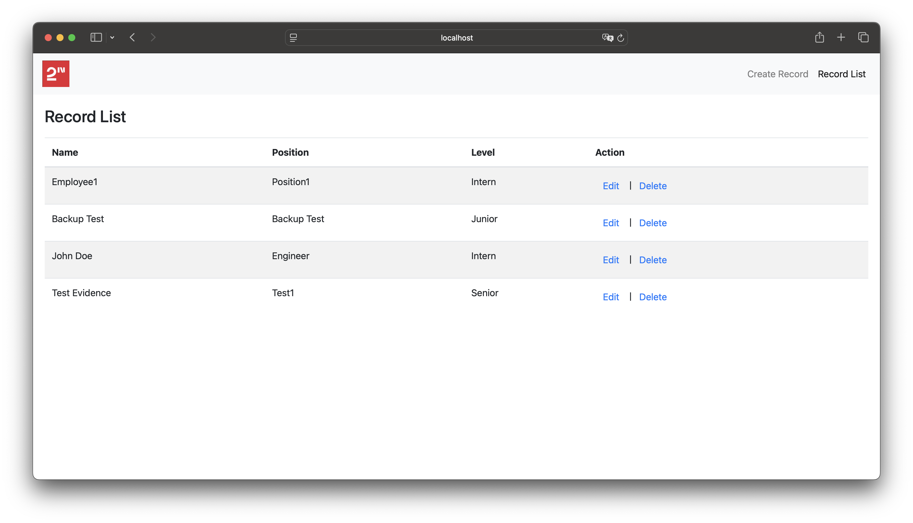

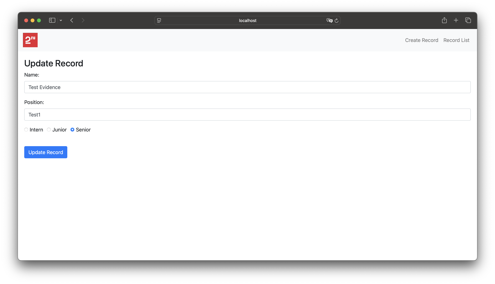

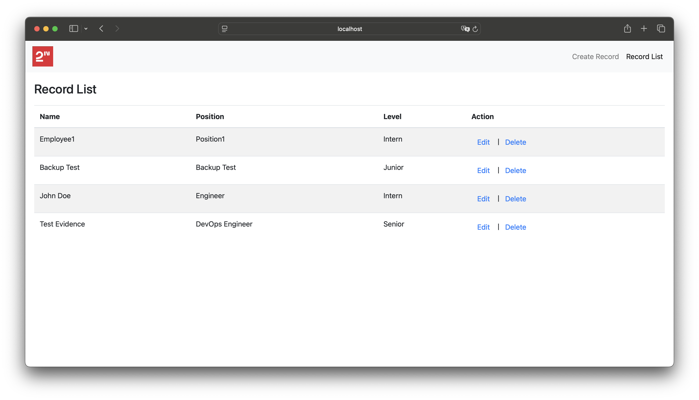

### 8.2 ETL UPDATE VALIDATION

The ETL CronJob and its Jobs can be checked with:

```bash
kubectl get cronjob github-etl -n devops-case
kubectl get jobs -n devops-case
```

To view the output of a specific Job:

```bash
kubectl logs -n devops-case job/<etl-job-name>
```

The `github-etl` CronJob runs at the start of every hour in the UTC time zone (`0 * * * *`). The first run stores GitHub repository data in MongoDB. Subsequent runs update matching records through the unique `github_id` field.

During validation, the same three repositories were processed a second time. The second run returned `fetched=3`, `inserted=0`, `updated=3`, and `unchanged=0`. The total number of records in the collection remained three. The unique index on `github_id` prevents duplicate records for the same repository.

The repository count may vary based on the selected GitHub account.

**Evidence:**

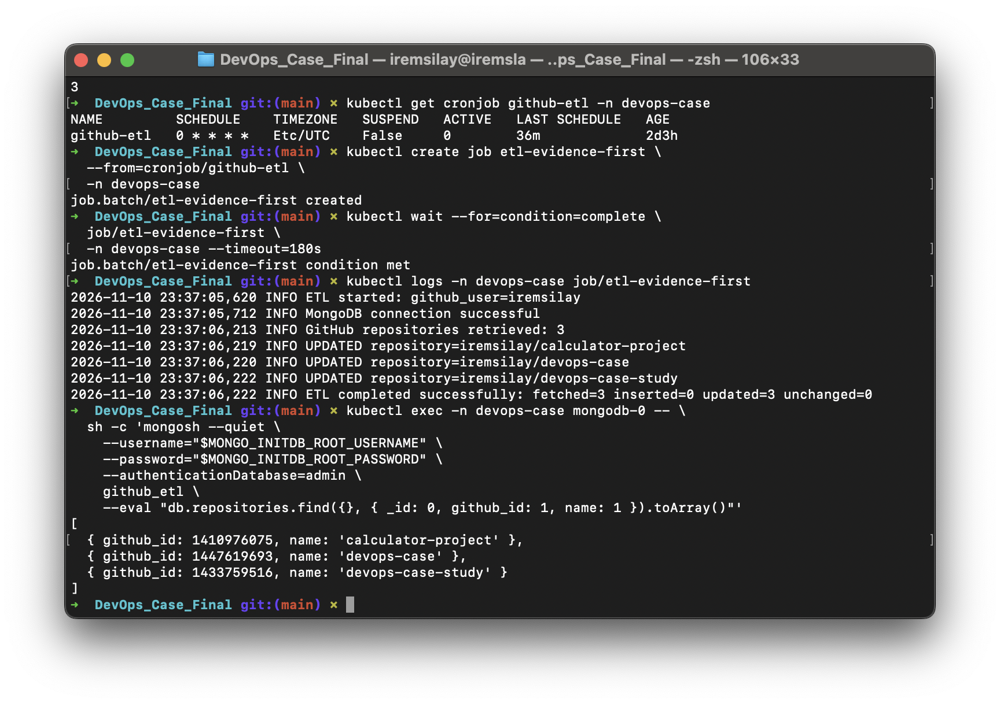

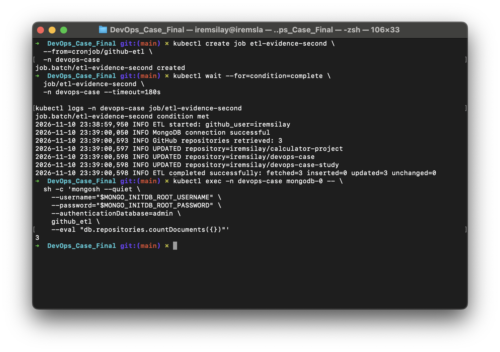

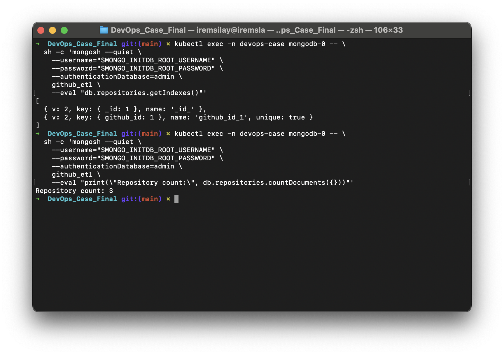

## 9. TESTS AND QUALITY CHECKS

### 9.1 FRONTEND PRODUCTION BUILD

```bash
cd mern-project/client
npm ci
npm run build
```

This command creates the production build output for the React application.

### 9.2 BACKEND CHECKS

```bash
cd mern-project/server
npm ci
npm audit --omit=dev --audit-level=high
node --check server.mjs
```

`npm audit` checks known security vulnerabilities in production dependencies. `node --check` validates the JavaScript syntax of the backend file.

### 9.3 CYPRESS END-TO-END TESTS

Cypress tests run while the frontend and backend are available:

```bash
cd mern-project/client
npx cypress run --e2e
```

The default address in the local Cypress configuration is `http://localhost:3000`. If the application runs on a different port, update the `baseUrl` value accordingly.

GitHub Actions runs Cypress tests with MongoDB, backend, and frontend containers in a Docker network independent from the target Kubernetes cluster. The original record creation test failed because it searched for the record on the wrong page. After updating the test to check the `/records` page, both Cypress tests passed.

### 9.4 MONITORING AND ETL RECOVERY UNIT TESTS

Run from the project root:

```bash
python3 -m unittest discover -s tests -p 'test_*.py' -v
```

The six unit tests cover the monitoring logic that evaluates ETL Job results. They validate distinguishing older and newer ETL failures, recovery after a successful run, no successful Job being available, missing failure timestamps, and filtering failures belonging to another CronJob.

Passing all six tests confirms these scenarios. Full code coverage has not been measured.

### 9.5 DEPENDENCY SECURITY CHECK

Initially, `npm audit` reported 11 vulnerabilities in the backend and 89 in the frontend. After dependency updates, no backend vulnerabilities remained; the latest local frontend check reported 33 remaining vulnerabilities.

These values are historical measurements. Run the audit commands again to determine the current result.

The final frontend container image does not contain Node.js dependencies; it serves built static files through Nginx. However, residual risks related to frontend build dependencies and the software supply chain are not fully eliminated. Remaining dependency risks are described in `docs/findings.md`.

### 9.6 CONTAINER IMAGE SECURITY SCANNING AND SBOM

The CI pipeline performs Trivy security scanning and generates CycloneDX-format SBOMs for backend, frontend, and ETL images.

The scan reports known `HIGH` and `CRITICAL` vulnerabilities. Trivy reports and SBOM files are retained as GitHub Actions artifacts for 14 days.

| Artifact | Contents |
| --- | --- |
| `security-backend` | `trivy-backend.json`, `sbom-backend.json` |
| `security-frontend` | `trivy-frontend.json`, `sbom-frontend.json` |
| `security-etl` | `trivy-etl.json`, `sbom-etl.json` |

In the workflow run on 10 November 2026, the `Security - backend`, `Security - frontend`, and `Security - etl` jobs completed successfully.

[GitHub Actions Run #13](https://github.com/iremsilay/devops-case/actions/runs/42861106121)

The scan is intended for reporting. Detected vulnerabilities do not automatically fail the CI workflow. Scanning runs against images built in the CI environment and does not directly scan the image digest published to GHCR. Image signing, policy as code, and vulnerability-based publishing blocks are not implemented.

**Evidence:**

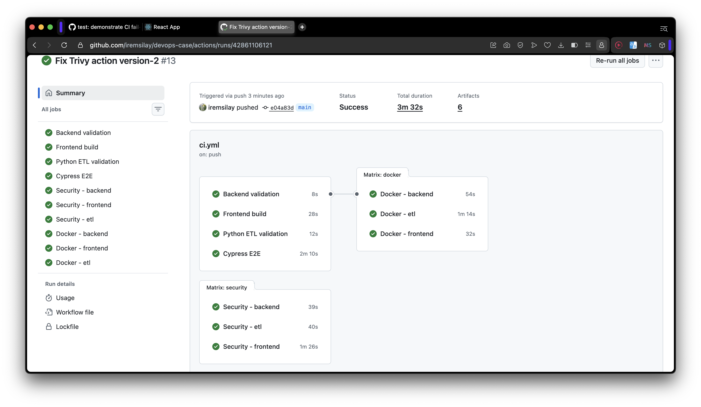

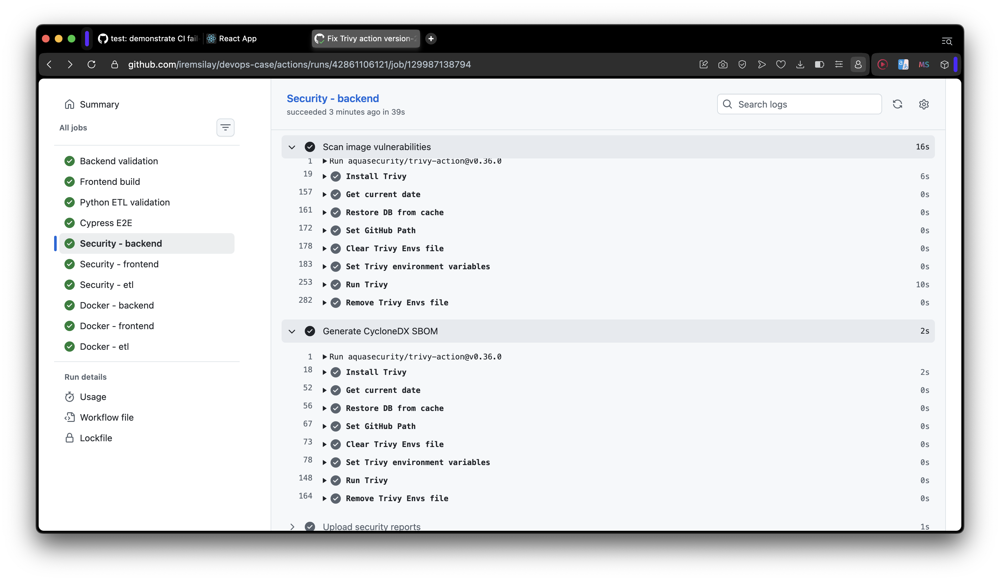

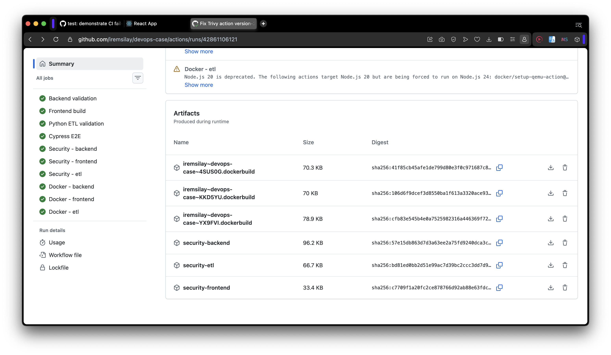

## 10. CI/CD AND RELEASE MANAGEMENT

The CI process performs validation, testing, and container image publishing through GitHub Actions. Deployment to the local Kubernetes cluster is performed in a controlled manner through `scripts/deploy-local.sh`.

### 10.1 CI PIPELINE

The workflow defined in `.github/workflows/ci.yml` runs in the following situations:

- Pushes to the `main` branch
- Pull requests targeting the `main` branch
- Manual execution through `workflow_dispatch`

The pipeline performs the following checks:

1. Installs backend dependencies, audits production dependencies, and checks JavaScript syntax.
2. Installs frontend dependencies and creates a production build.
3. Installs Python ETL dependencies, compiles the file, and verifies required modules.
4. Runs Cypress E2E tests with MongoDB, backend, and frontend containers.
5. Builds backend, frontend, and ETL images for `linux/amd64` and `linux/arm64` after successful checks.
6. Publishes images to GHCR on pushes to the `main` branch.

Container image security scanning and SBOM generation run in separate Security jobs. Their scope and evidence are described in [9.6 CONTAINER IMAGE SECURITY SCANNING AND SBOM](#96-container-image-security-scanning-and-sbom).

#### CYPRESS TEST ENVIRONMENT

Cypress tests run in a temporary Docker environment created on the GitHub Actions runner, not in the target Kubernetes cluster. The pipeline creates a separate `case-ci` network for MongoDB, backend, and frontend containers.

Before Cypress starts, backend readiness and API access through the frontend are verified. When a test fails, container logs and Cypress screenshots, when available, are stored as artifacts.

This environment prevents tests from affecting services or data in the local Kubernetes cluster. It does not test all Kubernetes orchestration behavior.

#### FAIL-FAST BEHAVIOR

The Docker image build and publishing stage depends on successful `backend`, `frontend`, `etl`, and `cypress` jobs. If any of these jobs fails, the Docker job does not run.

This behavior was verified with temporary Pull Request #1 from the `test/ci-fail-fast` branch to `main`. A deliberately failing `FAIL_FAST_TEST_ELEMENT` assertion was added to the Cypress test.

| Check | Result |
| --- | --- |
| Backend validation | Successful |
| Frontend build | Successful |
| Python ETL validation | Successful |
| Cypress E2E | Failed |
| Docker build/publish | Skipped |

- [Pull Request #1 — CI fail-fast test](https://github.com/iremsilay/devops-case/pull/1)
- Test commit: `4cd5e7d`

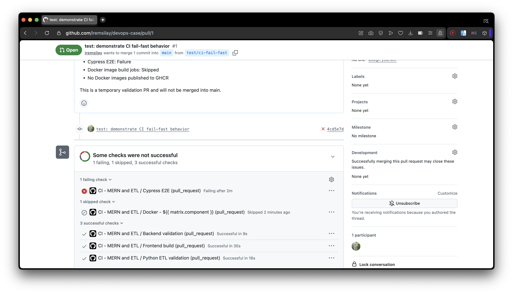

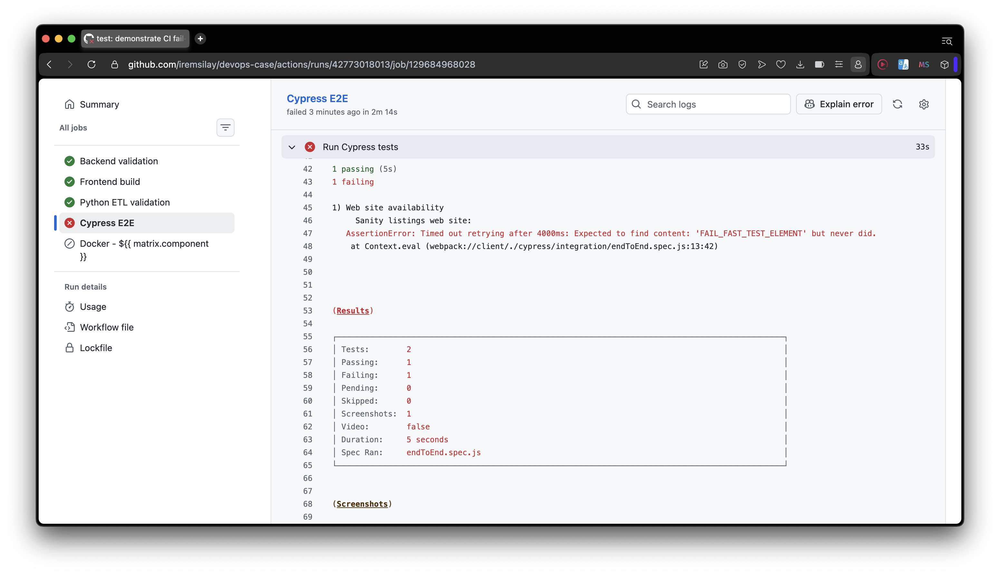

The test was performed only on the temporary branch. The failing assertion was not included in the `main` branch.

### 10.2 SUCCESSFUL CI RUN

The `CI - MERN and ETL` workflow completed successfully after a push to the `main` branch.

| Information | Value |
| --- | --- |
| Workflow | CI - MERN and ETL (#9) |
| Commit | `b5873c8` |
| Result | Success |
| Duration | 3 minutes 11 seconds |

Backend validation, frontend build, Python ETL validation, Cypress E2E, and Docker build jobs completed successfully.

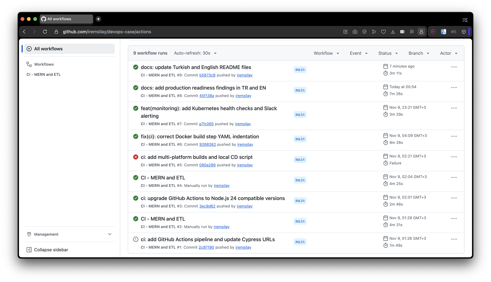

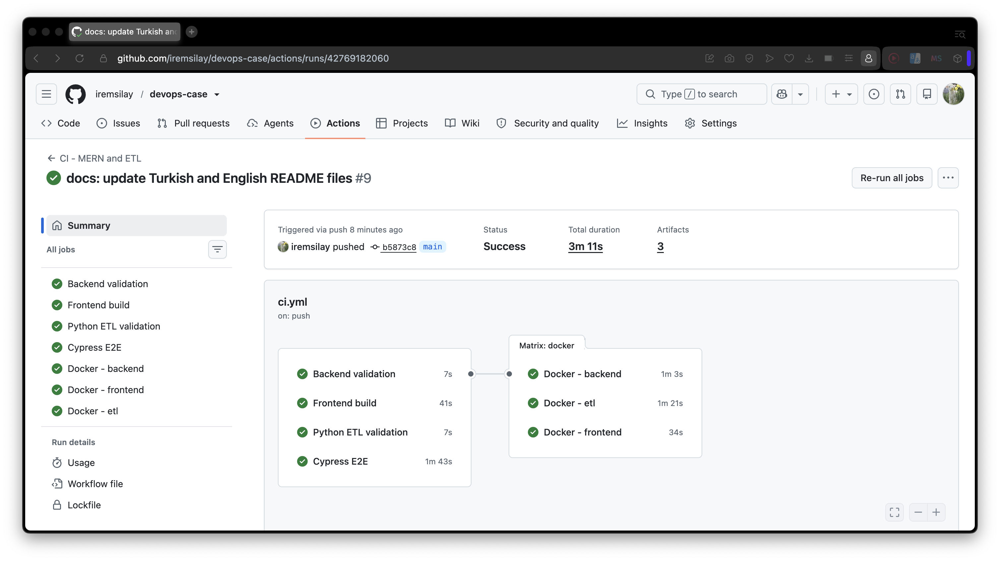

### 10.3 GHCR IMAGE PUBLISHING

The following images are published to GHCR after successful pushes to `main`:

- `ghcr.io/iremsilay/devops-case-backend`
- `ghcr.io/iremsilay/devops-case-frontend`
- `ghcr.io/iremsilay/devops-case-etl`

Two tags are used for each image:

- `latest`: Most recently published version
- `sha-<40-character-commit-hash>`: Version associated with a specific commit

The SHA tag allows a specific CI output to be selected during deployment.

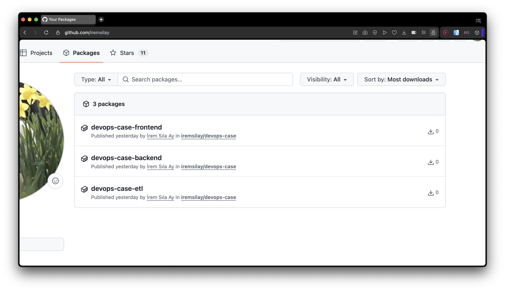

The backend image was verified as published with the `latest` and `sha-b5873c8b85f31885109fb038f517e18f06601448` tags. The SHA tag matches the commit from the successful CI workflow.

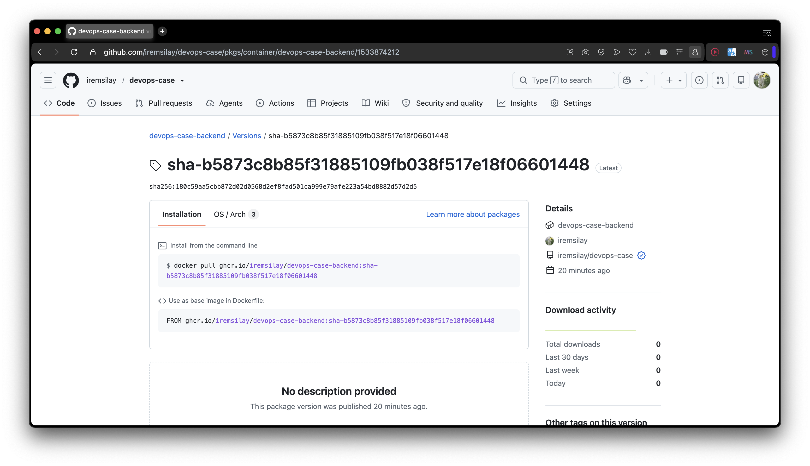

### 10.4 LOCAL KUBERNETES DEPLOYMENT

GitHub Actions does not deploy directly to the local Kubernetes cluster. Image publishing and deployment are separated instead of exposing the local cluster to a GitHub-hosted runner.

For this reason, the solution is not described as fully automated CD or GitOps. A release to the local cluster is started manually with:

```bash
./scripts/deploy-local.sh sha-<40-character-commit-hash>
```

The script runs only in the `k3d-devops-case` context. It updates the backend Deployment, frontend Deployment, and ETL CronJob image references in sequence. If the backend or frontend rollout fails, subsequent resources are not updated.

The following release to the local cluster was successfully verified:

| Information | Value |
| --- | --- |
| Namespace | `devops-case` |
| Previous version | `sha-92683629ca434accfb946cb255ad97eb0e4f4bc5` |
| New version | `sha-b5873c8b85f31885109fb038f517e18f06601448` |
| Method | `scripts/deploy-local.sh` |
| Result | Successful |

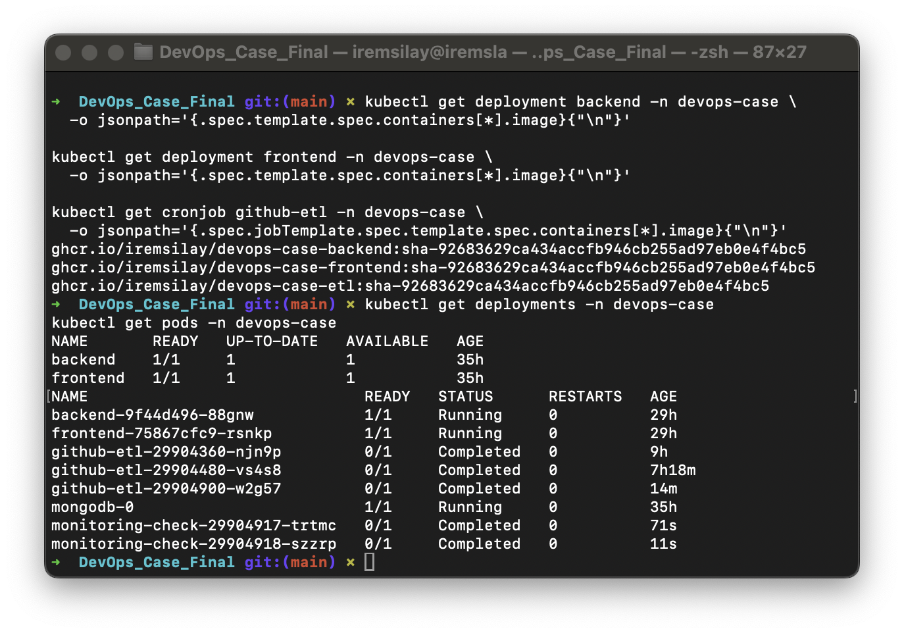

```bash
./scripts/deploy-local.sh sha-b5873c8b85f31885109fb038f517e18f06601448
```

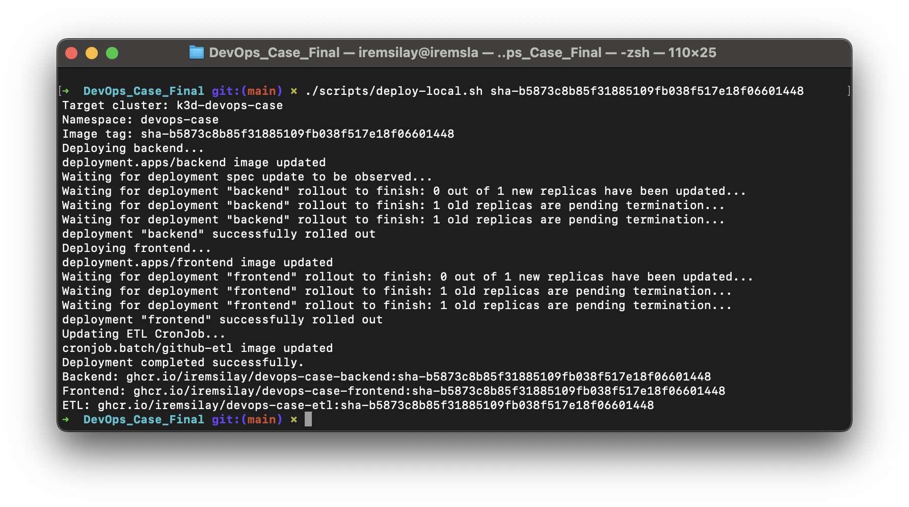

After deployment, backend and frontend were `1/1 Ready`, and related Pods were in the `Running` state. Backend, frontend, and ETL image references were verified as updated to the new SHA version.

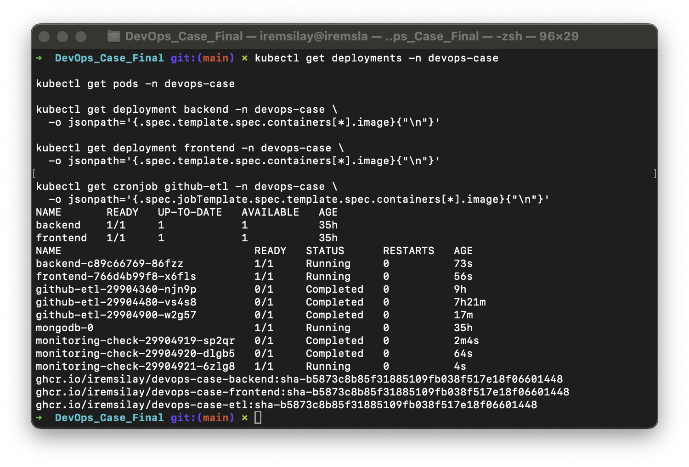

### 10.5 ROLLBACK

Before deployment, `deploy-local.sh` records the image references of backend, frontend, and ETL resources. If a command fails, the Bash `ERR` trap runs the rollback function.

Rollback reapplies the previous image references using `kubectl set image` and checks backend and frontend rollout status again. Manual investigation may be required if there is a cluster or image access issue.

The rollback mechanism was tested with an image tag that does not exist in GHCR:

| Information | Value |
| --- | --- |
| Healthy version | `sha-b5873c8b85f31885109fb038f517e18f06601448` |
| Invalid test version | `sha-0000000000000000000000000000000000000000` |
| Expected error | Backend rollout timeout |
| Result | Automatic rollback completed |

```bash
./scripts/deploy-local.sh sha-0000000000000000000000000000000000000000
```

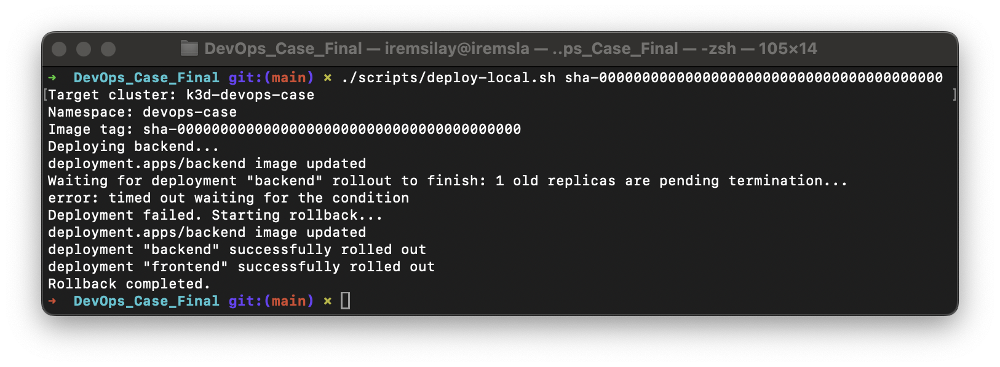

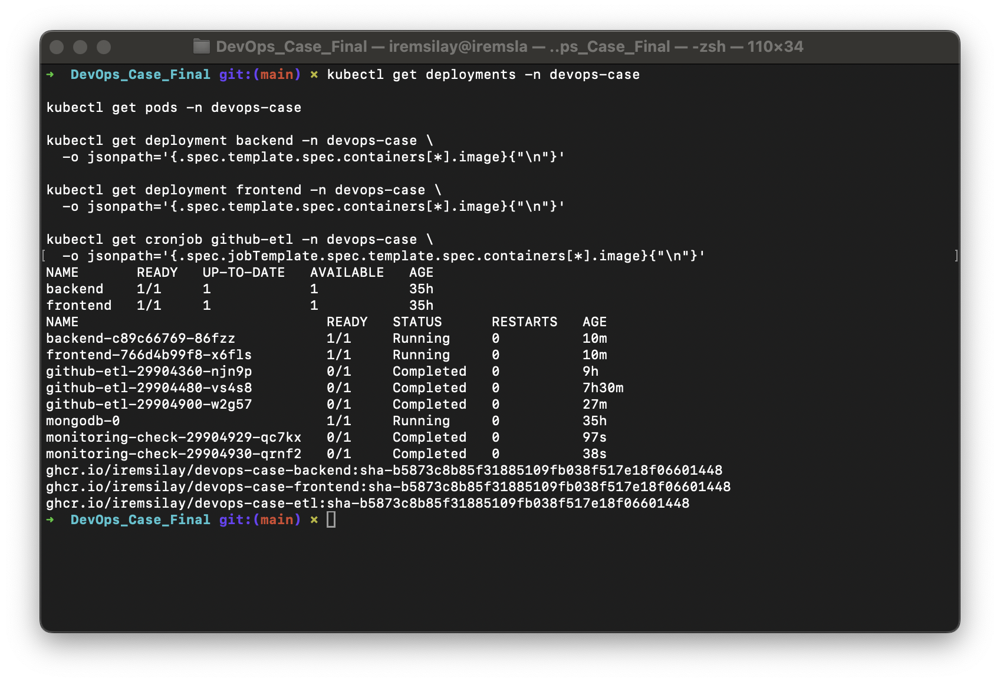

Rollback only restores image references. It does not restore database data or schema changes. After updating or reverting the ETL image, the result of the next ETL Job must be checked separately.

### 10.6 LIMITATIONS

- Kubernetes deployment is not triggered automatically by GitHub Actions.
- The SHA tag must exist in GHCR and be accessible to the cluster.
- If private image access is required, an appropriate `imagePullSecret` must be configured.
- Cypress tests run in an isolated Docker environment and do not cover all Kubernetes deployment behavior.

## 11. MONITORING, LOGGING, AND SLACK ALERTS

The `monitoring-check` CronJob runs every minute. It checks the available replica status of the backend Deployment, the `github-etl` CronJob, and ETL Job results through the Kubernetes API.

### 11.1 ALERT TYPES

| Alert | Condition |
| --- | --- |
| `BACKEND_UNAVAILABLE` | The desired backend replica count is zero or the available replica count is below the desired value |
| `ETL_OVERDUE` | The most recent successful ETL execution exceeds 4500 seconds, or 75 minutes |
| `ETL_JOB_FAILED` | A failed ETL Job exists after the most recent successful ETL execution |
| `ETL_NO_SUCCESS` | No successful ETL execution record exists |
| `ETL_SUSPENDED` | The `github-etl` CronJob is suspended |

The active state and last notification time for each alert are stored in the `monitoring-state` ConfigMap. The first alert is sent to Slack. For ongoing issues, a notification limit of 900 seconds, or 15 minutes, is applied to each alert.

When an issue is resolved, the alert state is cleared and a `RESOLVED` notification is sent to Slack. If the webhook request fails, the notification is not considered successful.

ConfigMap updates use `resourceVersion` to reject updates based on stale state. This control does not completely prevent all concurrent notification races.

`monitoring/evaluate_etl.py` evaluates Job `ownerReferences` and failure timestamps. This prevents failures that occurred before the most recent successful ETL execution from being evaluated as new alerts. This logic is covered by six unit tests.

### 11.2 CHECK COMMANDS

```bash
kubectl get cronjob monitoring-check -n devops-case
kubectl get jobs -n devops-case
kubectl logs -n devops-case job/<monitoring-job-name>
```

To inspect active alert state:

```bash
kubectl get configmap monitoring-state -n devops-case -o yaml
```

`monitoring-state` contains only alert metadata. The Slack webhook value is stored in a Secret and must not be read, logged, or shared.

### 11.3 VERIFIED BACKEND ALERT SCENARIO

Backend availability, Slack notification, notification throttling, and recovery behavior were tested in a controlled local Kubernetes environment.

During the test, the backend was temporarily scaled down to zero replicas. Monitoring detected this state as a `BACKEND_UNAVAILABLE` alert. The alert was verified as active in the `monitoring-state` ConfigMap, and the Slack notification was confirmed.

A repeated check did not send a new Slack notification and returned `ALERT_THROTTLED`. After the backend was scaled back to one replica, the Deployment returned to the `1/1 Available` state. Monitoring cleared the alert and sent a `RESOLVED` notification to Slack.

| Check | Result |
| --- | --- |
| Normal backend state | `1/1`, `BACKEND_HEALTHY` |
| Failure state | `0/0`, `BACKEND_UNAVAILABLE` |
| Alert record | `active:true` |
| Slack alert | `BACKEND_UNAVAILABLE` notification sent |
| Repeated check | `ALERT_THROTTLED` |
| Recovery | Backend `1/1`, monitoring healthy |
| Cleared alert | `active:false`, `last_sent:0` |
| Slack recovery notification | `RESOLVED` sent |

During testing, the previous backend check was found to treat the `0/0` state as healthy. The condition was updated as follows:

```bash
if (( desired == 0 || available < desired )); then
```

The updated script was added to the `monitoring-script` ConfigMap and verified through the controlled test.

### 11.4 TEST COMMANDS

To create a backend failure and run a monitoring Job manually:

```bash
kubectl scale deployment backend -n devops-case --replicas=0
kubectl get deployment backend -n devops-case

kubectl create job monitoring-backend-test \
  --from=cronjob/monitoring-check \
  -n devops-case

kubectl logs -n devops-case job/monitoring-backend-test

kubectl get configmap monitoring-state \
  -n devops-case \
  -o jsonpath='{.data.BACKEND_UNAVAILABLE}'
```

Restore the backend after the test:

```bash
kubectl scale deployment backend -n devops-case --replicas=1
kubectl rollout status deployment/backend \
  -n devops-case --timeout=180s
```

After testing, temporary Job resources were removed, automatic monitoring was re-enabled, and healthy monitoring results were verified.

### 11.5 EVIDENCE

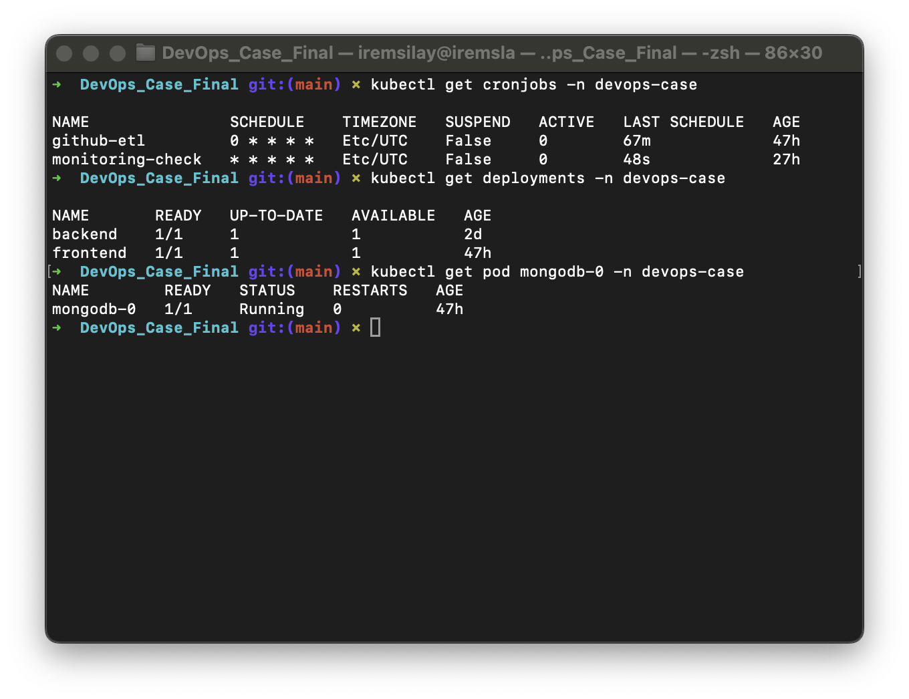

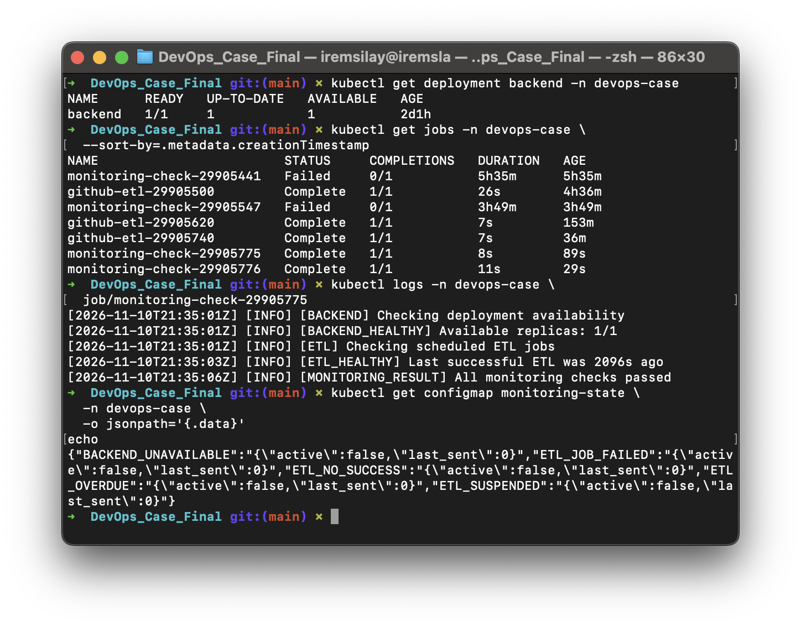

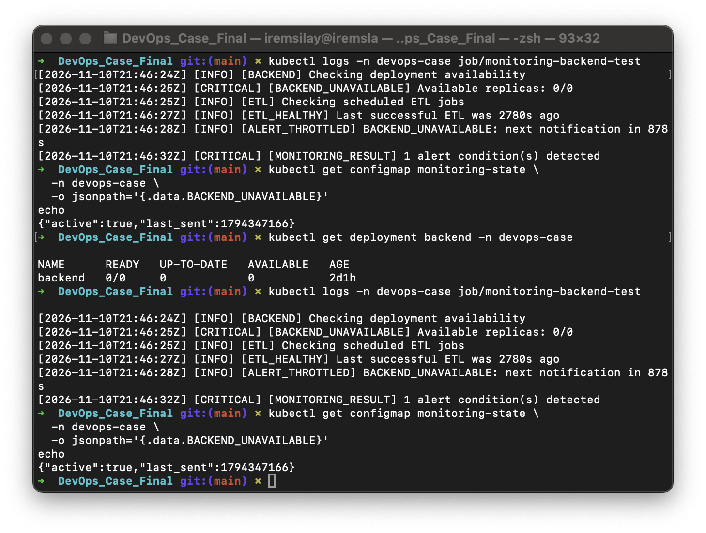

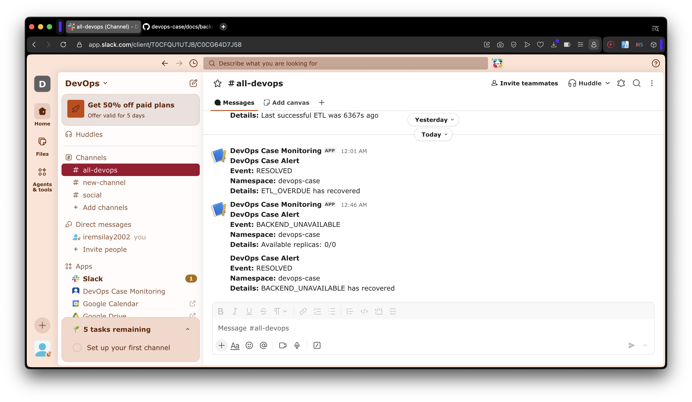

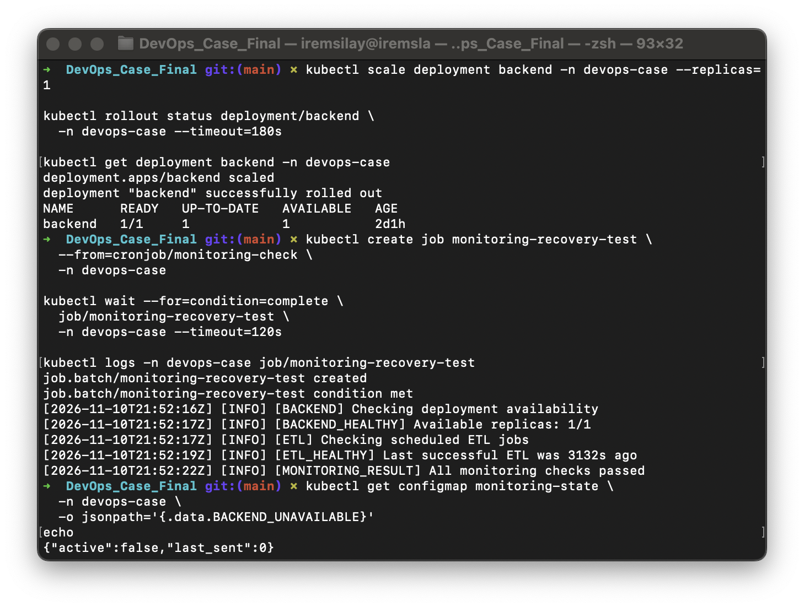


### 11.6 LIMITATIONS

This validation covers the alert, notification throttling, and recovery flow for backend availability. It does not mean that all ETL alert conditions or cluster-level failures were tested end to end.

If the cluster or Kubernetes API becomes completely unavailable, the monitoring CronJob running inside the cluster may not be able to send notifications. Prometheus/Grafana, centralized log collection, and external cluster availability monitoring are not implemented in this version.

```markdown
## 12. MONGODB BACKUP AND RESTORE

`scripts/backup.sh` and `scripts/restore.sh` are used for the `sample_training` and `github_etl` MongoDB databases. The scripts work with the `mongodb-0` Pod in the Kubernetes `devops-case` namespace and do not target the Docker Compose MongoDB container.

The detailed runbook, RPO/RTO targets, and retention approach are available in `docs/backup-restore.md`.

### 12.1 TAKE A BACKUP

Run from the project root:

```bash
./scripts/backup.sh
```

The script archives both databases with `mongodump` and creates a `backups/YYYYMMDDTHHMMSSZ/` directory for each execution.

```text
backups/<timestamp>/
├── sample_training.archive
├── github_etl.archive
└── SHA256SUMS
```

Archives are copied from the Kubernetes Pod to the local computer. Empty archives or failed dump operations are treated as errors. The backup directory is created with `700` permissions and files with `600` permissions.

To verify archive integrity:

```bash
(cd backups/<timestamp> && shasum -a 256 -c SHA256SUMS)
```

### 12.2 RESTORE

```bash
./scripts/restore.sh backups/<timestamp>
```

The script verifies SHA-256 checksums before restoring and requires the user to enter `RESTORE` for confirmation.

Restore uses `mongorestore --drop`. Existing data in target collections is deleted and replaced with the backup data. Changes made after the backup was taken may be lost during restore.

### 12.3 END-TO-END BACKUP AND RESTORE VALIDATION

Backup and restore were tested in the local Kubernetes environment on 10 November 2026.

| Information | Value |
| --- | --- |
| Kubernetes context | `k3d-devops-case` |
| Namespace | `devops-case` |
| MongoDB Pod | `mongodb-0` |
| Frontend | `http://localhost:8082/records` |
| Backup directory | `backups/20261110T161624Z` |
| Test record | `Backup Test` |

The ETL CronJob was temporarily suspended during the test to prevent new data from being written.

#### 1. CREATE A RECORD

The following employee record was created through the React interface:

| Field | Value |
| --- | --- |
| Name | `Backup Test` |
| Position | `Backup Test` |
| Level | `Junior` |

The record was verified in the React interface and in the MongoDB `sample_training.records` collection. Before the backup, the collection contained two records: `Backup Test` and `Employee1`.


#### 2. BACKUP AND INTEGRITY VALIDATION

```bash
./scripts/backup.sh
```

The backup was stored in `backups/20261110T161624Z`. Three documents from the `sample_training` database and three documents from the `github_etl.repositories` collection were backed up.

Checksum validation succeeded for both archives:

```text
sample_training.archive: OK
github_etl.archive: OK
```

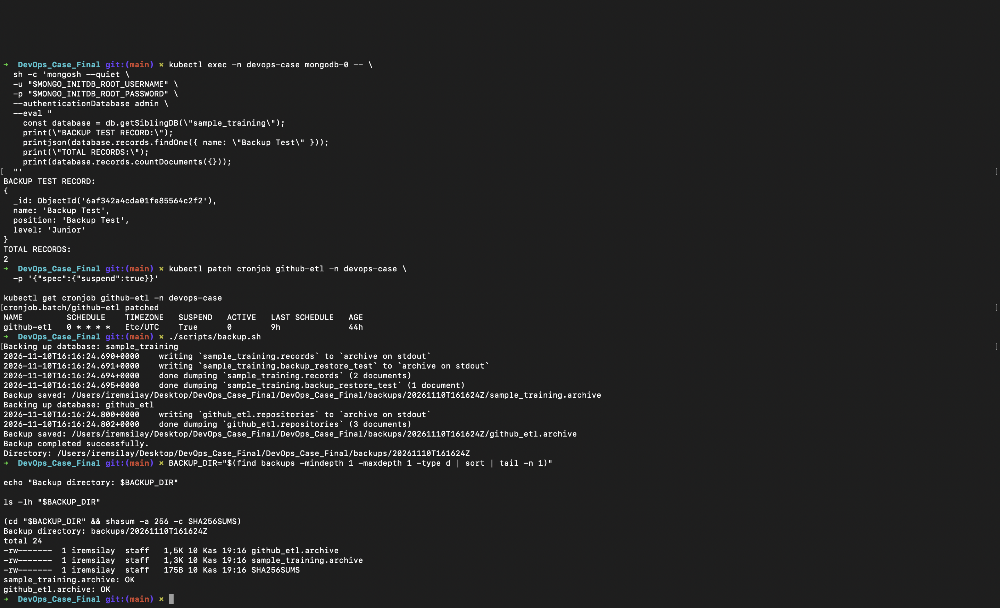

#### 3. DROP THE COLLECTION

To simulate data loss, the `sample_training.records` collection was dropped.

```text
RECORDS BEFORE DROP:
2

COLLECTION DROPPED:
true

RECORDS AFTER DROP:
0
```

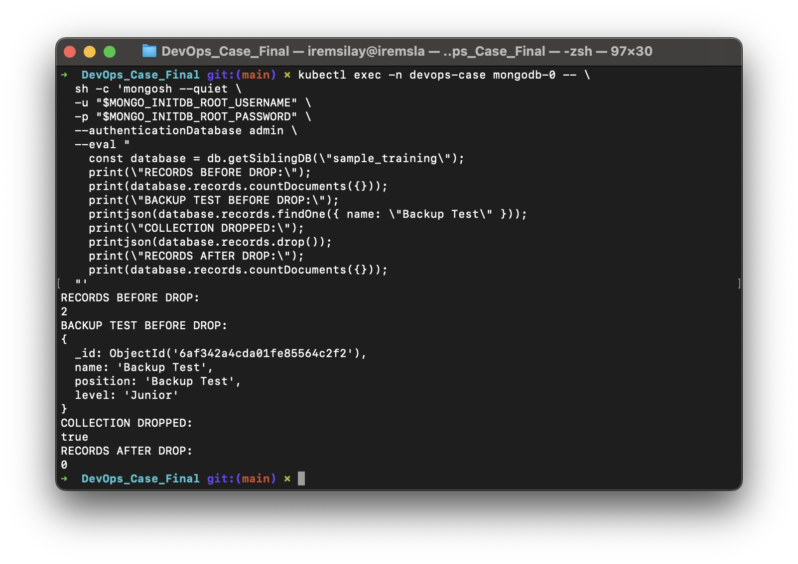

#### 4. VERIFY DATA LOSS

After the collection was dropped, the `Backup Test` and `Employee1` records were no longer visible in the React interface.

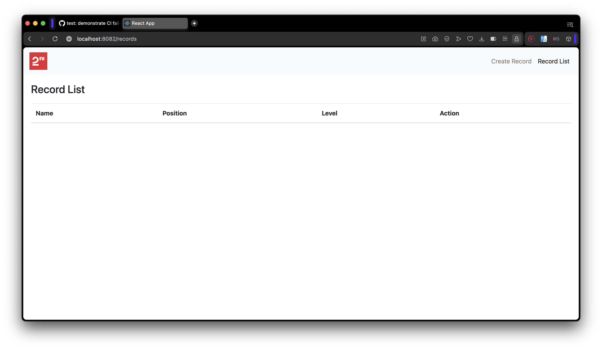

The MongoDB query also confirmed that the test record was missing and that the total record count was zero:

```text
BACKUP TEST AFTER DELETION:
null

TOTAL RECORDS:
0
```

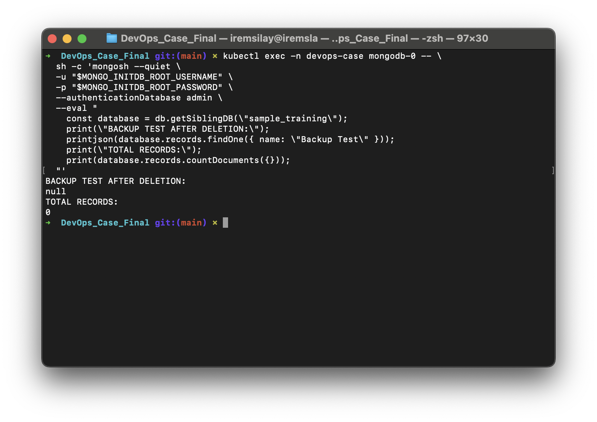

#### 5. RESTORE AND DURATION MEASUREMENT

```bash
/usr/bin/time -p ./scripts/restore.sh backups/20261110T161624Z
```

A total of six documents were restored across the two databases without errors.

| Database | Restored documents | Failed documents |
| --- | ---: | ---: |
| `sample_training` | 3 | 0 |
| `github_etl` | 3 | 0 |
| **Total** | **6** | **0** |

```text
Restore completed successfully.

real 4,80
user 0,12
sys 0,06
```

The script execution time was measured as 4.80 seconds. This measurement includes user confirmation and must not be considered an end-to-end application recovery time.

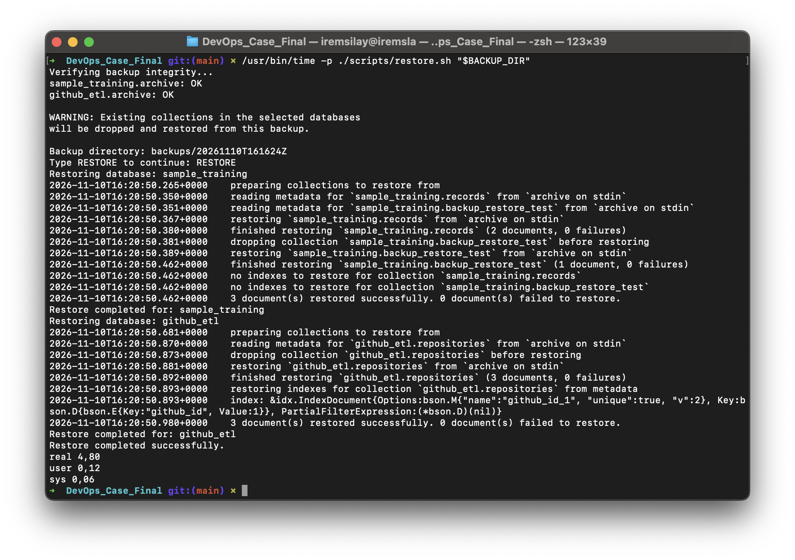

#### 6. VERIFY RESTORED DATA

After restore, the `Backup Test` and `Employee1` records were visible again in the React interface.

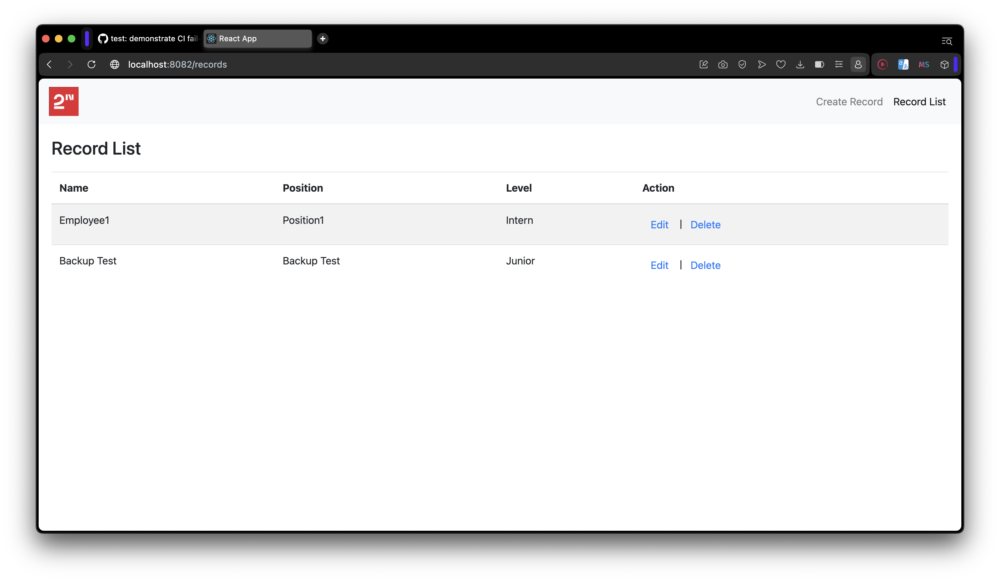

MongoDB queries also confirmed that the records were restored with the same field values:

```text
RESTORED BACKUP TEST RECORD:
name: 'Backup Test'
position: 'Backup Test'
level: 'Junior'

RESTORED EMPLOYEE1 RECORD:
name: 'Employee1'
position: 'Position1'
level: 'Intern'

TOTAL RECORDS:
2
```

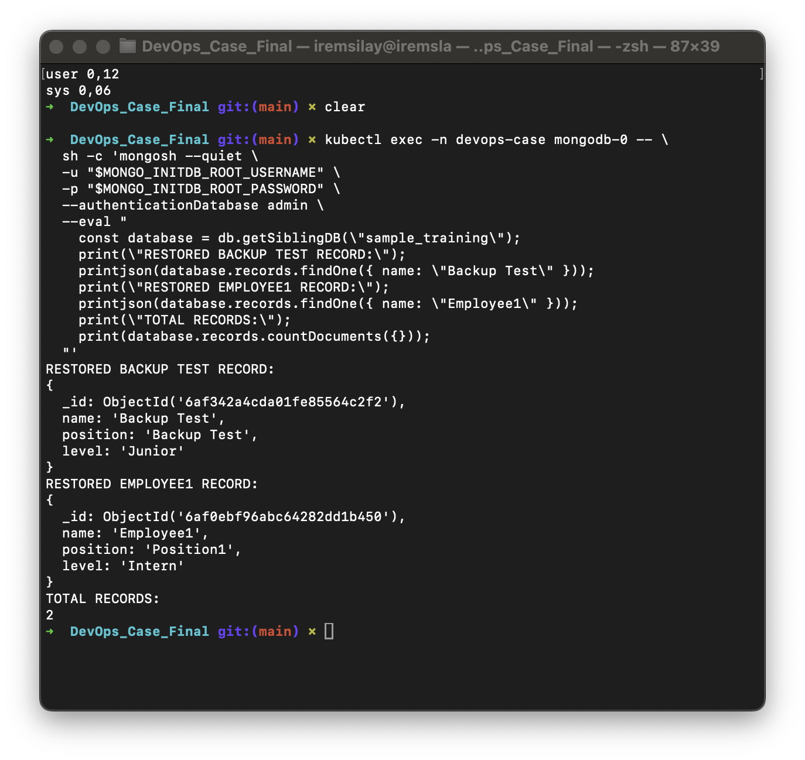

#### 7. POST-TEST SERVICE CHECK

After the test, the `github-etl` CronJob was re-enabled. During the final check, backend and frontend were `1/1 Ready`, and the MongoDB Pod was `1/1 Running`. The MongoDB Pod restart count was zero.

### 12.4 AUTOMATED BACKUP VERIFICATION

`scripts/verify-backup.sh` verifies not only checksum integrity but also whether backup archives can be restored in an isolated MongoDB environment.

The script performs the following actions:

1. Checks archive files and SHA-256 checksums.
2. Creates a temporary MongoDB 7 container in Docker with `--network none`.
3. Restores both archives into this isolated environment.
4. Checks that collections exist and are not empty.
5. Reports the result as `PASS` or `FAIL`.
6. Removes the temporary container after completion.

```bash
./scripts/verify-backup.sh backups/20261110T161624Z
```

A total of six documents were restored during the verification test:

| Collection | Restored documents |
| --- | ---: |
| `sample_training.records` | 2 |
| `sample_training.backup_restore_test` | 1 |
| `github_etl.repositories` | 3 |
| **Total** | **6** |

```text
PASS: Backup restored and verified successfully.
Backup verification completed successfully.
Cleaning up temporary MongoDB...
```

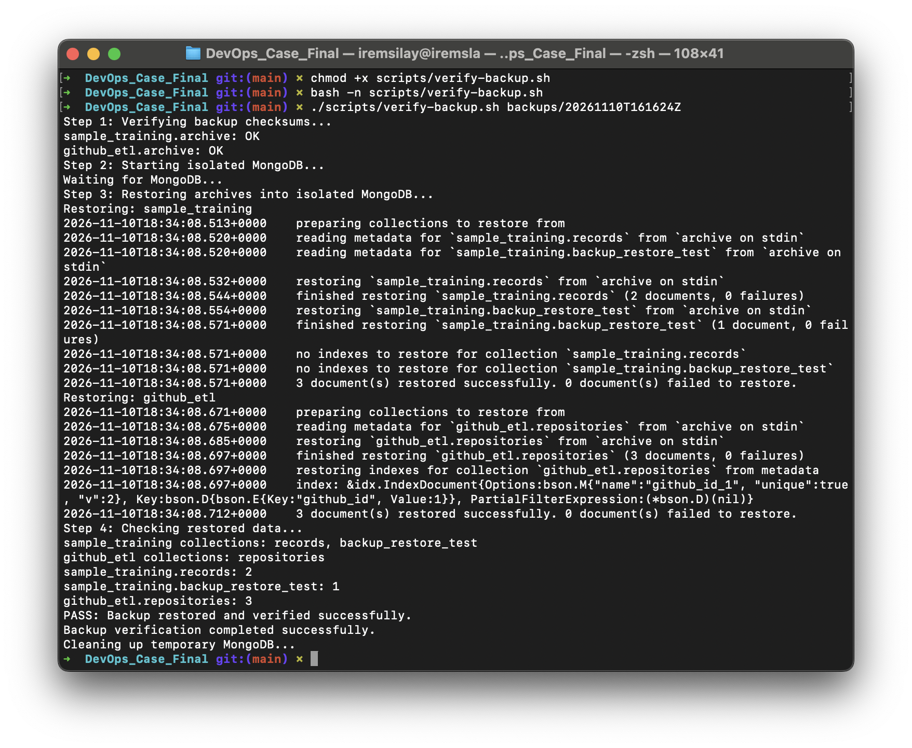

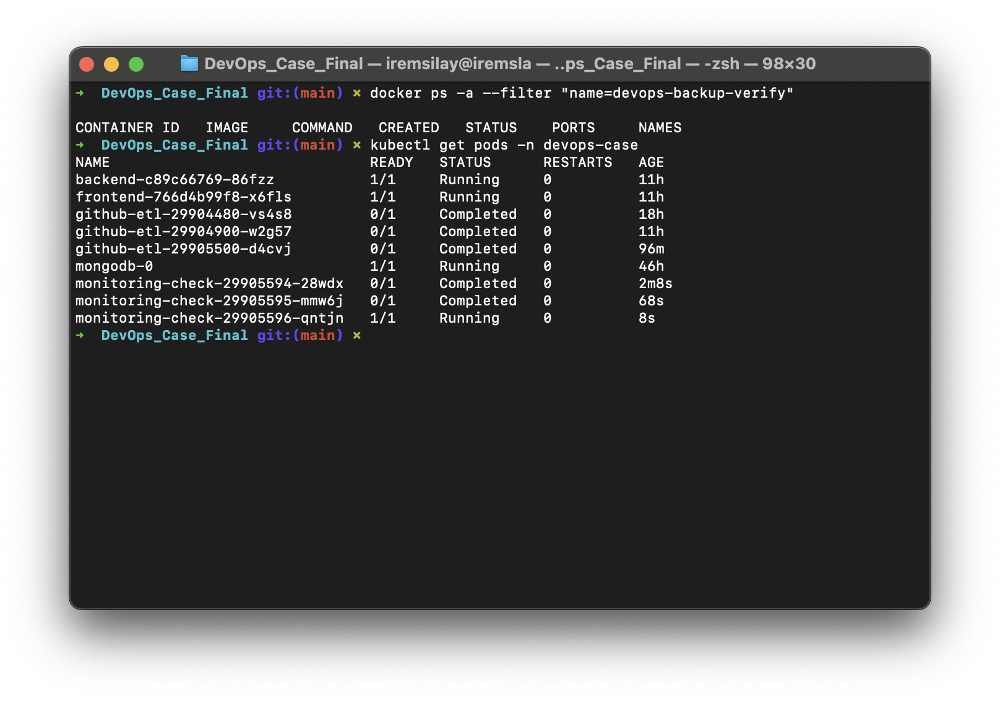

### 12.5 LIMITATIONS

- Backups are started manually; no scheduled backup exists.
- The target RPO is 24 hours, and the target RTO is 15 minutes. The current manual process does not automatically guarantee these targets.
- The 4.80-second restore duration is only the script execution time and is not an end-to-end RTO measurement.
- The retention target is seven days; automatic removal of older backups is not implemented.
- Backup files are stored outside the cluster but on the same local computer. They do not provide independent off-site protection against disk loss.
- Encrypted remote object storage, point-in-time recovery, and automated disaster recovery drills are not implemented.
- `verify-backup.sh` checks that collections are not empty but does not compare document contents or application behavior.

## 13. ROLLBACK, CLEANUP, AND SECURITY

### 13.1 ROLLBACK LIMITATIONS

After a deployment error, `deploy-local.sh` reapplies the image references recorded before deployment for backend, frontend, and ETL resources. The rollback flow and verified test evidence are available in **10.5 ROLLBACK**.

Rollback restores only Kubernetes image references. It does not restore MongoDB data, collection contents, or schema changes.

Automatic rollback is not triggered for an issue that appears after deployment completes successfully. In that case, identify the previous working commit SHA and run the script again with the previous image tag:

```bash
./scripts/deploy-local.sh sha-<previous-40-character-commit-hash>
```

Reverting the ETL CronJob image does not by itself confirm that the ETL is working correctly. The next ETL Job result must be checked separately.

### 13.2 SAFE CLEANUP

To remove the Docker Compose environment:

```bash
docker compose down
```

This command removes containers and networks while preserving the MongoDB volume.

```bash
docker compose down -v
```

This command also deletes the MongoDB volume. Do not use it when database data should be preserved.

Deleting the `devops-case` namespace in Kubernetes can cause data loss for the MongoDB PVC and related resources. Take a backup before deleting the namespace or cluster.

After a monitoring test, temporary Job and CronJob resources must be removed, the `monitoring-check` CronJob must be confirmed as not suspended, and active alert states must be checked. The `monitoring-state` ConfigMap must not be reset during normal operation.

### 13.3 SECURITY APPROACH

- Passwords, tokens, MongoDB URIs, and Slack webhook addresses are not added to the repository or container images.
- Kubernetes Secrets store sensitive values, while ConfigMaps store non-sensitive configuration.
- Backend and ETL use separate MongoDB users intended to access only their respective databases.
- Backend, frontend, and ETL containers avoid unnecessary root privileges.
- The monitoring component uses a read-only root filesystem and restricted Kubernetes ServiceAccount permissions.
- The backend is accessible only inside the cluster through a `ClusterIP` Service, and MongoDB is accessible only through a headless Service. External access is provided only through the frontend NodePort Service.
- Production dependency auditing runs in CI. Trivy scanning and SBOM generation are described in **9.6 CONTAINER IMAGE SECURITY SCANNING AND SBOM**.

### 13.4 KNOWN SECURITY LIMITATIONS

- CORS configuration is not restricted to a narrow allowlist.
- Full schema-based input validation is not implemented for the API.
- The cluster runs on a single node, and MongoDB has one replica.
- Automatic Secret rotation is not implemented.
- No NetworkPolicy is defined.
- Image signing, policy as code, and vulnerability-based image publishing blocks are not implemented.

These limitations belong to the local technical assessment environment. In a production environment, access policies, Secret management, network segmentation, high availability, and security policies must be implemented separately.

## 14. COMMON ISSUES

### FRONTEND OPENS BUT API REQUESTS FAIL

- Confirm that the frontend uses the `/api` address.
- Verify that the backend Pod is ready and that `/healthcheck/ready` returns HTTP 200.
- Check the `case-backend` Service name in the Nginx configuration and the Service resource in the same namespace.
- Check the k3d host port mapping or the `kubectl port-forward` command.

### BACKEND IS NOT READY

- Check MongoDB Pod and PVC status.
- Review MongoDB logs.
- Verify that the `backend-mongo-uri` Secret exists and that the backend user has the required permissions.
- Evaluate `/healthcheck` and `/healthcheck/ready` separately. Liveness can succeed while readiness fails because MongoDB is unavailable.

### POD IS IN `IMAGEPULLBACKOFF` STATE

- Verify that local `case-*` images were imported into the k3d cluster.
- If using a GHCR image, check that the required SHA tag exists and that the cluster can access the registry.
- Inspect Pod events for detailed errors:

```bash
kubectl describe pod <pod-name> -n devops-case
```

### ETL IS NOT RUNNING

- Verify that the `github-etl` CronJob has `suspend=false`.
- Review the status and logs of recent Jobs.
- Check the GitHub username, API request limit, and MongoDB connection.

```bash
kubectl get cronjob,jobs -n devops-case
kubectl logs -n devops-case job/<etl-job-name>
```

### SLACK NOTIFICATIONS ARE NOT RECEIVED

- Check the `monitoring-check` CronJob and recent monitoring Job logs.
- Verify that the `monitoring-slack-webhook` Secret exists.
- Check alert state and notification throttling time in the `monitoring-state` ConfigMap.
- Compare `WEBHOOK_FAILED` and `WEBHOOK_SENT` logs. Do not log or share the webhook value.

### BACKUP OR RESTORE FAILS

- Verify that the `mongodb-0` Pod is ready.
- Confirm that MongoDB users and connection Secrets are correctly configured.
- Check that archive files and `SHA256SUMS` exist.
- Remember that restore uses `--drop` and deletes existing data in target collections.

## 15. VERIFIED RESULTS AND KNOWN LIMITATIONS

### VERIFIED RESULTS

| Area | Verified result |
| --- | --- |
| Docker Compose | Frontend, backend, and MongoDB services were started successfully. |
| Web application | Create, read/list, update, and delete operations were validated through the interface. |
| Cypress | Two E2E tests completed successfully. |
| Readiness | During a MongoDB outage, readiness returned HTTP 503. When the database became available again, the backend returned to HTTP 200 without a restart. |
| Kubernetes | Frontend and backend Deployment resources were verified as `1/1 Ready`. |
| ETL | Hourly CronJob execution, initial data import, and duplicate-free updates using `github_id` were verified. |
| Monitoring | Backend alerting, Slack notification, 15-minute throttling, and the `RESOLVED` notification were tested end to end. |
| Backup and restore | Record creation, backup, collection deletion, data loss, restore, and validation of restored data were completed. |
| Backup verification | Checksum validation and archive restore were completed successfully in an isolated MongoDB container. |
| Advanced security | Trivy image scanning and CycloneDX SBOM generation were verified in CI. |

These results apply to the specified test environment and test time. In a new installation, the relevant commands should be run again to verify the current state.

### KNOWN LIMITATIONS

- This environment is not a public cloud production service; it was validated on a local k3d cluster running on Docker Desktop.
- MongoDB runs with a single replica. No replica set, automatic failover, or multi-node setup is available.
- CI automates image creation, while Kubernetes deployment is started manually.
- Helm/Kustomize, Terraform, Argo CD/Flux, and HPA/PDB are not implemented.
- Prometheus/Grafana, centralized log collection, and external cluster availability monitoring are not available.
- A narrow CORS allowlist, full API schema validation, NetworkPolicy, and automatic Secret rotation are not implemented.
- Backups are started manually. Automatic retention cleanup, encrypted remote storage, and point-in-time recovery are not available.
- Security scanning is intended for reporting; detected vulnerabilities do not automatically block image publishing.

## 16. ADDITIONAL DOCUMENTATION AND SUBMISSION EVIDENCE

- [Initial findings and applied improvements](docs/findings.md)
- [English findings document](docs/findings_en.md)
- [Architecture description](docs/architecture.md)
- [Editable architecture diagram](docs/architecture.drawio)
- [Backup and restore runbook](docs/backup-restore.md)
- [Screenshots](docs/screenshots/)
- [Turkish submission evidence](TESLIM_KANITLARI.md)
- [English submission evidence](SUBMISSION_EVIDENCE.md)
- [Turkish case answers](CASE_SONU_CEVAPLARI.md)
- [English case answers](CASE_END_ANSWERS.md)
- [Turkish assessment document](DevOps_Teknik_Case_TR.docx)
- [English assessment document](DevOps_Technical_Case_EN.docx)