# SUBMISSION EVIDENCE

## 1. MERN Application and CRUD Verification

Record listing, creation, and update operations were tested through the React interface. The application was run in the Kubernetes environment and accessed through a browser.

### 1.1. Record list

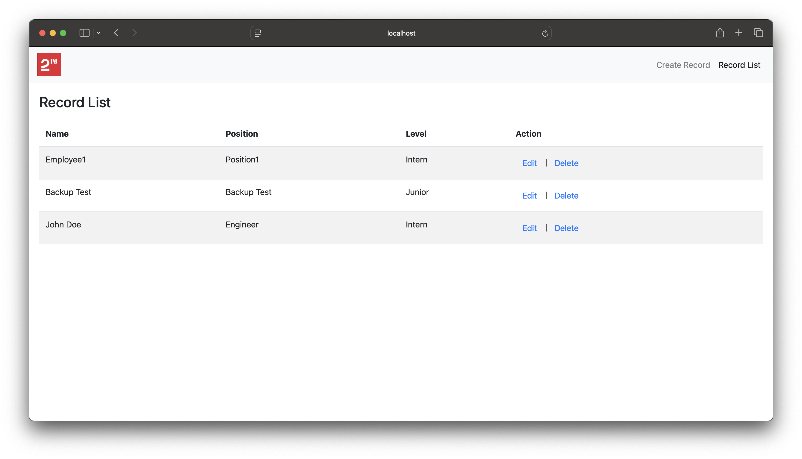

The React application's `Record List` page displays records retrieved from MongoDB. Each record's name, position, and level are listed, with `Edit` and `Delete` options provided for each record.

### 1.2. Creating a new record

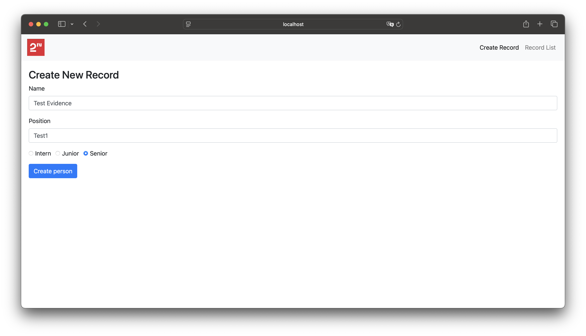

A new record was prepared on the `Create Record` page with the following details:

- **Name:** Test Evidence
- **Position:** Test1
- **Level:** Senior

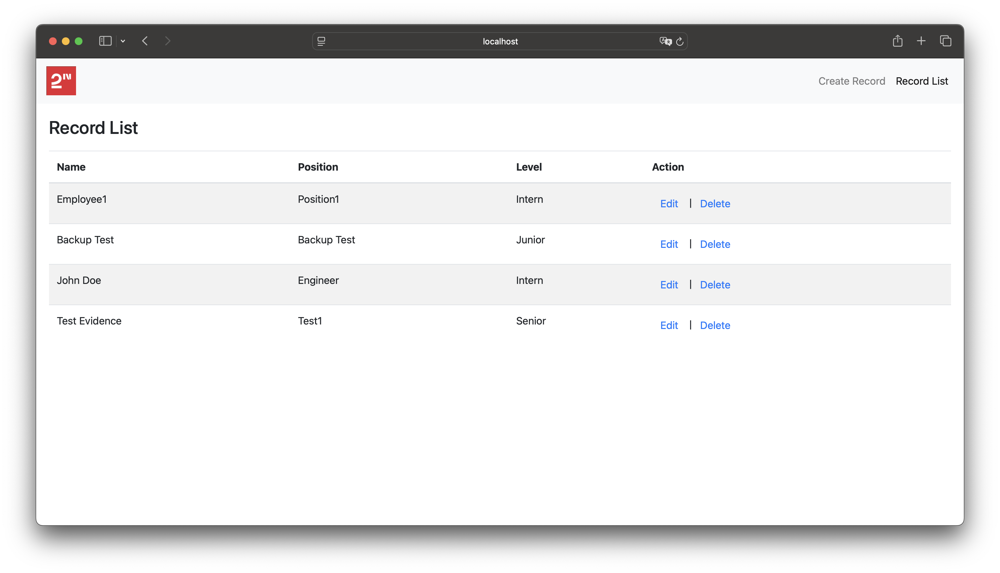

After the form was submitted, the `Test Evidence` record was confirmed to appear on the `Record List` page. This verified successful record creation and listing of the newly created record.

### 1.3. Updating a record

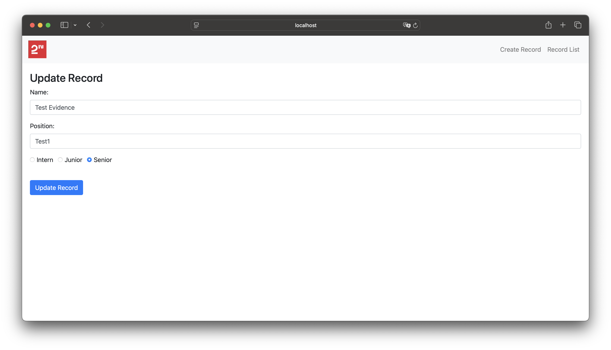

The update page was opened using the `Edit` option for the newly created `Test Evidence` record. The existing record details were displayed in the form.

The record's position was changed from `Test1` to `DevOps Engineer`. The name and level were kept unchanged.

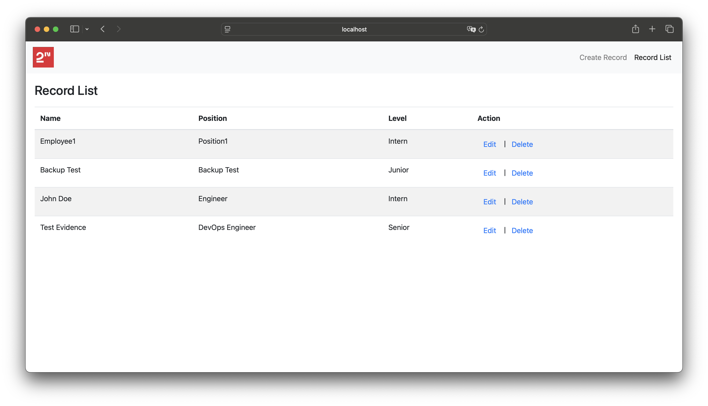

After the update was completed, the `Test Evidence` record was confirmed to appear on the `Record List` page with its updated position.

**Test result:** Record listing, creation, and update operations were successful in the React interface. Deletion was not separately documented in this group of screenshots.

---

## 2. Docker Compose Verification

Building and running the MERN application in containers using Docker Compose was verified. Separate Docker images were built for the backend and frontend, and the services were started together with MongoDB.

### 2.1. Building Docker images

Command used:

```bash
docker compose up -d --build
```

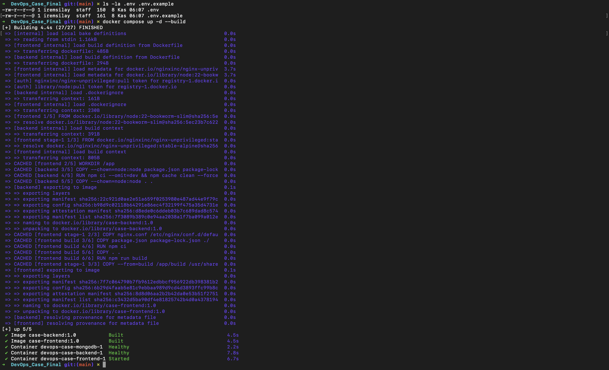

The backend and frontend images were built successfully during the Docker Compose operation.

The build output shows that the `case-backend:1.0` and `case-frontend:1.0` images were created, the MongoDB and backend containers passed their health checks, and the frontend container was started.

### 2.2. Verifying container status

Command used:

```bash
docker compose ps
```

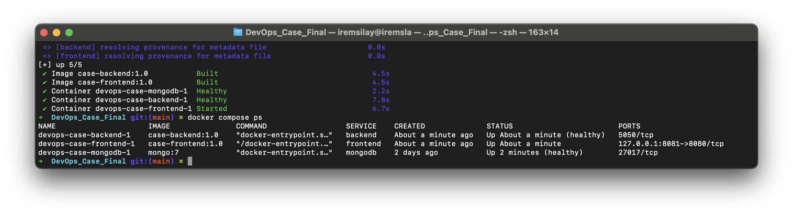

Three services were verified in the Docker Compose environment:

| Service | Container | Verified status |
| --- | --- | --- |
| MongoDB | `devops-case-mongodb-1` | Up, healthy |
| Backend | `devops-case-backend-1` | Up, healthy |
| Frontend | `devops-case-frontend-1` | Up |

The frontend service was mapped to `127.0.0.1:8081` on the local computer. The backend and MongoDB services run within the Docker network.

**Test result:** All three services were successfully started with Docker Compose. MongoDB and the backend passed their health checks, and the frontend container was confirmed to be running.

---

## 3. Kubernetes Deployment Verification

The application was run in the local `k3d-devops-case` Kubernetes cluster under the `devops-case` namespace.

The frontend and backend are managed through `Deployment` resources, MongoDB through a `StatefulSet`, and ETL and monitoring tasks through `CronJob` resources.

### 3.1. Workload and Pod status

Command used:

```bash
kubectl get deployments,statefulsets,pods -n devops-case
```

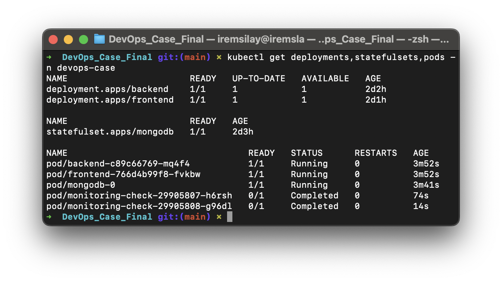

The following states were verified on Kubernetes:

| Component | Kubernetes resource | Verified status |
| --- | --- | --- |
| Backend | Deployment | 1/1 Available |
| Frontend | Deployment | 1/1 Available |
| MongoDB | StatefulSet | 1/1 Ready |
| Backend Pod | Pod | Running |
| Frontend Pod | Pod | Running |
| MongoDB Pod | Pod | Running |

The backend, frontend, and MongoDB Pods are shown running with zero restarts.

Completed Pods belonging to monitoring Jobs are in the `Completed` state. This indicates that the short-lived Job tasks finished successfully.

### 3.2. Kubernetes Services and access points

Command used:

```bash
kubectl get services -n devops-case -o wide
```

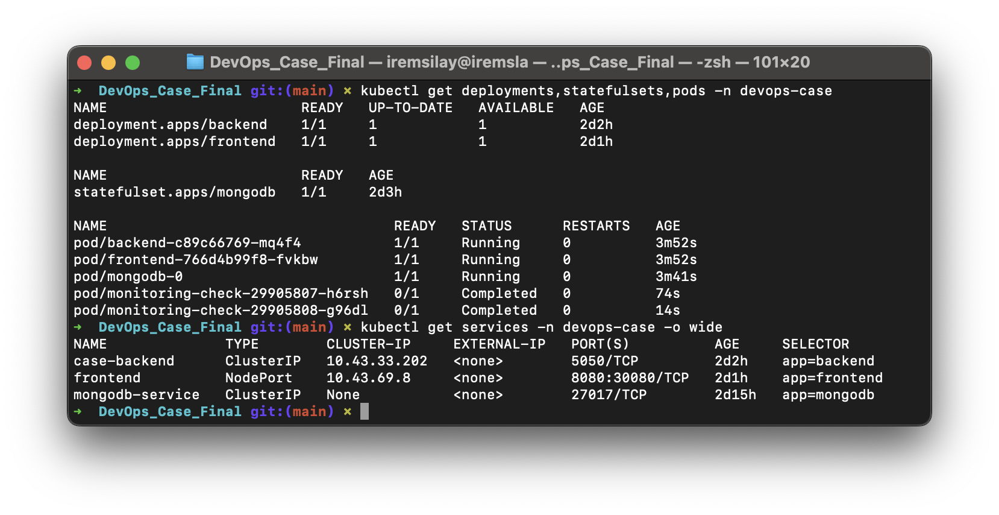

The application's Kubernetes Services are configured as follows:

| Service | Type | Port | Description |
| --- | --- | --- | --- |
| `frontend` | NodePort | 8080:30080/TCP | Provides access to the application's user interface. |
| `case-backend` | ClusterIP | 5050/TCP | Provides access to the backend API through the frontend Nginx reverse proxy. |
| `mongodb-service` | Headless Service | 27017/TCP | Allows backend and ETL workloads to connect to the MongoDB Pod through DNS. |

The `CLUSTER-IP` value of `None` for `mongodb-service` shows that the Service is configured as headless.

**External access:** The frontend is accessible through NodePort. No NodePort or LoadBalancer providing direct external access has been defined for the backend or MongoDB.

### 3.3. CronJob and Job status

Commands used:

```bash
kubectl get cronjobs -n devops-case

kubectl get jobs -n devops-case \
  --sort-by=.metadata.creationTimestamp
```

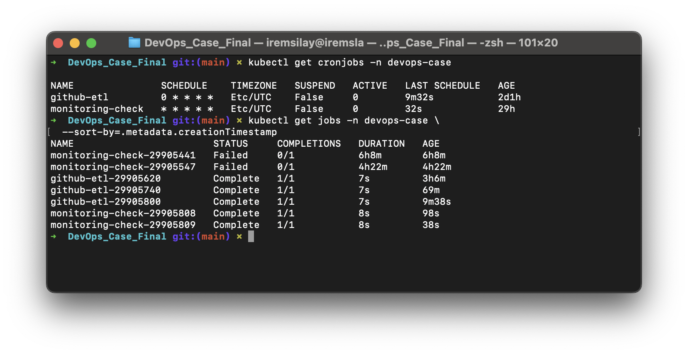

There are two scheduled workloads in the Kubernetes environment:

| CronJob | Schedule | Description |
| --- | --- | --- |
| `github-etl` | `0 * * * *` | Transfers GitHub repository data to MongoDB hourly. |
| `monitoring-check` | `* * * * *` | Checks backend and ETL status every minute. |

Both CronJobs were confirmed to have `TIMEZONE=Etc/UTC` and `SUSPEND=False`.

The screenshot shows that the latest GitHub ETL and monitoring Jobs finished successfully with the `Complete` status.

The Job list also contains two earlier failed monitoring runs. Their exact failure causes could not be determined because the corresponding Pods no longer existed. Subsequent monitoring runs completed successfully.

**Test result:** The configuration and current runtime status of Kubernetes Deployment, StatefulSet, Pod, Service, CronJob, and Job resources were verified. The backend, frontend, and MongoDB services are running in a healthy state.

## 4. Python ETL Verification

The Python ETL application's execution through a Kubernetes CronJob, retrieval of repository data from the GitHub REST API, storage in MongoDB, and prevention of duplicate records on repeated execution were verified.

The tests were performed by creating manual Jobs from the `github-etl` CronJob running in the `devops-case` namespace. Existing MongoDB data was not deleted.

### 4.1. ETL execution and MongoDB data verification

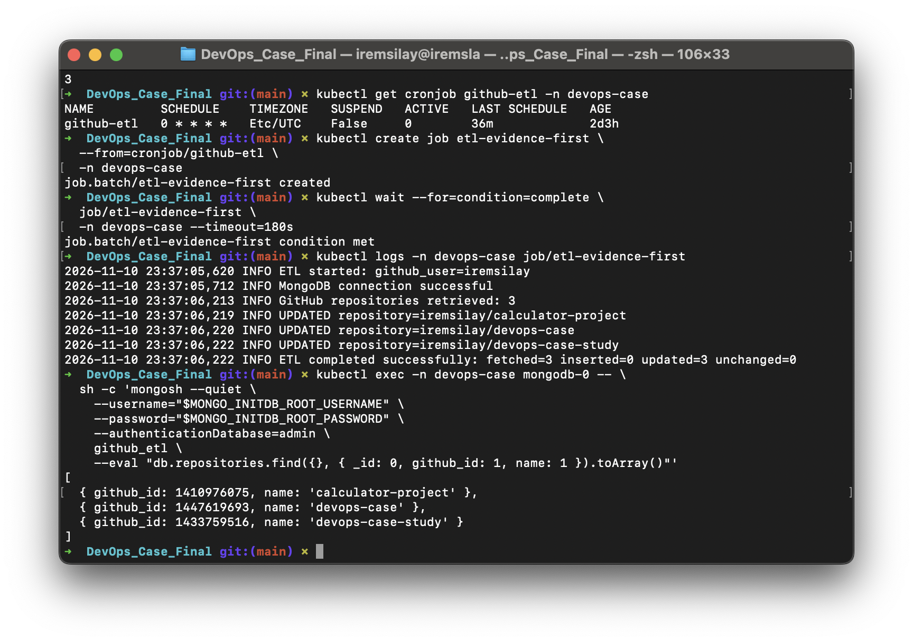

The `github-etl` CronJob was confirmed to be configured for hourly execution (`0 * * * *`, UTC) and to be enabled.

A manual Job named `etl-evidence-first` was created from the CronJob template:

```bash
kubectl create job etl-evidence-first \
  --from=cronjob/github-etl \
  -n devops-case

kubectl wait --for=condition=complete \
  job/etl-evidence-first \
  -n devops-case --timeout=180s

kubectl logs -n devops-case job/etl-evidence-first
```

The ETL logs show a successful MongoDB connection and retrieval of information for 3 repositories from the GitHub REST API.

**Actual ETL result:**

```text
GitHub repositories retrieved: 3
UPDATED repository=iremsilay/calculator-project
UPDATED repository=iremsilay/devops-case
UPDATED repository=iremsilay/devops-case-study
ETL completed successfully: fetched=3 inserted=0 updated=3 unchanged=0
```

This run updated 3 existing repositories and inserted no new documents.

The `github_etl.repositories` collection in MongoDB was queried, and the following records were verified:

| Repository | github_id |
|---|---:|
| calculator-project | 1410976075 |
| devops-case | 1447619693 |
| devops-case-study | 1433759516 |

This provided evidence that the ETL Job successfully retrieved GitHub data and processed repository records in MongoDB.

### 4.2. Repeated execution and upsert verification

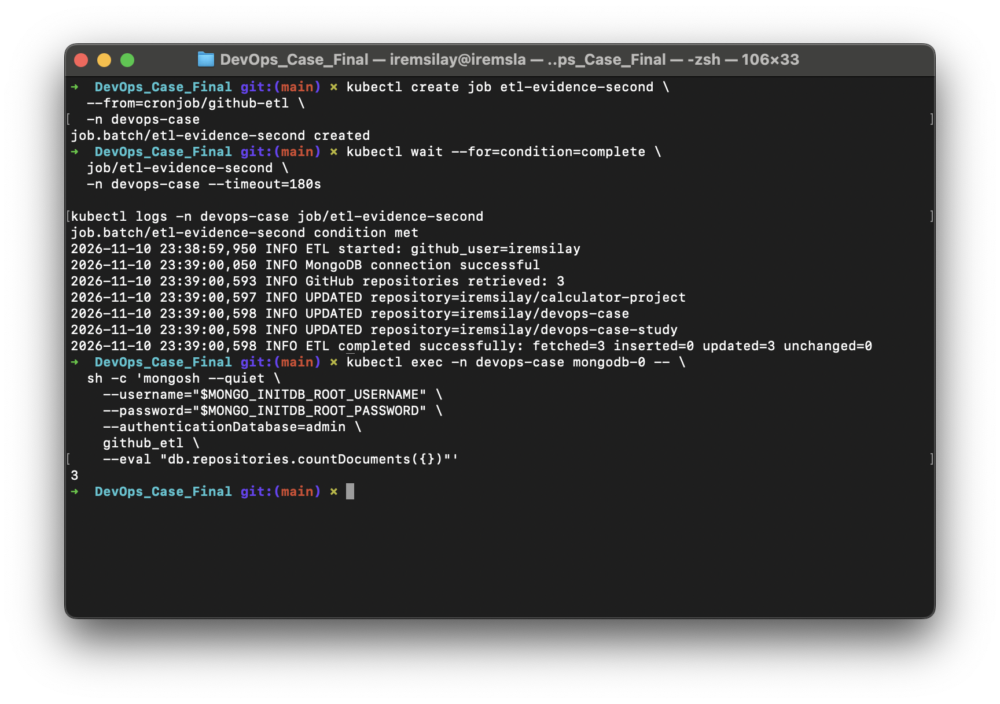

ETL was run again by creating a second manual Job from the same CronJob template:

```bash
kubectl create job etl-evidence-second \
  --from=cronjob/github-etl \
  -n devops-case

kubectl wait --for=condition=complete \
  job/etl-evidence-second \
  -n devops-case --timeout=180s

kubectl logs -n devops-case job/etl-evidence-second
```

During the second run, ETL retrieved the same 3 repositories again and updated the existing records.

**Actual ETL result:**

```text
GitHub repositories retrieved: 3
UPDATED repository=iremsilay/calculator-project
UPDATED repository=iremsilay/devops-case
UPDATED repository=iremsilay/devops-case-study
ETL completed successfully: fetched=3 inserted=0 updated=3 unchanged=0
```

After the second run, the record count in MongoDB was checked again:

```javascript
db.repositories.countDocuments({})
```

Result:

```text
3
```

Both the first and second runs processed 3 repositories, inserted no new documents, and preserved the collection's record count at 3.

This test confirms that processing the same repository data again did not create duplicate documents.

### 4.3. MongoDB unique index verification

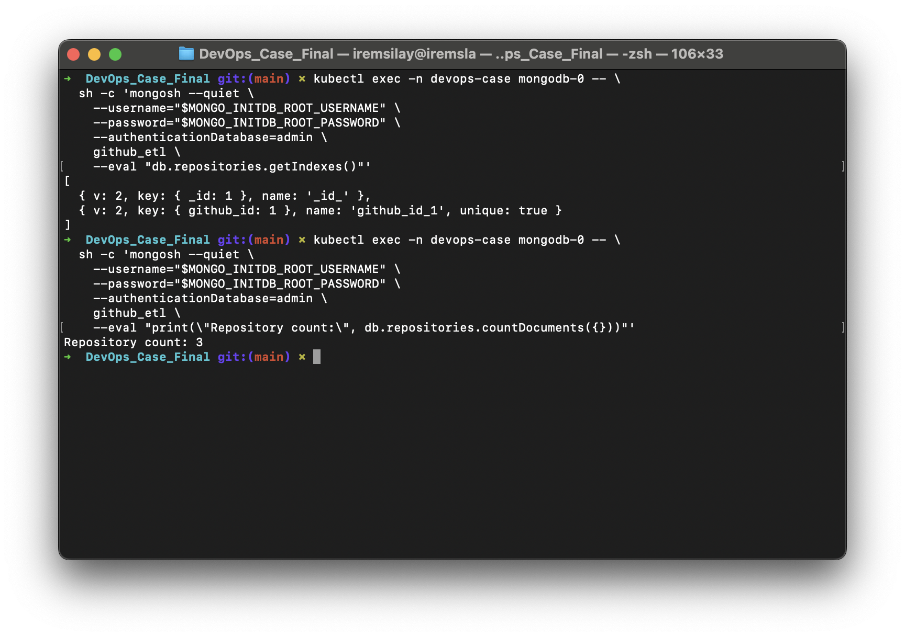

Indexes on the `github_etl.repositories` collection in MongoDB were checked:

```javascript
db.repositories.getIndexes()
```

The query result confirmed the following unique index on the `github_id` field:

```javascript
{
  v: 2,
  key: { github_id: 1 },
  name: "github_id_1",
  unique: true
}
```

This index prevents multiple repository documents with the same `github_id` value from being created in the collection.

The record count was also checked:

```text
Repository count: 3
```

**Test result:** The Python ETL application was confirmed to run successfully on Kubernetes, retrieve information for 3 repositories from the GitHub REST API, update existing MongoDB documents, preserve the record count on repeated execution, and have a unique index on `github_id`.

Since this test was performed on existing records, the initial insertion scenario into an empty database was not tested separately.

## 5. CI/CD

### 5.1 Successful CI Pipeline

**Pipeline history:**

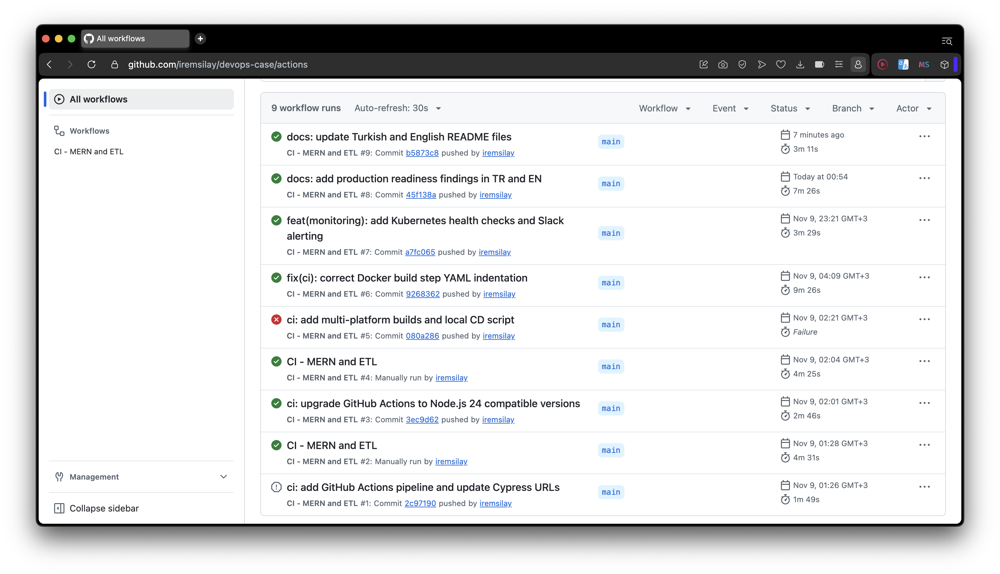

**Job results:**

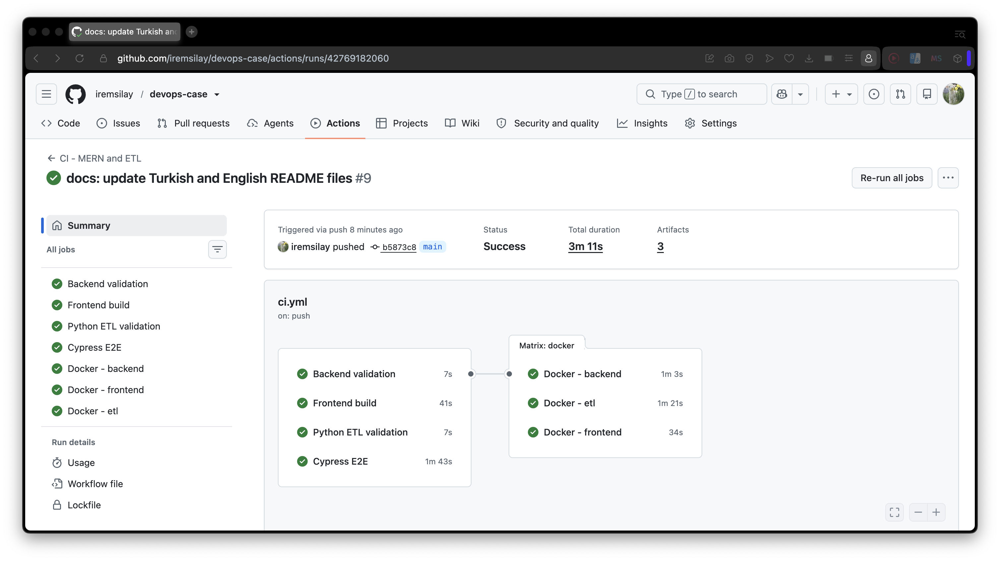

- **Workflow:** CI - MERN and ETL (#9)
- **Commit:** `b5873c8`
- **Result:** Success (3 minutes 11 seconds)
- **Description:** Backend, frontend, Python ETL, Cypress E2E, and Docker build stages completed successfully.

### 5.2 GHCR Image Publication

**Published packages:**

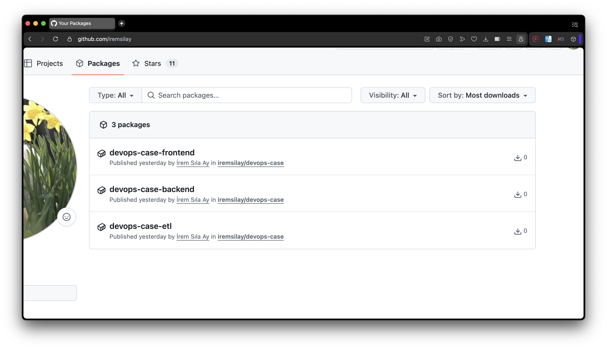

**Image version details:**

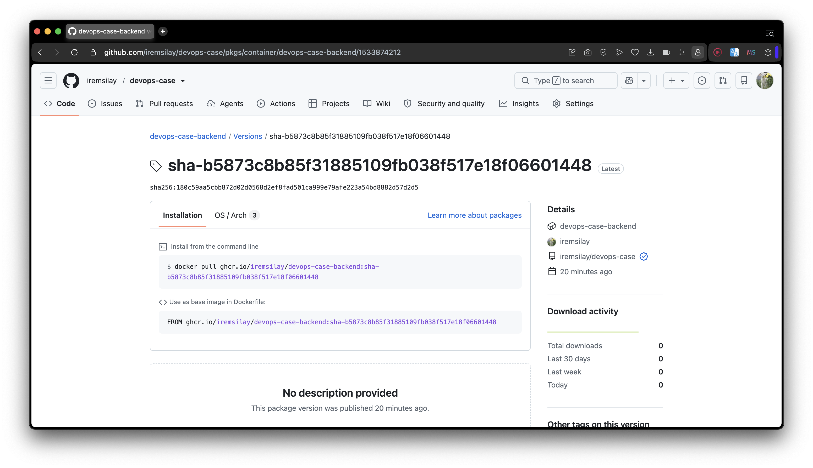

- **Verified tag:** `sha-b5873c8b85f31885109fb038f517e18f06601448`
- **Description:** Backend, frontend, and ETL images were published to GHCR. The backend image was confirmed to be versioned with the commit SHA and to have the `latest` tag.

### 5.3 Fail-Fast Verification

- **Pull Request:** [#1 — CI fail-fast test](https://github.com/iremsilay/devops-case/pull/1)
- **Branch:** `test/ci-fail-fast`
- **Commit:** `4cd5e7d`

**Check results:**

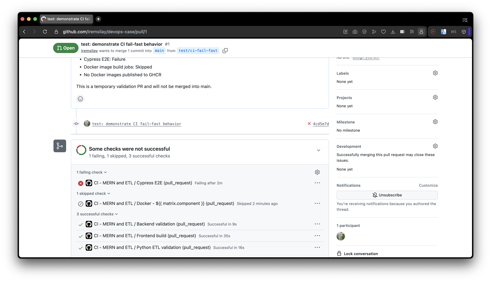

**Cypress error log:**

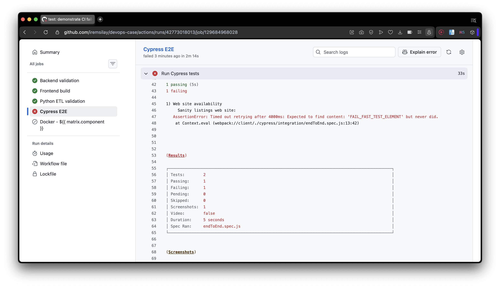

- **Cypress result:** Failure (intentional assertion failure)
- **Docker result:** Skipped
- **Other jobs:** Backend, frontend, and Python ETL validations succeeded.
- **Description:** A Cypress test was deliberately made to fail in a temporary Pull Request. It was verified that when Cypress failed, the Docker job did not start and the image publication stage was not reached. The test changes were not included in the `main` branch.

### 5.4 Kubernetes CD Deployment

**State before deployment:**

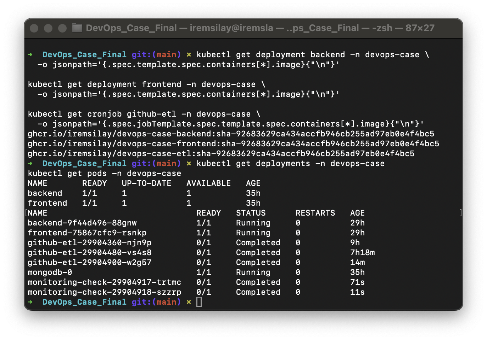

**Successful deployment:**

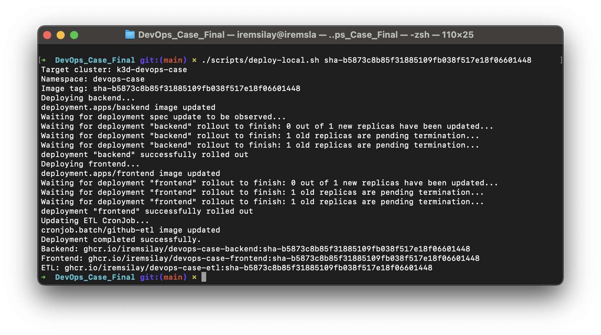

**Post-deployment verification:**

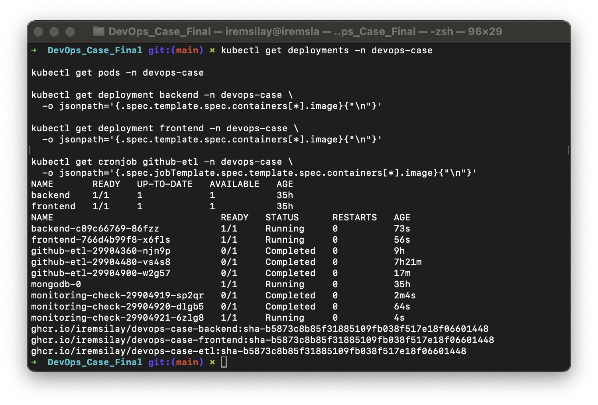

- **Cluster:** `k3d-devops-case`
- **Namespace:** `devops-case`
- **Previous image tag:** `sha-92683629ca434accfb946cb255ad97eb0e4f4bc5`
- **New image tag:** `sha-b5873c8b85f31885109fb038f517e18f06601448`
- **Result:** Backend and frontend rollouts succeeded, and the ETL CronJob image was updated.
- **Verification:** Backend and frontend Deployment resources are `1/1 Ready`; all three image references use the new SHA version.
- **Description:** The SHA-based image version published to GHCR by GitHub Actions was applied to the local Kubernetes cluster through `scripts/deploy-local.sh`. Kubernetes resources were confirmed to have switched to the new version after deployment. CD is triggered manually.

### 5.5 Automatic Rollback Verification

**Rollback trigger evidence:**

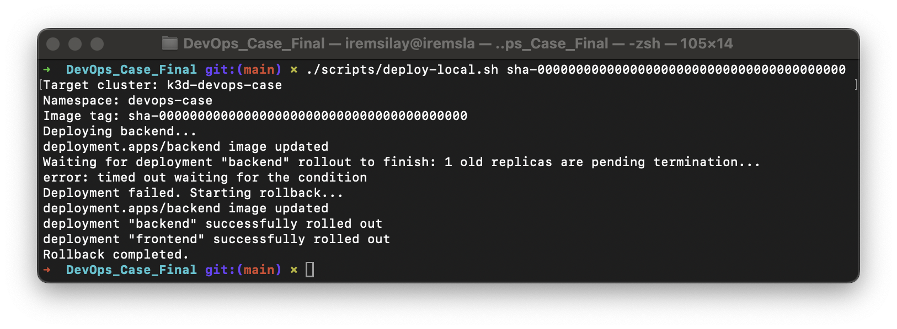

**Post-rollback verification:**

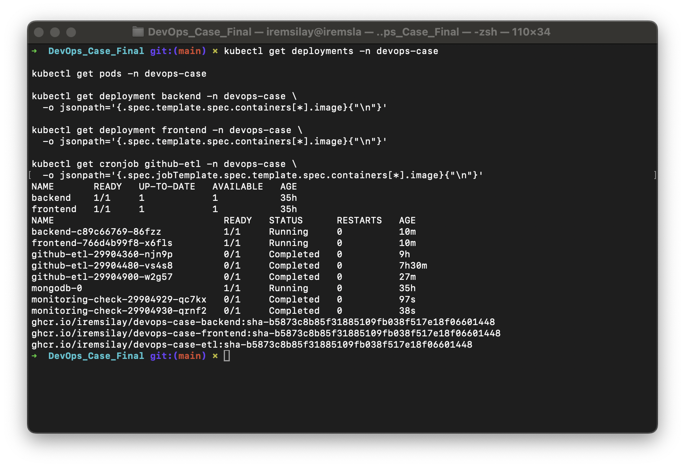

- **Cluster:** `k3d-devops-case`
- **Healthy image tag:** `sha-b5873c8b85f31885109fb038f517e18f06601448`
- **Invalid image tag:** `sha-0000000000000000000000000000000000000000`
- **Error:** Backend rollout timeout.
- **Script result:** `Rollback completed.`
- **Description:** Deployment was started with an image tag that did not exist in GHCR. When the backend rollout failed, the script automatically executed the rollback function. Backend and frontend rollout checks completed successfully. Kubernetes image references and Pod status were also verified.

## 6. Backup and Restore

MongoDB backup and restore were verified on 10 November 2026 in the local Kubernetes environment through a real data-loss scenario performed using the React application.

**Test environment:** `k3d-devops-case` / `devops-case`  
**MongoDB Pod:** `mongodb-0`  
**Backup directory:** `backups/20261110T161624Z`  
**Test record:** `Backup Test`  
**Result:** Successful

### 6.1. Creating a Record Through the React Interface

An employee record named `Backup Test` was created in the React application and displayed on the `Record List` page.

Record details:

- Name: `Backup Test`
- Position: `Backup Test`
- Level: `Junior`

The same record was also verified in MongoDB. Before the backup, the `sample_training.records` collection contained 2 records.


### 6.2. Taking a Backup and Verifying Integrity

After temporarily suspending the ETL CronJob, the following command was run:

```bash
./scripts/backup.sh
```

Backup directory:

```text
backups/20261110T161624Z
```

Files created:

- `sample_training.archive`
- `github_etl.archive`
- `SHA256SUMS`

SHA-256 verification succeeded for both archives:

```text
sample_training.archive: OK
github_etl.archive: OK
```

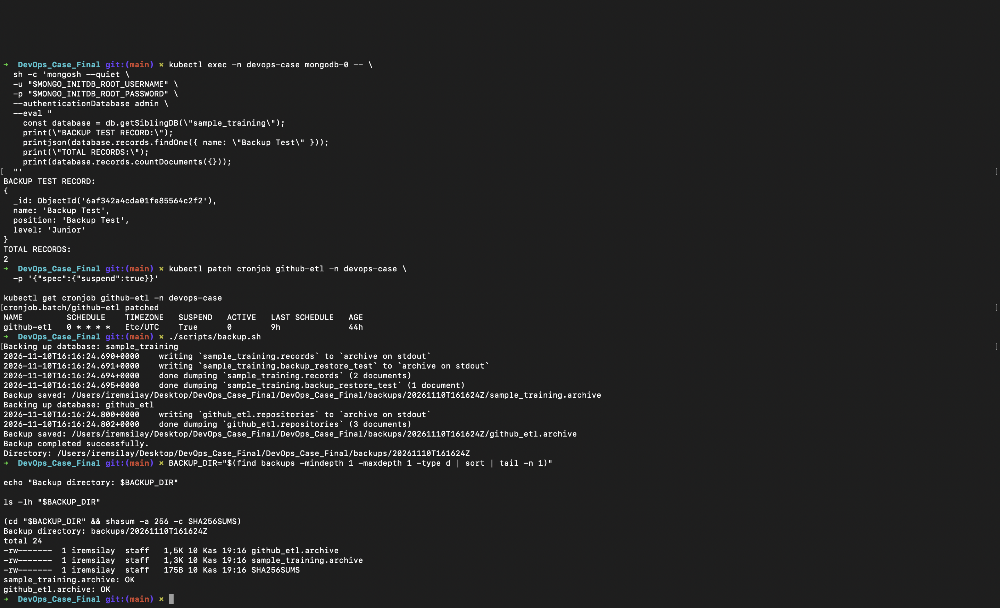

### 6.3. Dropping the MongoDB Collection

The `sample_training.records` collection used by the React application was dropped in MongoDB.

```text
RECORDS BEFORE DROP:
2

COLLECTION DROPPED:
true

RECORDS AFTER DROP:
0
```

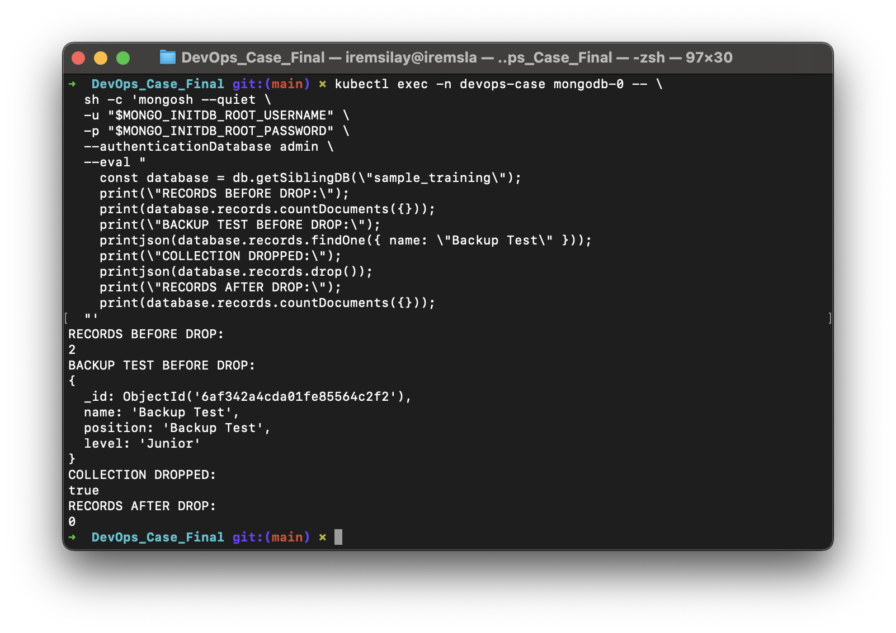

### 6.4. Verifying Data Loss in the Interface and MongoDB

After the collection was dropped, the `Record List` page in the React application was refreshed. The `Backup Test` and `Employee1` records were no longer listed.

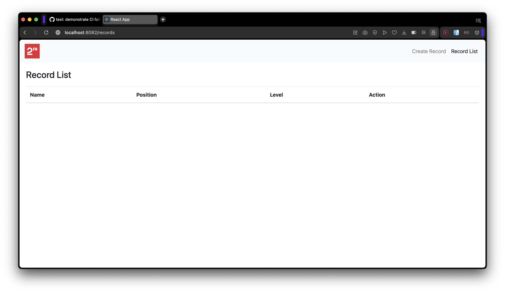

The MongoDB query confirmed the same result:

```text
BACKUP TEST AFTER DELETION:
null

TOTAL RECORDS:
0
```

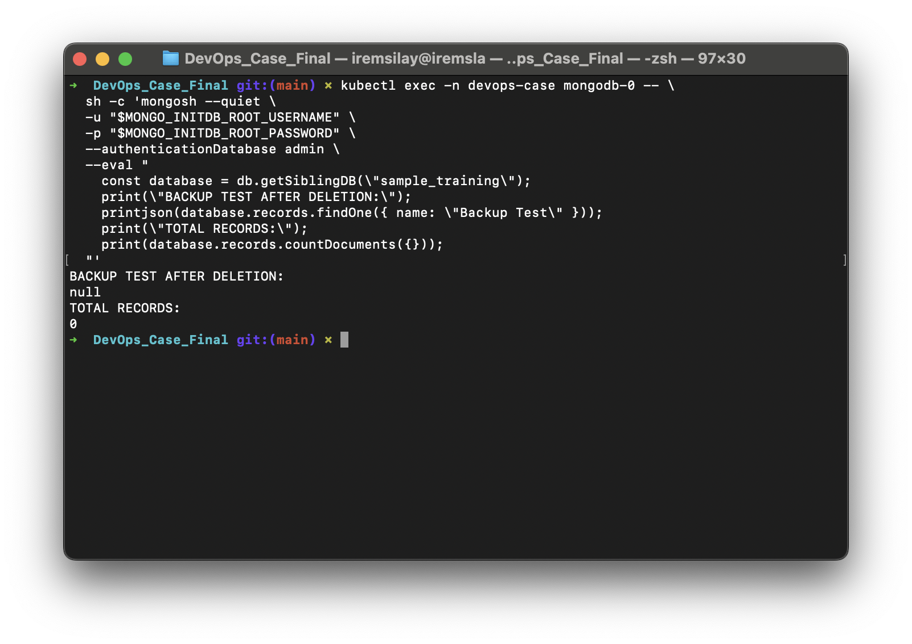

### 6.5. Restoring from the Backup and Measuring Duration

The following command was run:

```bash
/usr/bin/time -p ./scripts/restore.sh backups/20261110T161624Z
```

After SHA-256 verification and user confirmation, data was restored using `mongorestore --drop`.

**Actual restore results:**

| Database | Documents restored | Failed documents |
| --- | ---: | ---: |
| `sample_training` | 3 | 0 |
| `github_etl` | 3 | 0 |
| **Total** | **6** | **0** |

```text
Restore completed successfully.

real 4,80
user 0,12
sys 0,06
```

The measured 4.80 seconds is the total execution time of the restore script, including user confirmation. It is not an end-to-end RTO measurement.

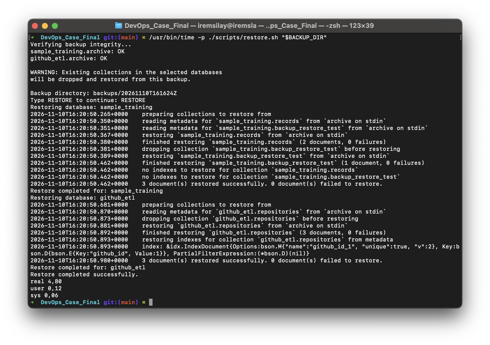

### 6.6. Verifying Recovered Data in the Interface and MongoDB

After the restore, the React application was refreshed, and the `Backup Test` and `Employee1` records were confirmed to be listed again.

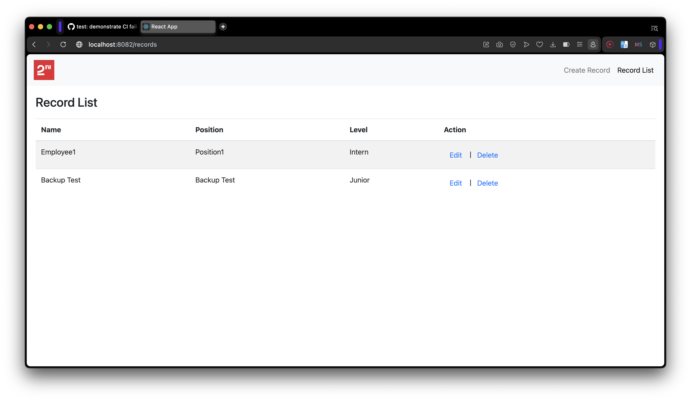

The same records were queried again in MongoDB.

```text
RESTORED BACKUP TEST RECORD:
name: 'Backup Test'
position: 'Backup Test'
level: 'Junior'

RESTORED EMPLOYEE1 RECORD:
name: 'Employee1'
position: 'Position1'
level: 'Intern'

TOTAL RECORDS:
2
```

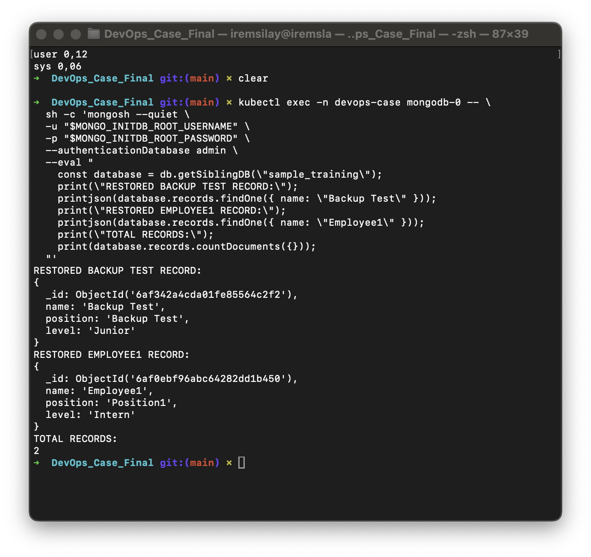

### 6.7. System Status After the Test

The ETL CronJob was re-enabled after restore verification.

The final Kubernetes checks returned the following results:

- `github-etl`: `SUSPEND=False`, `ACTIVE=0`
- Backend: `1/1 Ready`
- Frontend: `1/1 Ready`
- MongoDB: `1/1 Running`, `0` restarts

### 6.8. Overall Result

**The Core 8 backup and restore test was successful.**

All six stages required by the technical case document were completed. Records created through the React interface disappeared when the MongoDB collection was dropped and reappeared in both the application interface and MongoDB after restoration from the backup.

A total of 6 documents were restored without errors. The restore script's execution time was 4.80 seconds.

**Target RPO:** 24 hours  
**Target RTO:** 15 minutes  
**Target retention:** 7 days

These values are recommended targets for production. They are not automatically guaranteed by the current manual system.

Operational procedures and limitations are described in `docs/backup-restore.md`.

### 7.1 Advanced 5 — Container Security Scanning and SBOM

Trivy-based image vulnerability scanning and CycloneDX SBOM generation were added to the CI pipeline.

Three separate Security jobs for the backend, frontend, and ETL ran successfully.

**43 — Successful completion of Security jobs**

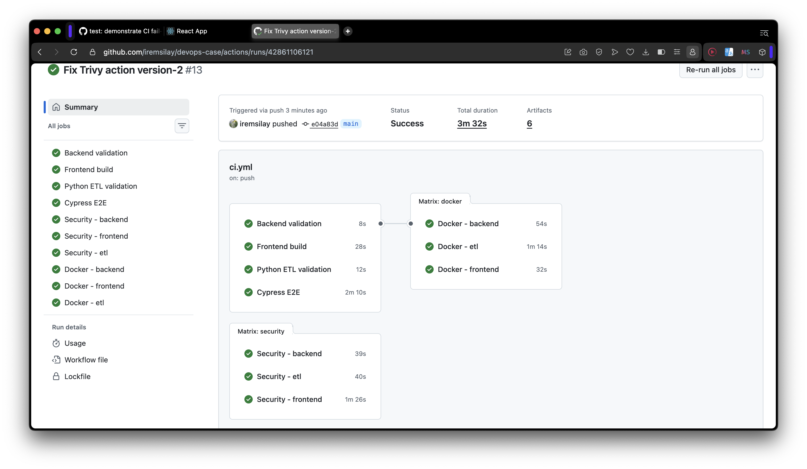

The GitHub Actions workflow shows that the backend, frontend, and ETL security jobs completed successfully.

**44 — Trivy scanning and CycloneDX SBOM generation**

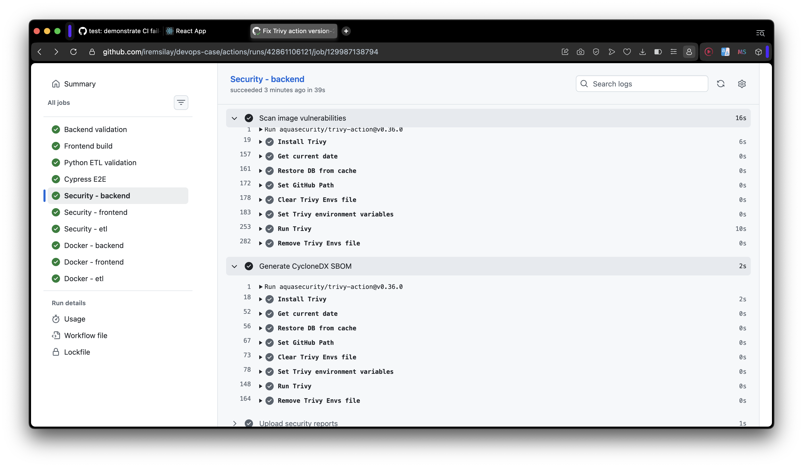

Image vulnerability scanning and CycloneDX SBOM generation were confirmed to run successfully in the Backend Security job.

**45 — Security artifacts**

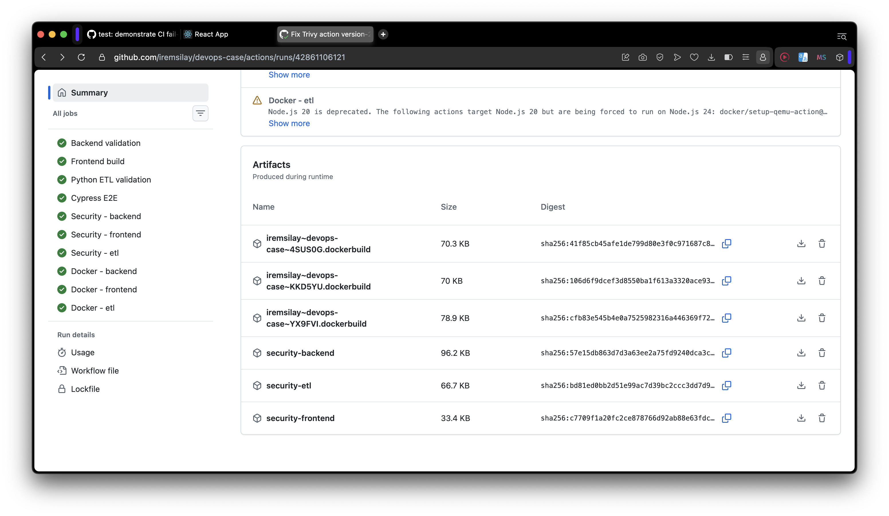

GitHub Actions shows that the `security-backend`, `security-frontend`, and `security-etl` artifacts were created.

Each artifact contains the Trivy JSON security report and CycloneDX SBOM file for the corresponding image.

**Result:** Automated security scanning and SBOM generation were implemented for three Docker images under Advanced 5 and verified in CI. Vulnerabilities are reported, but publication is not automatically blocked.

**Workflow:** [GitHub Actions Run #13](https://github.com/iremsilay/devops-case/actions/runs/42861106121)

### 7.2. Advanced 7 — Disaster Recovery Verification

In addition to the actual backup/restore drill performed under Core 8, automated restore validation in an isolated environment was implemented through `scripts/verify-backup.sh`.

**46 — Backup integrity and successful restore verification**

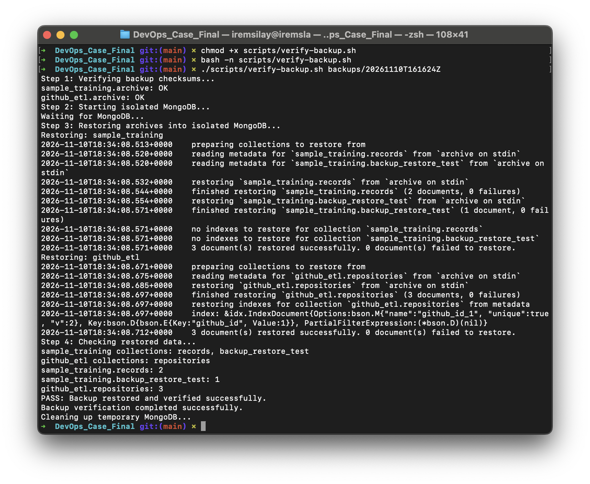

The script performed SHA-256 verification of the `backups/20261110T161624Z` backup and restored the two MongoDB databases to a temporary MongoDB container.

A total of 6 documents were successfully verified: 3 in the `sample_training` database and 3 in the `github_etl` database.

Result: `PASS: Backup restored and verified successfully.`

**48 — Cleanup of the isolated test environment**

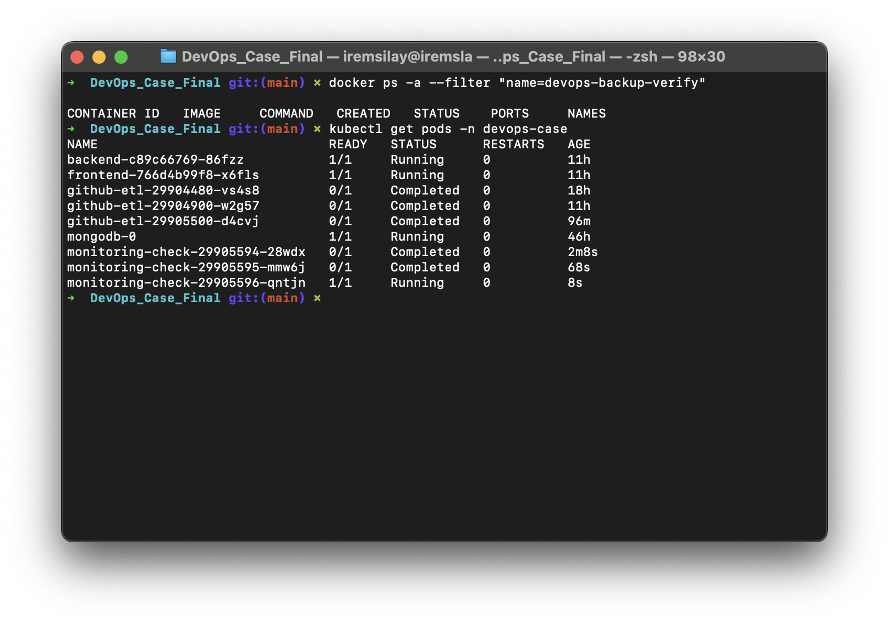

The output of `docker ps -a --filter "name=devops-backup-verify"` shows that no temporary container remains.

The output of `kubectl get pods -n devops-case` shows that the backend, frontend, and MongoDB services continue running.

**Result:** Under Advanced 7, backup archives stored outside the cluster were confirmed to be restorable in an isolated MongoDB environment. The test was started manually, while the restore and cleanup steps were performed automatically.

Scheduled backups, remote backups, and point-in-time recovery were not implemented.

### 7.3. Advanced 4 — Observability and Alert Verification

Backend failure detection, Slack alert notifications, 15-minute notification throttling, and recovery were tested using the monitoring system running on Kubernetes.

**49 — Healthy monitoring and service status**

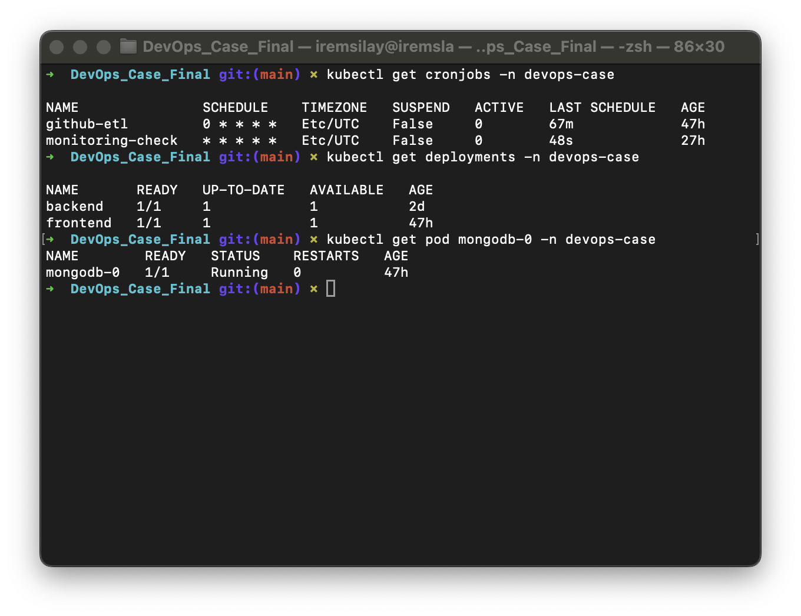

The `github-etl` and `monitoring-check` CronJobs were confirmed to be enabled, the backend and frontend Deployments were `1/1 Available`, and the MongoDB Pod was `1/1 Running`.

**50 — Healthy monitoring logs**

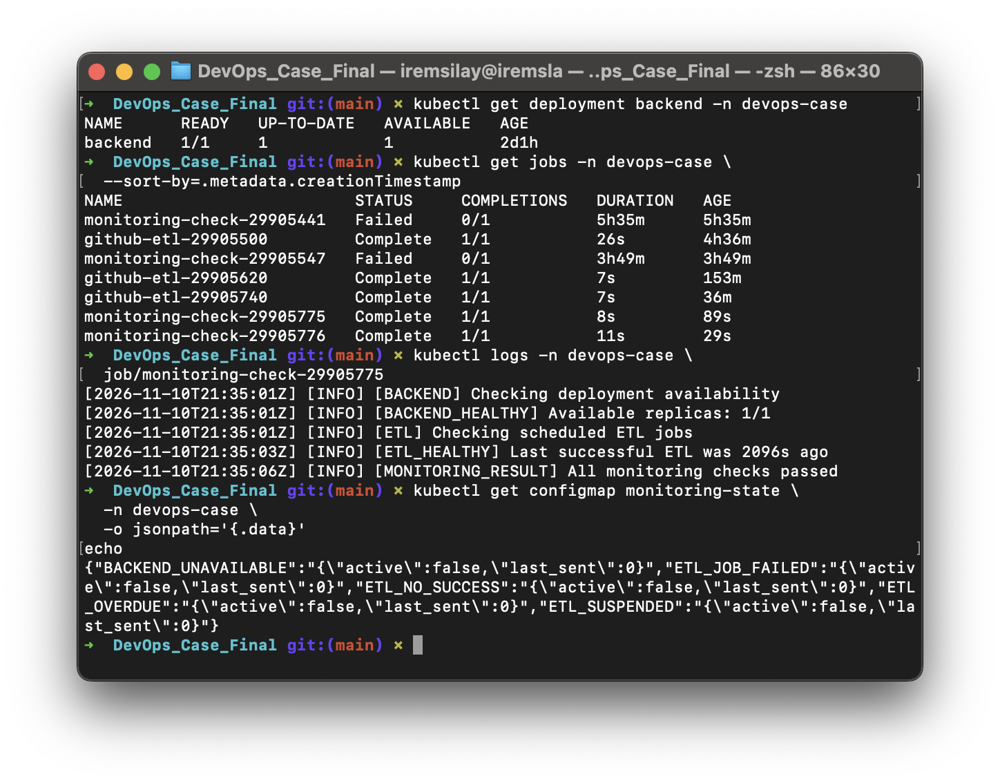

The monitoring Job logs show `BACKEND_HEALTHY`, `ETL_HEALTHY`, and `All monitoring checks passed`. All alert states in the `monitoring-state` ConfigMap are inactive.

**51 — Detecting the backend failure**

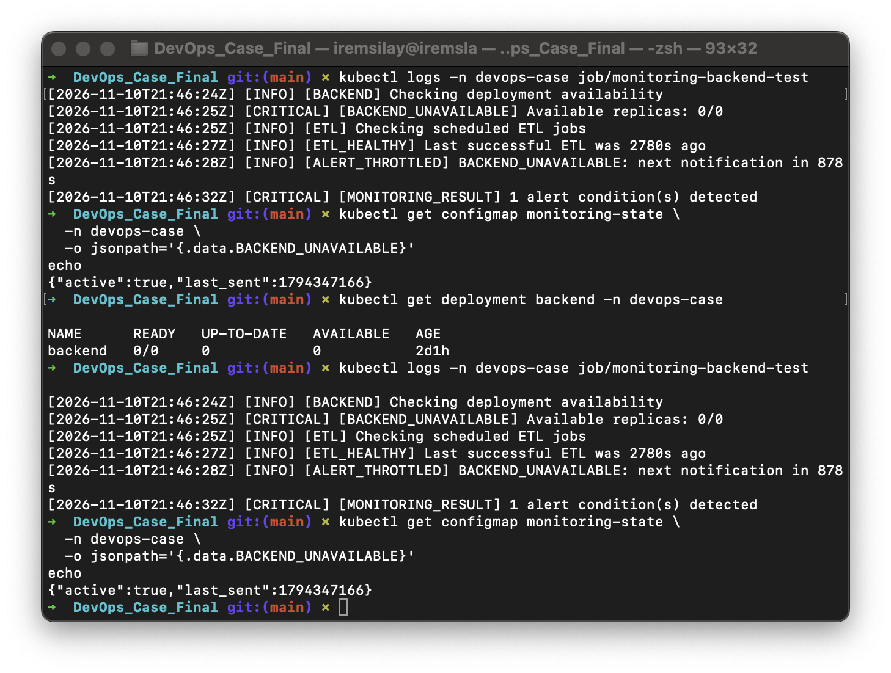

The backend Deployment was scaled down to zero replicas in a controlled manner.

Monitoring detected the `BACKEND_UNAVAILABLE` alert with the message `Available replicas: 0/0`. The alert was confirmed to have `active:true` in the ConfigMap.

The repeated alert produced an `ALERT_THROTTLED` result, and 15-minute notification throttling was observed.

**52 — Slack backend alert**

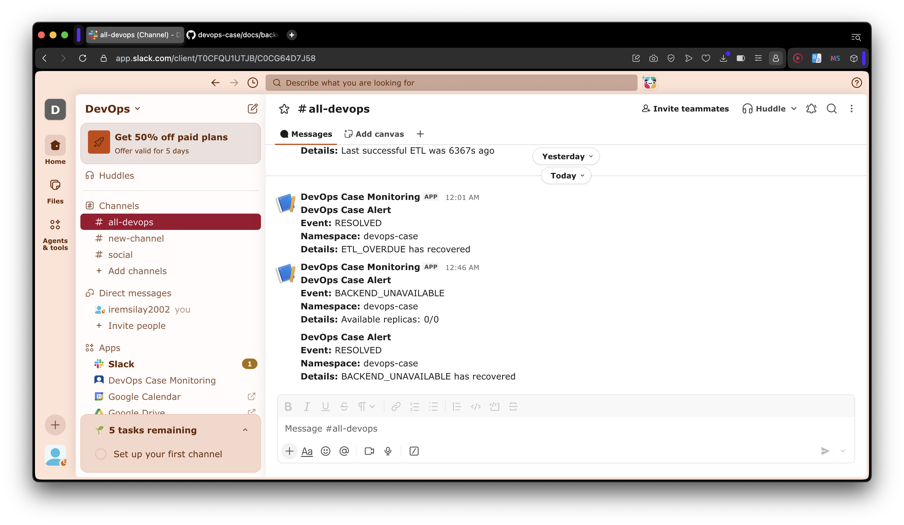

The Slack channel shows the actual alert notification for the `BACKEND_UNAVAILABLE` event. The notification includes the namespace and the number of unavailable backend replicas.

**53 — Backend recovery**

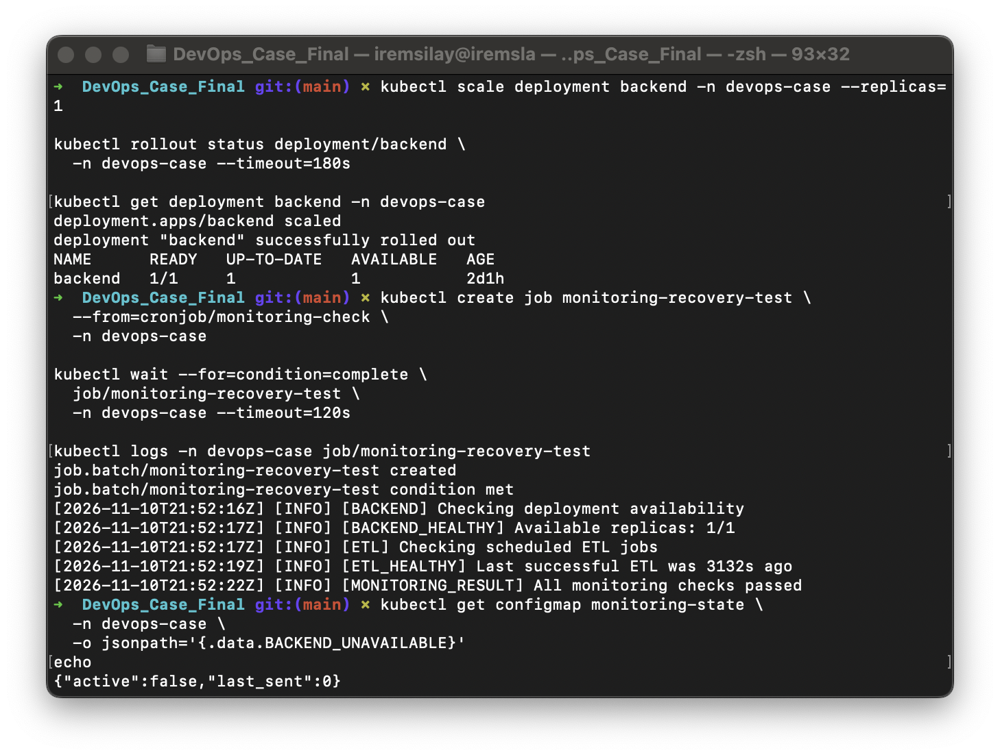

The backend Deployment was scaled back up to one replica and reached the `1/1 Available` state.

The monitoring Job produced `BACKEND_HEALTHY` and `All monitoring checks passed`. The backend alert in the ConfigMap was confirmed to have `active:false` and `last_sent:0`.

**54 — Slack RESOLVED notification**


The Slack channel shows the `RESOLVED` notification with the description `BACKEND_UNAVAILABLE has recovered`.

**Result:** Under Advanced 4, backend availability monitoring, failure detection, alert state storage, Slack notifications, repeated-alert throttling, and recovery mechanisms were verified in a real Kubernetes environment.

The `0/0` health-check issue identified during testing was resolved by updating the condition in `monitoring/check-health.sh`.

## 8. Additional Evidence

- **Screenshot:** `docs/screenshots/...`
- **Description:**
