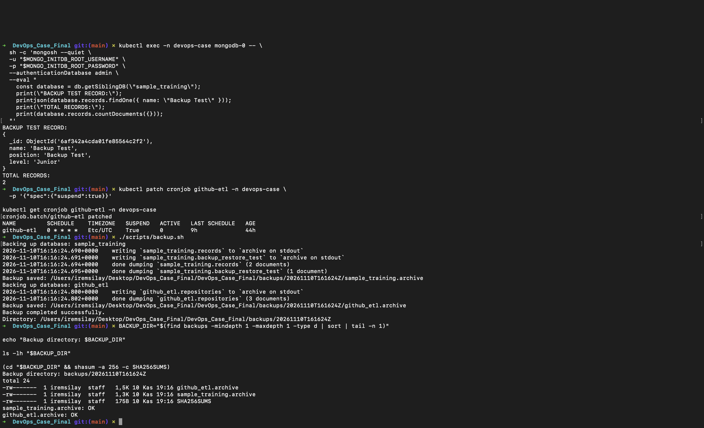
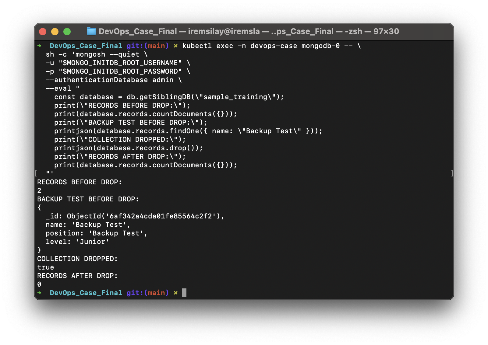
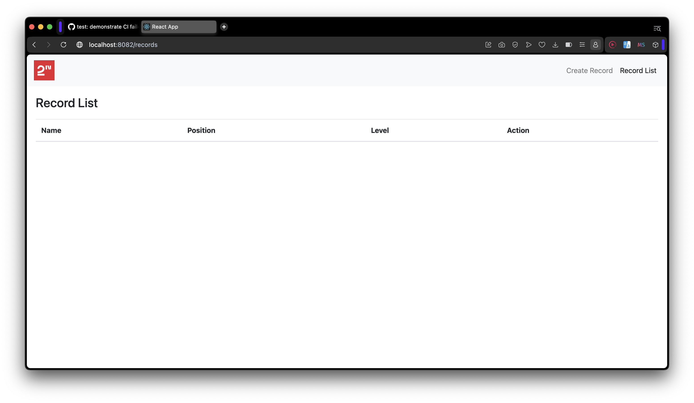
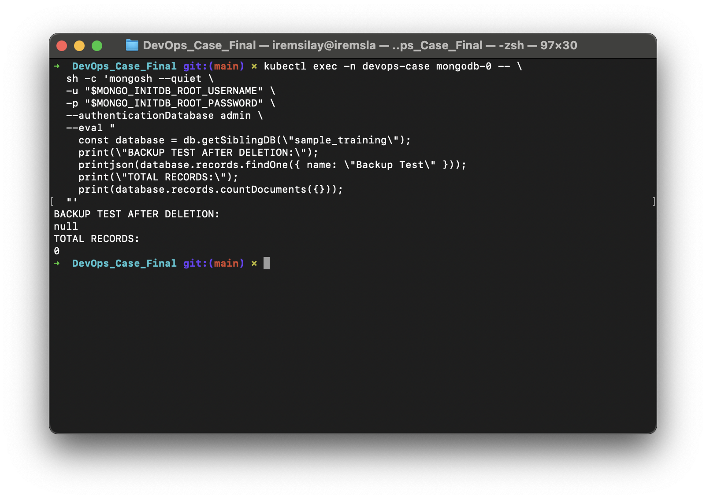
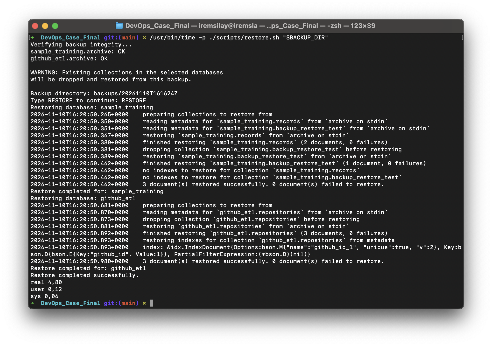
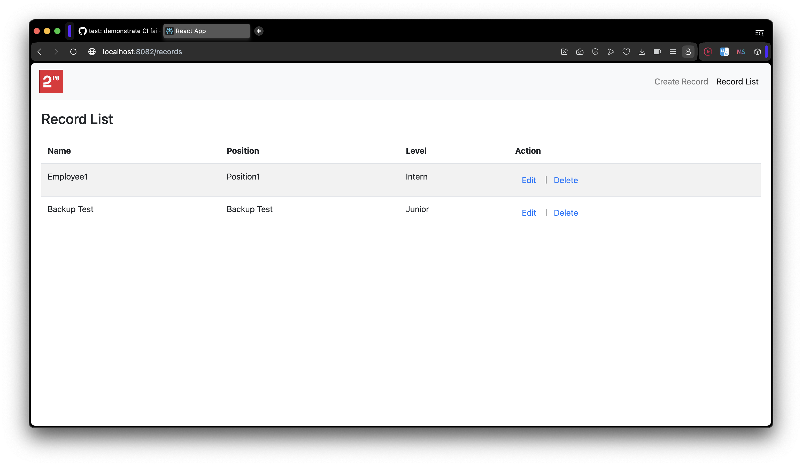
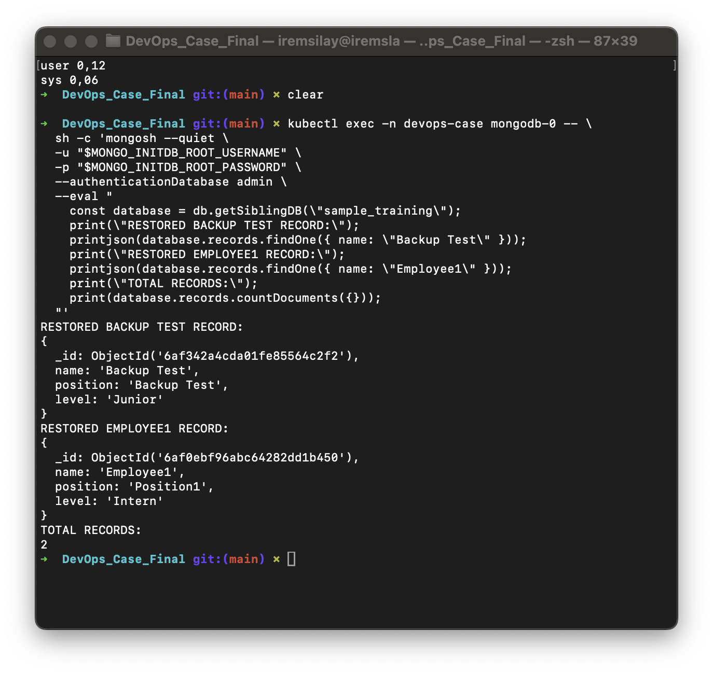
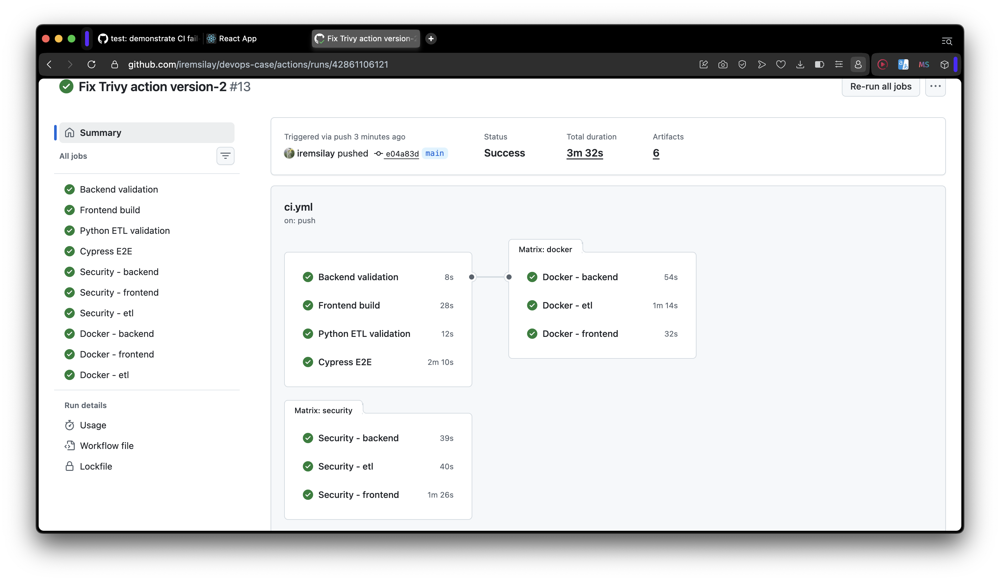
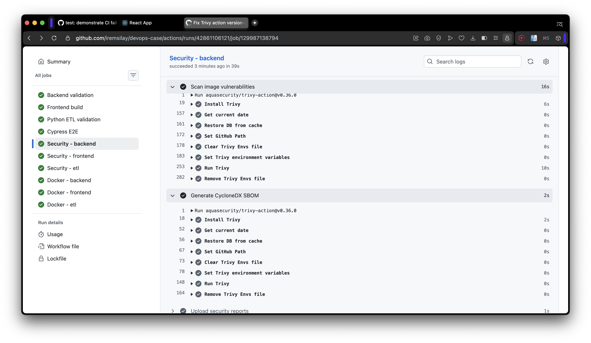
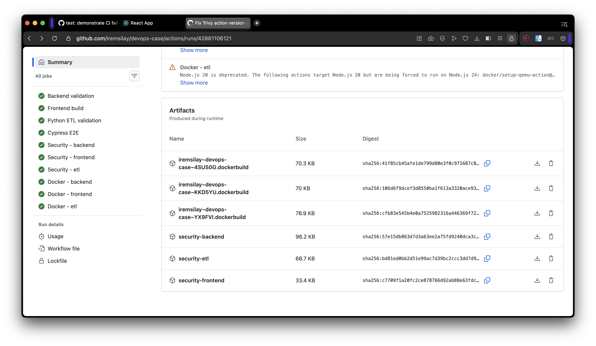

# TESLİM KANITLARI

Teslimin başarılı şekilde tamamlanmış sayılabilmesi için çalışan sisteme ait ekran görüntülerini `docs/screenshots/` klasörüne ekleyin ve aşağıdaki maddelerde ilgili dosya yolunu belirtin.

Ekran görüntülerinde gerçek credential, token, parola, private key veya hassas bağlantı bilgileri görünmemelidir.

## 1. Web Uygulaması

### 1.1 Ana sayfa

- **Görsel:** `docs/screenshots/...`
- **Açıklama:**

### 1.2 Create işlemi

- **Form görseli:** `docs/screenshots/...`
- **Başarılı sonuç görseli:** `docs/screenshots/...`
- **Açıklama:**

### 1.3 Edit işlemi

- **İşlem öncesi görsel:** `docs/screenshots/...`
- **İşlem sonrası görsel:** `docs/screenshots/...`
- **Açıklama:**

## 2. Docker

- **Image build görseli:** `docs/screenshots/...`
- **Çalışan container görseli:** `docs/screenshots/...`
- **Açıklama:**

## 3. Kubernetes

- **Pod/workload durumu:** `docs/screenshots/...`
- **Service ve varsa Ingress durumu:** `docs/screenshots/...`
- **ETL CronJob/Job durumu:** `docs/screenshots/...`
- **Açıklama:**

## 4. Python ETL

### 4.1 İlk veri aktarımı

GitHub repository bilgilerinin MongoDB’ye ilk kez kaydedildiğini gösterin.

- **Görsel veya terminal çıktısı:** `docs/screenshots/...`
- **Açıklama:**

### 4.2 Aynı repository için güncelleme

Aynı repository tekrar işlendiğinde duplicate kayıt oluşmadığını ve mevcut kaydın güncellendiğini gösterin. Mümkünse repository sayısını ve güncellenen alanı aynı kanıt içinde belirtin.

- **Görsel veya terminal çıktısı:** `docs/screenshots/...`
- **Kullanılan benzersiz alan:**
- **Açıklama:**

## 5. CI/CD

### 5.1 Başarılı CI Pipeline

- **Pipeline geçmişi:** `docs/screenshots/12-cicd-pipeline-success.png`
- **Job sonuçları:** `docs/screenshots/13-cicd-jobs-success.png`
- **Workflow:** CI - MERN and ETL (#9)
- **Commit:** `b5873c8`
- **Sonuç:** Success (3 dakika 11 saniye)
- **Açıklama:** Backend, frontend, Python ETL, Cypress E2E ve Docker build aşamaları başarıyla tamamlanmıştır.

### 5.2 GHCR Image Yayınlama

- **Yayınlanan paketler:** `docs/screenshots/20-cicd-ghcr-images.png`
- **Image sürüm detayları:** `docs/screenshots/21-cicd-ghcr-image-tags.png`
- **Doğrulanan tag:** `sha-b5873c8b85f31885109fb038f517e18f06601448`
- **Açıklama:** Backend, frontend ve ETL image'ları GHCR üzerinde yayınlanmıştır. Backend image'ının commit SHA'sıyla sürümlendiği ve `latest` tag'ine sahip olduğu doğrulanmıştır.

### 5.3 Fail-Fast Doğrulaması

- **Pull Request:** [#1 — CI fail-fast testi](https://github.com/iremsilay/devops-case/pull/1)
- **Branch:** `test/ci-fail-fast`
- **Commit:** `4cd5e7d`
- **Kontrol sonuçları:** `docs/screenshots/22-cicd-fail-fast.png`
- **Cypress hata logu:** `docs/screenshots/23-cicd-fail-fast-log.png`
- **Cypress sonucu:** Failure (kasıtlı assertion hatası)
- **Docker sonucu:** Skipped
- **Diğer job'lar:** Backend, frontend ve Python ETL doğrulamaları başarılı.
- **Açıklama:** Geçici bir Pull Request üzerinde Cypress testi kasıtlı olarak başarısız hale getirilmiştir. Cypress başarısız olduğunda Docker job'ının başlatılmadığı ve image yayınlama aşamasına geçilmediği doğrulanmıştır. Test değişiklikleri `main` branch'ine dahil edilmemiştir.

### 5.4 Kubernetes CD Deployment

- **Deployment öncesi durum:** `docs/screenshots/24-cd-before-deployment.png`
- **Başarılı deployment:** `docs/screenshots/25-cd-deployment-success.png`
- **Deployment sonrası doğrulama:** `docs/screenshots/26-cd-rollout-success.png`
- **Cluster:** `k3d-devops-case`
- **Namespace:** `devops-case`
- **Önceki image tag:** `sha-92683629ca434accfb946cb255ad97eb0e4f4bc5`
- **Yeni image tag:** `sha-b5873c8b85f31885109fb038f517e18f06601448`
- **Sonuç:** Backend ve frontend rollout başarılı, ETL CronJob image'ı güncellendi.
- **Doğrulama:** Backend ve frontend Deployment kaynakları `1/1 Ready`; üç image referansı da yeni SHA sürümünü kullanıyor.
- **Açıklama:** GitHub Actions tarafından GHCR'ye yayınlanan SHA tabanlı image sürümü, `scripts/deploy-local.sh` aracılığıyla yerel Kubernetes cluster'ına uygulanmıştır. Deployment sonrası Kubernetes kaynaklarının yeni sürüme geçtiği doğrulanmıştır. CD işlemi manuel olarak tetiklenmektedir.

### 5.5 Otomatik Rollback Doğrulaması

- **Rollback tetikleme kanıtı:** `docs/screenshots/27-cd-rollback-trigger.png`
- **Rollback sonrası doğrulama:** `docs/screenshots/28-cd-rollback-success.png`
- **Cluster:** `k3d-devops-case`
- **Sağlıklı image tag:** `sha-b5873c8b85f31885109fb038f517e18f06601448`
- **Hatalı image tag:** `sha-0000000000000000000000000000000000000000`
- **Hata:** Backend rollout zaman aşımı.
- **Script sonucu:** `Rollback completed.`
- **Açıklama:** GHCR'de bulunmayan bir image tag'iyle deployment başlatılmıştır. Backend rollout işlemi başarısız olduğunda script otomatik rollback fonksiyonunu çalıştırmıştır. Backend ve frontend rollout kontrolleri başarılı tamamlanmıştır. Kubernetes image referansları ve pod durumları ayrıca doğrulanmıştır.


## 6. Backup ve Restore

MongoDB backup ve restore işlemi, 10 Kasım 2026 tarihinde yerel Kubernetes ortamında React uygulaması üzerinden gerçekleştirilen gerçek veri kaybı senaryosuyla doğrulanmıştır.

**Test ortamı:** `k3d-devops-case` / `devops-case`  
**MongoDB Pod:** `mongodb-0`  
**Backup klasörü:** `backups/20261110T161624Z`  
**Test kaydı:** `Backup Test`  
**Sonuç:** Başarılı

### 6.1. React Arayüzünden Kayıt Oluşturma

**Kanıt:** `35-backup-ui-record-created.png`

React uygulamasında `Backup Test` adlı çalışan kaydı oluşturulmuş ve `Record List` ekranında görüntülenmiştir.

Kayıt bilgileri:

- Name: `Backup Test`
- Position: `Backup Test`
- Level: `Junior`

MongoDB üzerinde de aynı kayıt doğrulanmıştır. Backup öncesinde `sample_training.records` collection'ında 2 kayıt bulunmaktadır.


### 6.2. Backup Alma ve Bütünlük Doğrulaması

**Kanıt:** `36-backup-ui-created.png`

ETL CronJob'ı geçici olarak askıya alındıktan sonra aşağıdaki komut çalıştırılmıştır:

```bash
./scripts/backup.sh
```

Backup klasörü:

```text
backups/20261110T161624Z
```

Oluşturulan dosyalar:

- `sample_training.archive`
- `github_etl.archive`
- `SHA256SUMS`

Her iki arşivin SHA-256 doğrulaması başarılıdır:

```text
sample_training.archive: OK
github_etl.archive: OK
```



### 6.3. MongoDB Collection'ının Silinmesi

**Kanıt:** `37-backup-records-dropped.png`

React uygulamasının kullandığı `sample_training.records` collection'ı MongoDB üzerinden silinmiştir.

```text
RECORDS BEFORE DROP:
2

COLLECTION DROPPED:
true

RECORDS AFTER DROP:
0
```



### 6.4. Veri Kaybının Arayüzde ve MongoDB'de Doğrulanması

**Kanıtlar:**

- `38-backup-ui-data-lost.png`
- `39-backup-db-data-lost.png`

Collection silindikten sonra React uygulamasındaki `Record List` sayfası yenilenmiştir. `Backup Test` ve `Employee1` kayıtlarının artık listelenmediği görülmüştür.



MongoDB sorgusu da aynı sonucu doğrulamıştır:

```text
BACKUP TEST AFTER DELETION:
null

TOTAL RECORDS:
0
```



### 6.5. Yedekten Geri Yükleme ve Süre Ölçümü

**Kanıt:** `40-backup-restore-timed.png`

Aşağıdaki komut çalıştırılmıştır:

```bash
/usr/bin/time -p ./scripts/restore.sh backups/20261110T161624Z
```

SHA-256 doğrulaması ve kullanıcı onayından sonra `mongorestore --drop` ile veriler geri yüklenmiştir.

**Gerçek restore sonuçları:**

| Veritabanı | Geri yüklenen belge | Başarısız belge |
| --- | ---: | ---: |
| `sample_training` | 3 | 0 |
| `github_etl` | 3 | 0 |
| **Toplam** | **6** | **0** |

```text
Restore completed successfully.

real 4,80
user 0,12
sys 0,06
```

Ölçülen 4,80 saniye, kullanıcı onayı dahil restore script'inin toplam çalışma süresidir. Uçtan uca RTO ölçümü değildir.



### 6.6. Kurtarılan Verilerin Arayüzde ve MongoDB'de Doğrulanması

**Kanıtlar:**

- `41-backup-ui-recovered.png`
- `42-backup-db-recovered.png`

Restore sonrasında React uygulaması yenilenmiş ve `Backup Test` ile `Employee1` kayıtlarının yeniden listelendiği doğrulanmıştır.



MongoDB üzerinden aynı kayıtlar tekrar sorgulanmıştır.

```text
RESTORED BACKUP TEST RECORD:
name: 'Backup Test'
position: 'Backup Test'
level: 'Junior'

RESTORED EMPLOYEE1 RECORD:
name: 'Employee1'
position: 'Position1'
level: 'Intern'

TOTAL RECORDS:
2
```



### 6.7. Test Sonrası Sistem Durumu

Restore doğrulamasından sonra ETL CronJob'ı yeniden etkinleştirilmiştir.

Son Kubernetes kontrollerinde:

- `github-etl`: `SUSPEND=False`, `ACTIVE=0`
- Backend: `1/1 Ready`
- Frontend: `1/1 Ready`
- MongoDB: `1/1 Running`, `0` restart

sonuçları alınmıştır.

### 6.8. Genel Sonuç

**Core 8 backup ve restore testi başarılıdır.**

Teknik case dokümanında istenen altı aşama tamamlanmıştır. React arayüzünden oluşturulan kayıtlar MongoDB collection'ının silinmesiyle kaybolmuş, backup'tan geri yükleme sonrasında hem uygulama arayüzünde hem MongoDB'de yeniden görüntülenmiştir.

Toplam 6 belge hatasız geri yüklenmiştir. Restore script'inin çalışma süresi 4,80 saniyedir.

**Hedef RPO:** 24 saat  
**Hedef RTO:** 15 dakika  
**Hedef retention:** 7 gün

Bu değerler üretim ortamı için önerilen hedeflerdir. Mevcut manuel sistemde otomatik olarak garanti edilmemektedir.

Operasyon prosedürleri ve sınırlamalar `docs/backup-restore.md` dosyasında açıklanmıştır.

### 7.1 Advanced 5 — Container Security Scanning ve SBOM

CI pipeline'ına Trivy tabanlı image vulnerability scanning ve CycloneDX SBOM üretimi eklenmiştir.

Backend, frontend ve ETL için üç ayrı Security job'ı başarıyla çalıştırılmıştır.

**43 — Security job'larının başarılı tamamlanması**



GitHub Actions workflow'unda backend, frontend ve ETL güvenlik job'larının başarılı tamamlandığı görülmektedir.

**44 — Trivy taraması ve CycloneDX SBOM üretimi**



Backend Security job'ında image vulnerability scanning ve CycloneDX SBOM üretiminin başarıyla çalıştığı doğrulanmıştır.

**45 — Security artifact'ları**



GitHub Actions üzerinde `security-backend`, `security-frontend` ve `security-etl` artifact'larının oluşturulduğu görülmektedir.

Her artifact, ilgili image'ın Trivy JSON güvenlik raporunu ve CycloneDX SBOM dosyasını içerir.

**Sonuç:** Advanced 5 kapsamında üç Docker image'ı için otomatik güvenlik taraması ve SBOM üretimi uygulanmış ve CI üzerinde doğrulanmıştır. Güvenlik açıkları raporlanmakta, ancak yayın otomatik olarak engellenmemektedir.

**Workflow:** [GitHub Actions Run #13](https://github.com/iremsilay/devops-case/actions/runs/42861106121)

## 8. Ek Kanıtlar

- **Görsel:** `docs/screenshots/...`
- **Açıklama:**
